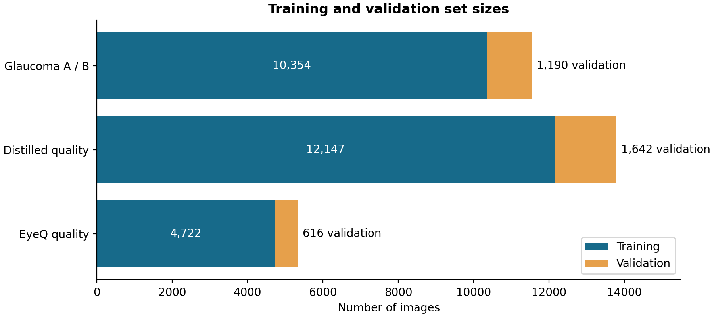
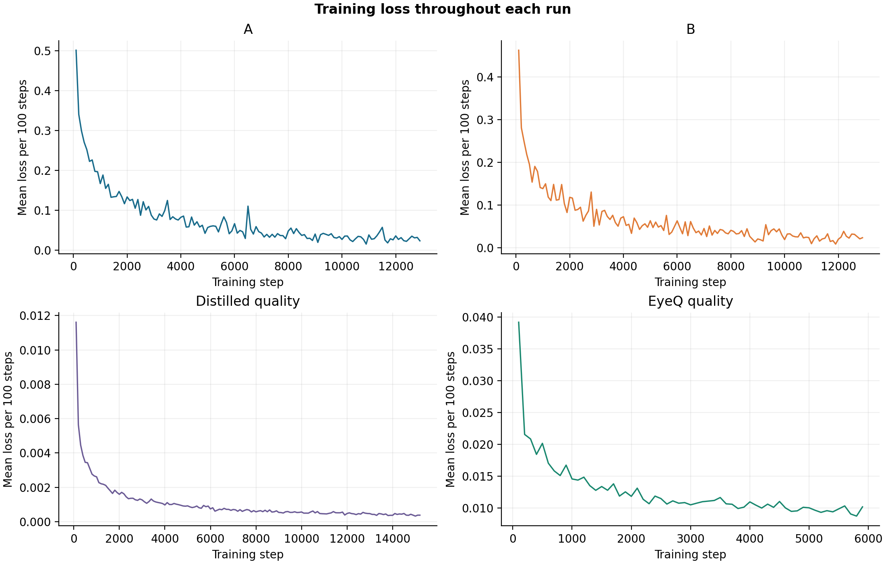
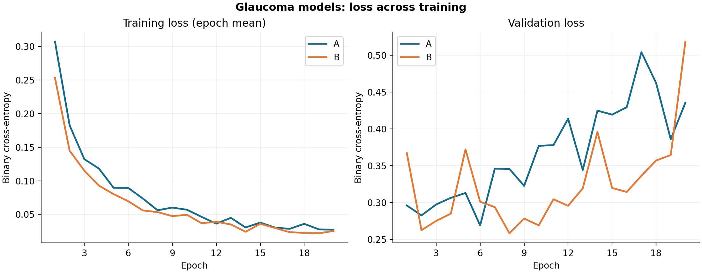
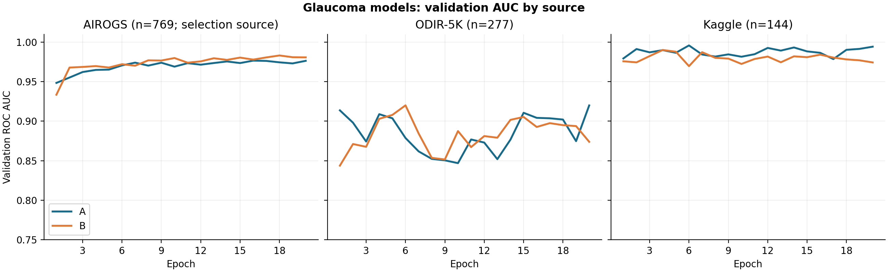
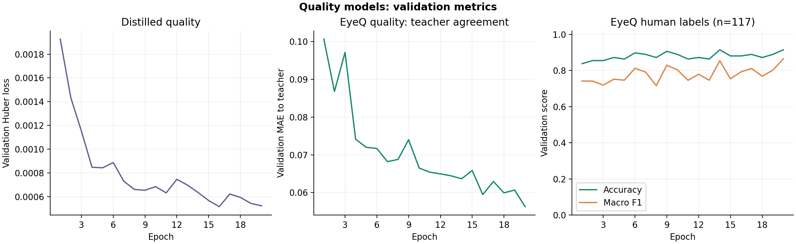
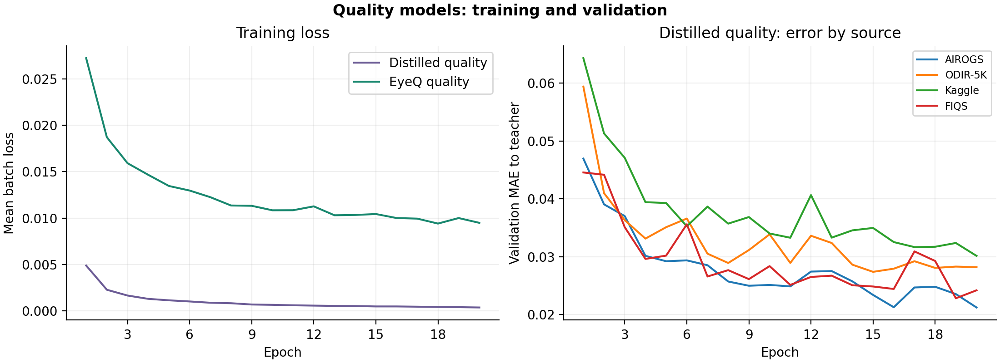
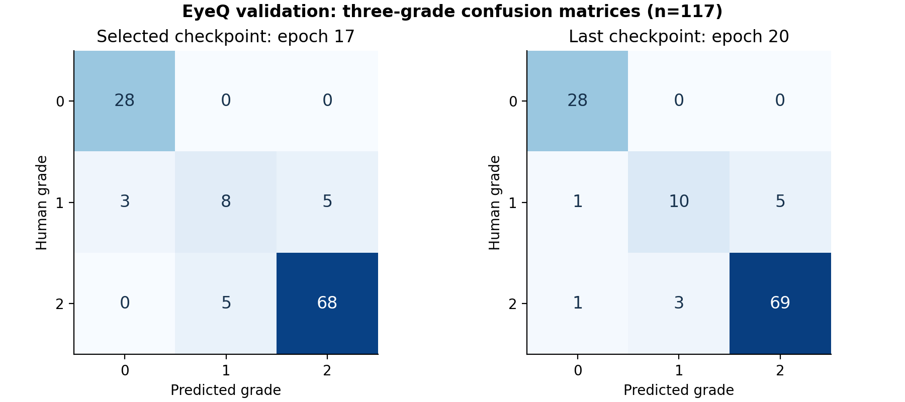

# 模型训练进展报告

[English](training-progress.en.md) | 中文

数据核对日期：2026-11-12。依据项目内已保存的正式训练和模型验证记录。

## 训练状态与记录

| 任务 | 模型 | 训练 / 验证图像 | 已完成 | 训练 step |
|---|---|---:|---:|---:|
| 青光眼 A | EfficientNet-B0 | 10,354 / 1,190 | 20 / 20 epoch | 12,960 |
| 青光眼 B（候选） | ResNet50 | 10,354 / 1,190 | 20 / 20 epoch | 12,960 |
| formal_v3 图像质量蒸馏 | EfficientNet-B0 | 12,147 / 1,642 | 20 / 20 epoch | 15,200 |
| EyeQ 质量模型 | EfficientNet-B0 | 4,722 / 616 | 20 / 20 epoch | 5,920 |

两条训练队列的状态文件均记录为 completed。每组 `steps.jsonl` 保存每个训练 batch 的损失、步数和梯度信息；`epochs.jsonl` 保存每轮验证结果，`best.pt` 和 `last.pt` 保存模型检查点。四组日志步数连续，训练损失值均有限。图中的训练损失是每个 epoch 内所记录 batch 损失的算术平均，而非逐样本加权平均。formal_v3 日志的 epoch 从 0 开始，图表统一标成第 1–20 轮；EyeQ 验证日志本身从 1 开始。

上图显示各模型使用的图像数量。青光眼 A 和 B 使用相同的数据划分。一个 epoch 指模型遍历一轮训练数据；一个 step 指使用一批图像完成一次训练。

为便于观察，图中每个点是连续 100 个训练步骤的平均损失。损失越低表示模型在该批数据上与训练目标的差异越小。

## 青光眼模型

A 的训练损失均值从第 1 轮的 0.307 降至第 20 轮的 0.027；B 从 0.253 降至 0.025。对应的整体验证损失从 0.296 升至 0.435（A），从 0.367 升至 0.518（B）。训练损失下降而末轮验证损失高于首轮，提示应关注过拟合或概率校准问题。

AUC 衡量模型将阳性样本排在阴性样本之前的能力。训练配置使用 AIROGS 验证子集的 AUC 选择最佳检查点（769 张）。A 最佳为第 16 轮 AUC **0.9766**，B 最佳为第 18 轮 **0.9831**；第 20 轮分别为 0.9764 和 0.9807。其他来源验证集分别为 ODIR-5K 277 张、Kaggle 144 张。

疾病模型日志没有逐轮保存准确率，只保存验证损失和各来源 AUC。`validation_predictions.csv` 在每轮验证时覆盖，因此对应最后一次验证，不能据此重建每一轮或最佳检查点的准确率。

## 图像质量模型

- formal_v3 质量蒸馏模型的验证 Huber loss 从 0.001927 降至 0.000524，最低为第 16 轮的 0.000517。验证目标为教师模型评分。
- 独立 EyeQ 质量模型使用 616 张验证图像，其中 117 张有 EyeQ 三档人工标签。由每轮混淆矩阵计算，准确率从第 1 轮 **83.8%（98/117）**升至第 20 轮 **91.5%（107/117）**；末轮 macro-F1 为 **0.865**。
- EyeQ 的最佳检查点按教师 Huber loss 与人工标签序数损失组成的选择损失确定。按该规则选择的第 17 轮准确率为 **88.9%（104/117）**、macro-F1 为 **0.811**。

左图展示两种质量模型各自的训练损失。右图按图像来源展示原质量模型与教师评分的平均绝对误差（MAE），数值越低表示越接近教师评分。

矩阵的行表示人工质量等级，列表示模型预测等级；对角线上的数字是预测正确的图像数。第 17 轮是按预先设定的选择损失确定的检查点，第 20 轮是最后一轮。Macro-F1 是分别计算各等级的 F1 分数后取平均，用于同时观察各等级的表现。

## 数据来源与图表生成

数据来源：`runs/formal_v3/{glaucoma_a,glaucoma_b_candidate,quality_student}/{steps,epochs}.jsonl`、`runs/eyeq_quality_v1/quality_student/{steps,epochs}.jsonl`，以及对应 `config.json`、`run_summary.json` 和队列 `status.json`。重新生成图表：运行本目录的 `plot_training.py`，需要 Python 和 matplotlib。图表使用随报告保存的 `chart_data.json`；其中只包含训练步数、损失和汇总验证指标，不包含图像或样本身份。
