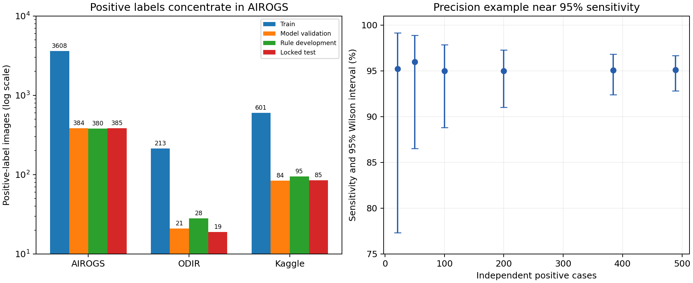
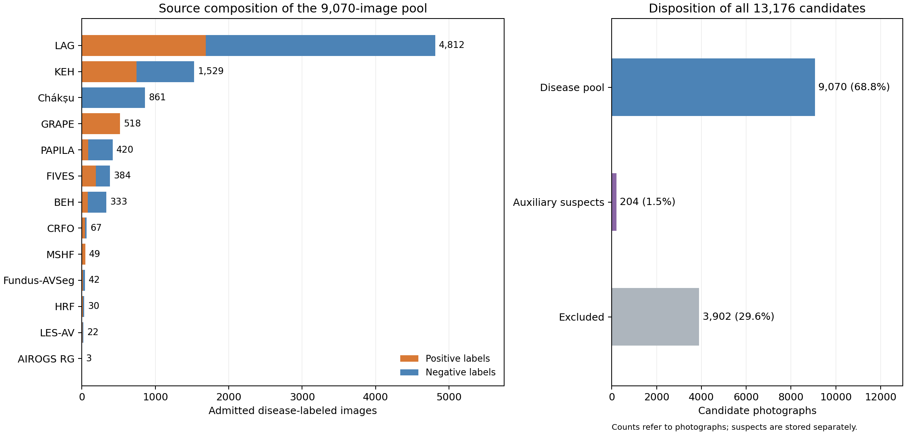

# Data expansion, fundus degradation, and evaluation design

November 13, 2026 · Eye Sentinel

[中文](data-and-degradation-review.zh.md) · [English PDF](data-and-degradation-review.en.pdf) · [Daily progress overview](../progress-overview.en.md)

This report records the data review and experimental design completed before the new training round on November 13. The [training report](../training-results/training-results.en.md) documents the four subsequent arms, and the [experimental analysis](../experimental-analysis/experimental-analysis.en.md) explains their paired results. Read the three reports in the order of data preparation, training, and interpretation.

## Main results

The audit covered 13,176 candidate fundus photographs and admitted **9,070 disease-labeled images, including 3,446 positives**. A separate auxiliary pool retains 204 suspect images. Every candidate image has a decision, and all 315,074 similarity candidate pairs were adjudicated. Admission uses original source labels, permissions, file integrity, and known patient and image relationships.

The expansion pool contains 146 real poor-quality positive photographs: 99 FIVES images with at least one poor-quality dimension and 47 MSHF images with poor overall quality. These cases support evaluation of disease recognition under real quality variation. Synthetic defocus and exposure changes support training augmentation and paired stress comparisons; case counts follow the original photographs.

The review proposed 0%, 30%, and 50% degradation arms and recording actual training draws from original and added sources. The later training round used a new joint allocation of 15,480 training images, 2,046 model-validation images, and 2,053 rule-development images. Descriptions of earlier training below refer to formal_v3 at the review stage. Expansion-pool counts, original-release counts, and later training counts are kept explicit.

## 1. Models and data at the review stage

The formal_v3 EfficientNet-B0 disease model A, ResNet50 candidate B, original quality model, and EyeQ quality model each completed 20 epochs. A selected epoch 16 and B selected epoch 18, achieving AUROCs of 0.9766 and 0.9831 on AIROGS model validation.

AUROC is the area under the receiver operating characteristic curve. It describes ranking: for a randomly drawn positive and negative from the same evaluation set, it is the probability that the model assigns the positive a higher score, counting ties as one half. A value of 0.5 corresponds to random ranking and 1.0 to perfect separation. Misses and false positives at a chosen threshold are reported as separate counts.

The original quality model selected epoch 16. EyeQ selected epoch 17 by combined validation loss and achieved macro-F1 0.811 on 117 human-graded validation images in three quality categories; the final epoch 20 achieved 0.865. Macro-F1 gives equal weight to each quality category. Selected and final-epoch results are recorded separately.

| Set at review stage | Images | Positive images | Positive linked groups | Role |
|---|---:|---:|---:|---|
| formal_v3 disease training | 10,354 | 4,422 | 4,341 | Learn disease models |
| formal_v3 model validation | 1,190 | 489 | 482 | Select weights |
| November 13 repaired rule development | 1,220 | 503 | 494 | Calibration and review-rule development |
| Frozen internal test | 1,233 | 489 | 481 | Evaluate after locking models and rules |
| ACRIMA external test | 705 | 396 | 396 | External-source evaluation |
| HYGD external test | 737 | 540 | 183 | Patient/image grouped evaluation |

Linked groups connect known patients, paired eyes, repeated photographs, and image versions. Sources without published patient identifiers use image-association groups. Labels remain source-specific: AIROGS RG/NRG describes referral for glaucoma, while other sources use their own glaucoma diagnosis or glaucomatous optic neuropathy (GON) definitions.

Figure 1 shows positive-image counts in four original-release roles on the left, with a logarithmic vertical axis. Training contains 3,608 AIROGS, 601 Kaggle, and 213 ODIR positives. ODIR model validation, rule development, and testing contain 21, 28, and 19 positives. The right panel illustrates Wilson 95% intervals near 95% sensitivity to explain how independent positive counts affect precision. Actual evaluations account for paired eyes and repeated photographs through linked-group resampling.

On the same 277 ODIR model-validation images, A and B achieve AUROCs of 0.9042 and 0.8950. At display threshold 0.5, A detects 13/21 positives, with an image-level Wilson interval of approximately 40.9%–79.2%. The difference from AIROGS supports source-specific evaluation; the small positive subset also limits precision. Deployment thresholds are determined through later model validation and rule development.

The original sampler gives equal weight to each source and each class within a source, drawing 10,354 images with replacement per epoch. Each source/class receives approximately 1,726 draws. An ODIR positive is drawn 8.10 times on average, a Kaggle negative 4.87 times, and an AIROGS positive 0.478 times. Training records therefore need update budgets, actual draws, and distinct-image coverage.

A's mean training-batch loss falls from 0.307 to 0.027 while validation cross-entropy rises from 0.296 to 0.435. B's training loss falls from 0.253 to 0.025 while validation cross-entropy rises from 0.367 to 0.518. Cross-entropy measures agreement between probabilities and labels and is particularly sensitive to confident errors. These curves motivate comparisons of sampling, checkpoint selection, probability calibration, and augmentation. Grouped learning curves address training size separately.

## 2. Public datasets and admission decisions

The search covered dedicated glaucoma datasets, multi-disease fundus datasets with image-level glaucoma labels, real-quality data, catalogs, and standardized collections, including related work from 2024–2026. Evidence includes author papers, official releases, terms, and obtainable images. Third-party collections are assigned to their parent sources and deduplicated. All 45 reviewed entries appear below. DR denotes diabetic retinopathy; OCT denotes optical coherence tomography, a separate modality from the color fundus photographs used here.

| Source | Decision and evidence |
|---|---|
| [LAG](https://github.com/smilell/AG-CNN) | Official part 1 acquired: 4,854 images, 1,711 positives; clinical diagnosis established in the original paper. Academic use; no reupload. |
| [GRAPE](https://springernature.figshare.com/articles/dataset/GRAPE_dataset_CFPs/23575926) | Originals and clinical table acquired: 144 people, 263 eyes, 631 photographs, all glaucoma. CC0. |
| [Fundus-AVSeg](https://figshare.com/articles/dataset/27938034) | Official 100-image package acquired, including 20 glaucoma images; masks counted separately. CC BY 4.0. |
| [LES-AV](https://figshare.com/articles/dataset/LES-AV_dataset/11857698) | Official 22 images and clinical table acquired, including 11 glaucoma images. GPL; image identifiers recorded, with patient identifiers unavailable. |
| [HRF](https://www5.informatik.uni-erlangen.de/research/data/fundus-images/) | Official 45 originals acquired: 15 glaucoma, 15 healthy, 15 DR; counted separately from the repeat-photography quality set. |
| [CRFO-v4](https://data.mendeley.com/datasets/trghs22fpg/4) | Official 79 color photographs acquired, originally 48 positives; four identifiers contain identical-image label conflicts and are excluded as groups. CC BY 4.0. |
| [G1020](https://arxiv.org/abs/2006.09158) | Mirror completed to 1,020 images; original permission and the 432-patient mapping were unavailable. Excluded from mixed training. |
| [BEH](https://github.com/mirtanvirislam/Deep-Learning-Based-Glaucoma-Detection-with-Cropped-Optic-Cup-and-Disc-and-Blood-Vessel-Segmentation/tree/master/Dataset) | CC BY-NC 4.0 permits academic use; duplicate and conflicting photographs excluded specifically. |
| [KEH](https://doi.org/10.7910/DVN/1YRRAC) | Official 1,544 images, 756 original positives, CC0; four conflicting-image groups excluded, with the disc-crop domain retained. |
| [GFID / Harvard copy](https://zenodo.org/records/12562673) | Matches official KEH files; grouped with the same source and official labels. |
| [RIM-ONE DL](https://github.com/miag-ull/rim-one-dl) | Author instructions request training and tuning with RIM-ONE DL alone. Excluded from the mixed pool; retain standalone research use. |
| [RIM-ONE r1/r2/r3](https://github.com/miag-ull/rim-one-dl) | Same release family as DL; counted after deduplicating the original photographs. |
| [PAPILA](https://doi.org/10.6084/m9.figshare.14798004.v2) | 488 images from 244 people; 87 glaucoma, 68 suspects. Group paired eyes and retain suspects separately. |
| [Chákṣu](https://doi.org/10.6084/m9.figshare.20123135.v2) | 1,009 official training images with 137 majority-vote suspects; suspects retained only as auxiliary supervision. |
| [FIVES](https://doi.org/10.6084/m9.figshare.19688169.v1) | 800 originals, 200 glaucoma; 101 positives have at least one poor-quality dimension. Retain disease and quality labels. |
| [MSHF](https://doi.org/10.6084/m9.figshare.21507564.v1) | 1,302 originals, 52 glaucoma, of which 50 have poor overall quality. CC BY 4.0; retain both conflicting quality summaries. |
| [HYGD](https://physionet.org/content/hillel-yaffe-glaucoma-dataset/1.1.0/) | Existing source; 540 positives retained for external testing with patient/image grouping. |
| [ACRIMA](https://figshare.com/s/c2d31f850af14c5b5232) | Existing 705-image source with 396 positives retained for external testing. |
| [AIROGS original](https://zenodo.org/records/5793241) | Audit covers all 163 RG images in the earlier 5,000-image acquisition. Same parent source as Light/SMDG; photograph relationships grouped. |
| [AIROGS-Light](https://www.kaggle.com/datasets/deathtrooper/glaucoma-dataset-eyepacs-airogs-light-v2) | Current training source; v1/v2 are related releases, and 4,770 is a count of positive image labels. |
| [ODIR](https://www.kaggle.com/datasets/andrewmvd/ocular-disease-recognition-odir5k) | Already acquired; use eye-specific keywords and paired-eye groups, without recounting third-party subsets. |
| [Kaggle / EyeAugmented](https://github.com/yiweichen04/retina_dataset) | Existing source and augmentation families; repackaged images without parent provenance isolated. |
| [SMDG-19](https://github.com/TheBeastCoding/standardized-multichannel-dataset-glaucoma) | Standardization of 19 sources; 4,817 positives assigned to their parent datasets and deduplicated. |
| [ORIGA](https://www.kaggle.com/datasets/sshikamaru/glaucoma-detection) | Published size is 650/168, but original permission and image/diagnosis provenance were not obtained. Excluded. |
| [REFUGE / REFUGE2](https://refuge.grand-challenge.org/REFUGE2Download/) | Download requires an account; verified originals and terms unavailable. Releases reuse images, which are counted by original photograph. |
| [Drishti-GS1](https://cvit.iiit.ac.in/projects/mip/drishti-gs/mip-dataset2/Download.php) | Official download requires login/registration; verified originals and diagnosis table unavailable. Excluded. |
| [BrG](https://pmc.ncbi.nlm.nih.gov/articles/PMC9778370/) | Official site and retries failed DNS resolution; no original package or diagnosis table. Excluded. |
| [BRSET](https://physionet.org/content/brazilian-ophthalmological/1.0.2/) | Images require credentials and a data-use agreement; the public label is increased cup/disc ratio, with glaucoma diagnoses unavailable. Excluded. |
| [mBRSET](https://physionet.org/content/mbrset/1.0/) | Credentialed access and a data-use agreement; primarily DR/quality. Original permission and images were not acquired in this review. |
| [GAMMA](https://gamma.grand-challenge.org/) | 300-person multimodal grading dataset; competition access requires registration. Verified case labels unavailable. Excluded. |
| [RIGA / RIGA+](https://deepblue.lib.umich.edu/data/concern/data_sets/3b591905z) | Disc/cup segmentation resource without the image-level clinical glaucoma diagnoses required here. |
| [RFMiD](https://doi.org/10.3390/data6020014) | Provides optic-disc cupping in a multi-disease label set; image-level confirmed glaucoma labels unavailable. Excluded. |
| [DR-HAGIS](https://personalpages.manchester.ac.uk/staff/niall.p.mcloughlin/) | Author entry timed out; originals and case mapping unavailable. Ten SMDG copies assigned to the original source. |
| [sjchoi86-HRF](https://github.com/yiweichen04/retina_dataset) | Related to the existing Kaggle/HRF mixture, without independent patient or original permission provenance. Excluded as a new source. |
| [BIOMISA](https://data.mendeley.com/datasets/2rnnz5nz74/2) | Related multimodal releases; verified CRFO color photographs acquired, without another independent diagnosed fundus cohort. |
| [DRIONS-DB](https://www.researchgate.net/publication/326460478_Glaucoma_dataset_-_DRIONS-DB) | Disc-segmentation resource without verified image-level glaucoma diagnoses; excluded from positive supervision. |
| [AGE / GOALS / OCTV](https://age.grand-challenge.org/Download/) | Anterior-segment or retinal OCT tasks without verified color-fundus glaucoma images for this batch. |
| [INSPIRE](https://medicine.uiowa.edu/eye/inspire-datasets) | Vessel-ratio/stereo-disc resources without verified clinical positive labels for this batch. |
| [JSIEC](https://www.kaggle.com/datasets/linchundan/fundusimage1000) | Relevant classes are normal and suspect; verified author image/diagnosis release unavailable. |
| [Leuven-Haifa HRF](https://doi.org/10.48804/Z7SHGO) | Request-only access and a related LES-AV source; no new independent patient cohort acquired. |
| [ONHSD / SIGF / VEIRC](https://github.com/XiaofeiWang2018/DeepGF) | Unavailable, request-only, or third-party entries without verified originals for this batch. Excluded. |
| [Harvard fairness datasets](https://github.com/Harvard-Ophthalmology-AI-Lab/Harvard-GDP) | Primarily OCT-derived modalities; image reuse exists within the release family. Excluded from this batch. |
| [GLEAM (2026)](https://doi.org/10.1109/TMI.2026.3692814) | 2026 paper found without a verified public image/clinical-label package. Excluded. |
| [EyeQ / FIQS](https://github.com/HzFu/EyeQ) | Quality data already acquired; useful for quality supervision, with no new clinical glaucoma labels. |
| [FunPiQ / FPE / Real Fundus / DeepDRiD](https://zenodo.org/records/21838047) | Quality, surgical-pair, or DR resources; original sources recorded, with the required glaucoma labels unavailable. |

Admission considers image availability, image-level labels, imaging modality, label consistency, permissions, and relationships to reserved testing cohorts. Request-only resources that have not been acquired are recorded as pending acquisition. Usable sample counts refer to photographs with completed audits.

## 3. Image audit and the expansion pool

Each candidate image underwent file SHA256, full RGB decoding, and pixel-hash checks. SHA256 is a digest used to verify file contents; pixel hashes verify decoded image content. Perceptual hashes search for visually similar candidates across 78,047 historical images, acquired sources, and within-source images, using eight rotation/flip orientations and a distance radius of six.

Photograph confirmation combines internal retinal features, geometric registration, and agreement in grayscale and high-frequency vessel structure. This reduces matches driven by circular borders, text, and black margins. Known patients, exact file/pixel matches, and confirmed image relationships form the groups; candidates connected to reserved test groups are excluded from the expansion pool.

The 315,074 candidate-pair decisions comprise 314,194 visual similarities rejected as same photographs, 755 confirmed photograph or retinal associations, 89 pairs whose images were excluded because evidence remained inconclusive, and 36 same-eye follow-up pairs identified using official GRAPE patient/eye metadata. Follow-up photographs remain distinct acquisitions in a common patient group. Pair counts and image counts are reported separately because one image can participate in several pairs. Admitted originals and training copies were rechecked in a common decoding environment before release.

| Source | Images audited | Original positive labels | Images admitted | Positives admitted |
|---|---:|---:|---:|---:|
| AIROGS RG | 163 | 163 | 3 | 3 |
| BEH | 634 | 171 | 333 | 83 |
| Chákṣu | 1,009 | 0 | 861 | 0 |
| CRFO | 79 | 48 | 67 | 40 |
| FIVES | 800 | 200 | 384 | 191 |
| Fundus-AVSeg | 100 | 20 | 42 | 14 |
| G1020 | 1,020 | 296 | 0 | 0 |
| GRAPE | 631 | 631 | 518 | 518 |
| HRF | 45 | 15 | 30 | 15 |
| KEH | 1,544 | 756 | 1,529 | 747 |
| LAG part 1 | 4,854 | 1,711 | 4,812 | 1,688 |
| LES-AV | 22 | 11 | 22 | 11 |
| MSHF | 1,302 | 52 | 49 | 49 |
| PAPILA | 488 | 87 | 420 | 87 |
| RIM-ONE DL | 485 | 172 | 0 | 0 |

Six official sources supplied 5,731 newly downloaded photographs with 2,436 original positive labels before deduplication. The final pool also includes previously downloaded KEH, BEH, PAPILA, FIVES, MSHF, and other images whose audits completed in this review. Audit scope, downloads, and admissions therefore represent different counts.

Figure 2 shows positive and negative counts by source in the 9,070-image disease pool on the left. LAG, KEH, and Chákṣu contribute 7,202 images together. The right panel accounts for all 13,176 candidates: 9,070 disease-labeled admissions, 204 auxiliary suspects, and 3,902 exclusions. The two admitted pools are stored separately. Counts come from the audit summary and expansion-pool release.

**Original rule development was repaired to 1,220 images and 503 positives.** Confirmed training/model-validation relationships involve ten images in the previous 1,230-image set; these were removed by identity and saved predictions filtered accordingly. The later four-arm experiment uses 2,053 joint rule-development images, including these 1,220 originals.

**Real poor-quality positives total 146.** Among admitted positives, 99/191 FIVES images have at least one poor official quality dimension and 47/49 MSHF images have poor overall quality. The two definitions remain separate, and both original official and majority-vote MSHF grades are retained. Of the 3,446 positives, 3,443 use source-defined glaucoma diagnoses and three use AIROGS RG referral labels. Image counts, patient groups, and clinical definitions are separate manifest fields.

LAG's positive folder retains its name suspicious_glaucoma; mapping follows the specialist clinical definition in section 3.1 of the original CVPR paper. BEH and KEH conflicting-image groups are excluded. PAPILA and Chákṣu suspects retain their categories. FIVES glaucoma supervision uses explicit disease labels, while diabetic-retinopathy and macular-degeneration categories retain their original labels. The two RIM-ONE partitions organize the same 485 photographs.

KEH provides optic-disc crops, with this imaging domain retained in disease training. Its quality assessment requires definitions appropriate to the cropped field. Quality scores for full fundus photographs and disc crops are interpreted separately.

LAG and GRAPE originate at the same hospital, and confirmed same-eye or same-photo relationships also connect GRAPE/FIVES, FIVES/Fundus-AVSeg, and FIVES/MSHF. The five sources are grouped jointly by known patients and image relationships before allocating training, checkpoint validation, and rule development. Unknown patient identities use image-group evaluation; external evaluation holds out complete source families. GRAPE and the admitted MSHF subset contain only positives and support detection or miss counts. AUROC and specificity require corresponding negatives.

## 4. Fundus degradation methods and their use

At the review stage, the disease pipeline padded to a square, resized to 320×320, and used horizontal flips. The original quality model used 384×384. The November 11 stress pilot used 179 AIROGS, ODIR, and Kaggle development originals, including 83 positives. At display threshold 0.5, 8/83 positives fell below threshold on originals, 27/83 under stronger blur, and 20/83 under stronger darkening. Four conditions produced 716 image versions, measured on the same 179 originals. This development result motivates defocus and exposure experiments.

| Work | Fundus mechanism and actual release | Project use |
|---|---|---|
| [CoFe-Net, 2020/TMI 2021](https://arxiv.org/abs/2005.05594) | Uneven illumination, halos, local shadows, artifacts, and defocus; generation scripts released | First physical reference for a replayable implementation; old scripts contain Python 3 floating-point random-bound and spot-replay errors |
| [ArcNet](https://arxiv.org/abs/2203.07737), [SCR-Net, 2022](https://arxiv.org/abs/2206.04684) | Cataract opacity and scattering; simulation scripts released | A separate degradation family, preserving disc assessability; target adaptation performed on development data |
| [RFormer, 2022](https://arxiv.org/abs/2201.00466) | Restoration using 120 real low/high-quality repeat pairs | Real repeat-photography calibration and restoration comparison |
| [GFE-Net, 2023](https://arxiv.org/abs/2309.00885) | High-frequency structure preservation and unknown degradation; generic scripts released | Reference for degradation families and structural constraints |
| [FD3, 2024](https://arxiv.org/abs/2409.12377) | Paper describes clinically calibrated haze/blur/noise/shadow synthesis | Author repository supplies restoration code and weight links; the full synthesis program is unavailable |
| [Catintell, 2024](https://arxiv.org/abs/2411.12278) | Learns real cataract degradation style | Inference and weight links released; full synthesis training not public in this review |
| [Contextual-OT](https://arxiv.org/abs/2409.07862), [CUNSB, 2024](https://arxiv.org/abs/2409.10966) | Unpaired restoration with contextual or vessel-curve constraints; code available | Restoration ablation, with separate disc and diagnostic validation |
| [TPOT, 2024/2025](https://arxiv.org/abs/2411.01403), [VAOT, 2025](https://arxiv.org/abs/2511.18763) | Vessel-topology-constrained restoration | No complete executable release in checked repositories; not ready components |
| [MTRL-FIE, 2025](https://arxiv.org/abs/2505.01831) | Wavelet, multi-scale, and lesion features; training and degradation code | Recent research comparator without an explicit README weight-download entry |
| [RetinaRegen, 2025](https://arxiv.org/abs/2502.19153) | Readability classification and diffusion restoration, mainly synthetic validation | Executable author release not verified; real disc/cup preservation requires separate evaluation |
| [SGW-GAN, 2026](https://arxiv.org/abs/2601.13417) | Restoration preserving within-disease structure | Adopt task-preservation evaluation; a complete public implementation was not verified |
| [Handheld diffusion autoencoder, 2026](https://arxiv.org/abs/2604.15723) | Handheld reflection, exposure, and motion-blur restoration | Relevant to low-resource photography; not run in this project |
| [EyeBench-V2, 2026](https://arxiv.org/abs/2604.03806), [TSMSA-Net, 2026](https://arxiv.org/abs/2609.20222) | Task/expert evaluation and two-stage cataract restoration, respectively | Add glaucoma and optic-disc evaluation; TSMSA uses Kaggle/ODIR and evaluated within the same sources |

The table distinguishes proposed methods, browseable code, complete generators, and executed weights. The subsequent [degradation audit](../training-results/degradation-audit.en.md) records actual downloads and executions. Restoration can alter cup/disc edges, color, and fine vessels, so evaluation examines clarity, diagnostic structures, and disease predictions together. Current experiments prioritize augmentation with explicit, reproducible parameters.

## 5. Mixed degradation training and quality supervision

Patient and image grouping precedes allocation. Variants are generated online inside training groups and inherit their original group. Application probability is independent of disease label, with actual applications checked by source and class.

The design compares degradation probabilities of 0%, 30%, and 50% under common initialization, grouping, and optimizer-update budgets. Mild or moderate changes include exposure, smooth uneven illumination, defocus, slight motion, noise, compression, and slight scattering. Use mainly one family at a time, combining at most two changes. Spatial severity follows retinal-field diameter, and padding, resizing, and degradation order are recorded. Blur parameter five at a 512-pixel reference field and brightness multiplier 0.4 are stronger stress conditions.

HRF same-eye defocus repeats, Real Fundus pairs, and FIVES/MSHF quality labels check parameter ranges. Assessability concerns visibility of cup/disc boundaries and diagnostic evidence. Images with an obscured disc or insufficient diagnostic evidence support repeat-photography, rejection, and referral evaluation, while retaining disease metadata.

Quality supervision follows the exact image version. Frozen-teacher quality targets (teacher_q) are bound to original-image contents; degraded versions require newly obtained teacher scores or human grades. The first degradation experiment augments disease training, while quality supervision is separately evaluated on actual variants and real poor-quality images.

Every arm shares fixed originals, real poor-quality cases, and unassessable groups. Synthetic conditions use paired comparisons on the same photographs, with patient or linked-group resampling for intervals. Primary outcomes include real poor-quality positive sensitivity, sensitivity at fixed specificity, AUPRC, probability calibration, and residual misses at matched review volume. AUPRC is the area under the precision–recall curve and depends on positive prevalence; interpret it within the same source. Real-photo and synthetic-stress outcomes are reported separately.

## 6. Training size and evaluation precision

The binary EfficientNet-B0 used here has 4,008,829 parameters and ImageNet initialization. Required training data depends on source coverage, cases, and development performance. Nested grouped learning curves compare 25%, 50%, 75%, and 100% of training groups, each with three seeds. Preserve source and disease strata and complete patient/image groups, training from common initialization.

All sizes share maximum update budgets and validation cadence. Record actual updates, selected checkpoints, repeated draws, and distinct-image coverage. Choose training size using development ranking, sensitivity, and real poor-quality performance. Allocate evaluation roles before training a new release; images learned by existing weights remain development or new-model training data.

| Independent-positive precision planning | Approximate positives | Interpretation |
|---|---:|---|
| Sensitivity near 95%, margin ±5 percentage points | 73 | Independent-binomial precision approximation |
| Sensitivity near 95%, margin ±3 percentage points | 203 | Same approximation |
| Sensitivity near 95%, margin ±2 percentage points | 457 | Same approximation |
| Zero misses, one-sided 95% miss-rate upper bound near 5% | 59 | Zero-event binomial bound |
| Zero misses, one-sided 95% miss-rate upper bound near 2% | 149 | Same bound |
| Zero misses, one-sided 95% miss-rate upper bound near 1% | 299 | Same bound |

These counts plan estimation precision; actual grouped data use linked-group resampling. Comparing review strategies also requires a paired power calculation based on discordant decisions in development cases.

Prioritize about 200 independent positives in a main cohort with compatible clinical definitions and add real poor-quality strata. New sources with patient identifiers can start allocation planning at 60% training, 10% checkpoint validation, 10% rule development, and 20% testing, followed by checks of positive counts per role. The five associated sources are grouped jointly. ACRIMA and HYGD retain external-test roles. Models, degradation parameters, classification thresholds, and review rules are determined during development.

## 7. Experiment progression and evidence

This review delivered the expansion pool, label/group audits, degradation research catalog, and [experimental design](experiment-proposal.json). Later on the same day, joint allocation, four 1,200-update training arms, and development predictions completed. Grouped learning curves, additional seeds, locked review rules, and final testing remain subsequent work. See the [training report](../training-results/training-results.en.md) and [paired analysis](../experimental-analysis/experimental-analysis.en.md) for results.

[Public-data review](../../../../data/audit/data_expansion_20261113/public_dataset_review.md) · [Per-image audit](../../../../data/audit/data_expansion_20261113/local_decisions.csv) · [Audit summary and input hashes](../../../../data/audit/data_expansion_20261113/local_summary.json) · [Expansion pool](../../../../data/prepared/expansion_20261113/README.en.md) · [Degradation literature and code](../../../../data/audit/data_expansion_20261113/degradation_review.md) · [Release evidence](../../../../data/audit/data_expansion_20261113/degradation_sources.json) · [Development statistics](development_analysis.json) · [Statistics and Figure 1](analyze_splits.py) · [Figure 2 script](plot_admission.py).

Both languages and figures use common audit and statistical inputs. The LaTeX sources for the PDFs are retained beside the reports.
