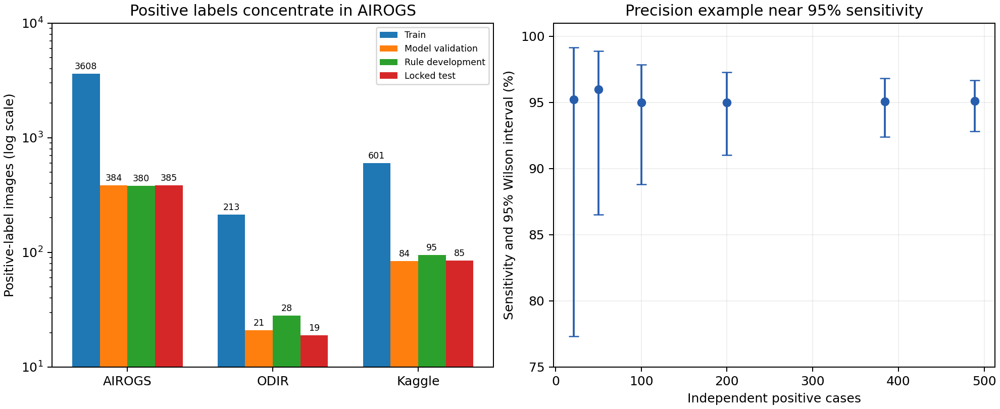
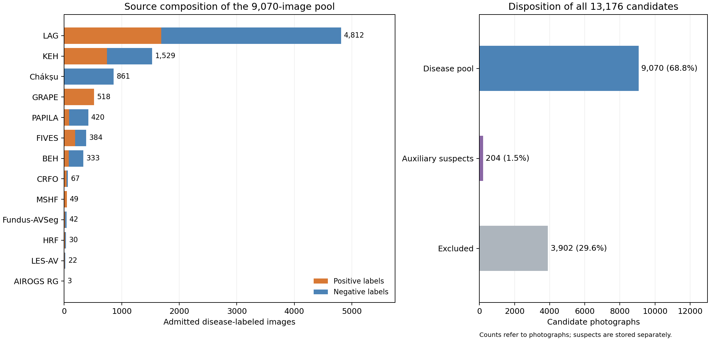

# 数据扩展、眼底退化与评估设计审查

2026 年 11 月 13 日 · Eye Sentinel

[English](data-and-degradation-review.en.md) · [中文 PDF](data-and-degradation-review.zh.pdf) · [当日进度总览](../progress-overview.zh.md)

本文记录 11 月 13 日新训练开始前的数据审查与实验设计。随后完成的四组训练，以及对其结果的配对分析，分别见[训练结果](../training-results/training-results.zh.md)和[实验分析](../experimental-analysis/experimental-analysis.zh.md)。三份报告按数据准备、训练、结果解释的顺序阅读。

## 核心结果

本次审计覆盖 13,176 张候选眼底照片，最终纳入 **9,070 张疾病标签图像，其中 3,446 张阳性**；另保留 204 张疑似图像作辅助监督。所有候选图像均有逐图决定，315,074 个相似候选对均完成裁决。入选依据为原始来源标签、使用许可、文件完整性以及已知患者和图像关联。

扩展池含 146 张真实低质量阳性照片：FIVES 有 99 张至少一个质量维度为差，MSHF 有 47 张总体质量为差。这部分数据为检验真实质量变化下的疾病识别提供了病例基础。合成失焦、暗光等变化用于训练增强和同图压力比较，其病例数按原始照片统计。

审查提出比较无退化、30% 退化、50% 退化三种训练方案，并记录原来源与新增来源的实际采样次数。同日后续训练使用新的联合划分：15,480 张训练图像、2,046 张模型验证图像和 2,053 张规则开发图像。下文对原训练的描述对应审查时的 formal_v3 版本；新增池规模、原版本规模和后续训练规模分别列示。

## 1. 审查时的模型和数据

formal_v3 的 EfficientNet-B0 疾病模型 A、ResNet50 候选模型 B、原质量模型，以及 EyeQ 质量模型均完成 20 轮训练。模型 A 选中第 16 轮权重，B 选中第 18 轮权重，两者在 AIROGS 模型验证集上的 AUROC 分别为 0.9766、0.9831。

AUROC 是“受试者工作特征曲线下面积”，衡量模型的排序能力：从同一评价集随机抽取一张阳性和一张阴性，AUROC 表示模型给阳性更高分的概率，分数并列按一半计。0.5 对应随机排序，1.0 对应完全区分；具体阈值下的漏诊和误报另用计数报告。

原质量模型选中第 16 轮。EyeQ 按组合验证损失选中第 17 轮，在 117 张人工三等级验证图像上 macro-F1 为 0.811；最后第 20 轮为 0.865。macro-F1 对各质量等级的分类表现等权平均，选中权重和最后一轮的结果分别记录。

| 审查时的集合 | 图像数 | 阳性图像 | 阳性关联组 | 用途 |
|---|---:|---:|---:|---|
| formal_v3 疾病训练 | 10,354 | 4,422 | 4,341 | 学习疾病模型 |
| formal_v3 模型验证 | 1,190 | 489 | 482 | 选择权重 |
| 11 月 13 日修正规则开发 | 1,220 | 503 | 494 | 校准与复核规则开发 |
| 冻结内部测试 | 1,233 | 489 | 481 | 模型和规则锁定后测试 |
| ACRIMA 外部测试 | 705 | 396 | 396 | 外部来源评价 |
| HYGD 外部测试 | 737 | 540 | 183 | 患者和图像分组评价 |

关联组将已知患者、双眼、重复照片及图像版本连在一起。未公开患者编号的来源以图像关联组记录。来源标签也分别保留：AIROGS 的 RG/NRG 表示是否需因青光眼转诊，其他来源采用各自的青光眼诊断或青光眼性视神经病变（GON）定义。

图 1 左侧显示原版本四个内部集合的阳性图像数，纵轴为对数尺度。训练阳性中 AIROGS 有 3,608 张、Kaggle 有 601 张、ODIR 有 213 张；ODIR 的模型验证、规则开发、测试阳性分别为 21、28、19 张。右侧为敏感度约 95% 时的 Wilson 95% 区间示例，用于说明独立阳性数与估计精度的关系。双眼及重复照片的相关性应在实际评估中通过关联组重采样处理。

在相同的 277 张 ODIR 模型验证图像上，模型 A、B 的 AUROC 分别为 0.9042、0.8950。以 0.5 为展示阈值时，A 检出 13/21 张阳性，图像级 Wilson 区间约为 40.9%–79.2%。ODIR 与 AIROGS 的结果差异支持按来源评估；小规模阳性子集的估计精度也较低。部署阈值由后续模型验证和规则开发确定。

原采样器对各来源等权，并在来源内对正负类别等权，以有放回方式每轮抽取 10,354 次。每个来源类别平均约 1,726 次；每张 ODIR 阳性平均抽取 8.10 次、每张 Kaggle 阴性约 4.87 次、每张 AIROGS 阳性约 0.478 次。训练记录需要同时报告更新预算、采样次数和实际覆盖的独立图像。

模型 A 的平均训练批损失从 0.307 降至 0.027，验证交叉熵从 0.296 升至 0.435；B 的训练损失从 0.253 降至 0.025，验证交叉熵从 0.367 升至 0.518。交叉熵衡量预测概率与标签的符合程度，对高置信度错误尤其敏感。这些曲线支持进一步比较采样、选模、概率校准和增强方法。训练规模则通过分组学习曲线单独研究。

## 2. 公开数据检索与纳入决定

检索覆盖青光眼专用数据、带逐图青光眼标签的多病眼底数据、真实质量数据、数据目录和标准化合集，并检查 2024—2026 年相关工作。依据包括作者论文、官方发布、使用条款和实际可获取的图像。第三方合集按原始来源归类、去重；下表列出全部 45 个审查条目。表中“糖网病”指糖尿病视网膜病变；OCT 指光学相干断层扫描，与本轮使用的彩色眼底照片分别记录。

| 来源 | 本轮决定及依据 |
|---|---|
| [LAG](https://github.com/smilell/AG-CNN) | 官方首包已取得，4,854 图、1,711 阳性；原论文结合眼压、视野及视盘确认诊断。仅学术使用、禁止再上传。 |
| [GRAPE](https://springernature.figshare.com/articles/dataset/GRAPE_dataset_CFPs/23575926) | 原图及临床表已取得，144 人、263 眼、631 次成像；631 图均为青光眼。CC0。 |
| [Fundus-AVSeg](https://figshare.com/articles/dataset/27938034) | 官方 100 图、20 青光眼，原图与分割掩模分别计数。CC BY 4.0。 |
| [LES-AV](https://figshare.com/articles/dataset/LES-AV_dataset/11857698) | 官方 22 图、11 青光眼及临床表已取得。GPL；按图像编号记录，患者编号未公开。 |
| [HRF](https://www5.informatik.uni-erlangen.de/research/data/fundus-images/) | 官方 45 原图取得：15 青光眼、15 健康、15 糖网病；与重拍质量集分别处理。 |
| [CRFO-v4](https://data.mendeley.com/datasets/trghs22fpg/4) | 官方 79 张 OD 彩照取得，48 原阳性；四个患者标识涉及同图异标签，定点整组排除。CC BY 4.0。 |
| [G1020](https://arxiv.org/abs/2006.09158) | 镜像补齐 1,020 图；原授权和 432 人的患者映射缺失，明确排除本轮混合训练。 |
| [BEH](https://github.com/mirtanvirislam/Deep-Learning-Based-Glaucoma-Detection-with-Cropped-Optic-Cup-and-Disc-and-Blood-Vessel-Segmentation/tree/master/Dataset) | CC BY-NC 4.0 允许本项目学术使用；重复与异标签同图定点排除。 |
| [KEH](https://doi.org/10.7910/DVN/1YRRAC) | 官方 1,544 图、756 原阳性，CC0；排除四组异标签同图，保留视盘裁切域。 |
| [GFID / Harvard copy](https://zenodo.org/records/12562673) | 与 KEH 官方包逐文件一致，归入同一来源并采用官方标签。 |
| [RIM-ONE DL](https://github.com/miag-ull/rim-one-dl) | 作者使用说明要求仅用该库训练和调参；本轮排除混合池，保留单源研究。 |
| [RIM-ONE r1/r2/r3](https://github.com/miag-ull/rim-one-dl) | 与 DL 属同一发布家族，按原始照片去重计数。 |
| [PAPILA](https://doi.org/10.6084/m9.figshare.14798004.v2) | 488 图、244 人；87 青光眼、68 疑似。双眼按患者分组，疑似单列。 |
| [Chákṣu](https://doi.org/10.6084/m9.figshare.20123135.v2) | 1,009 官方训练图、137 多数票疑似；多数票疑似标签保留为辅助监督。 |
| [FIVES](https://doi.org/10.6084/m9.figshare.19688169.v1) | 800 原图，200 青光眼；101 阳性至少一质量维度差，保留疾病与质量原标。 |
| [MSHF](https://doi.org/10.6084/m9.figshare.21507564.v1) | 1,302 原图、52 青光眼，其中 50 总体质量差。CC BY 4.0；质量分歧保留双版本。 |
| [HYGD](https://physionet.org/content/hillel-yaffe-glaucoma-dataset/1.1.0/) | 既有来源，540 张阳性保留作外部测试；按患者和关联图像分组。 |
| [ACRIMA](https://figshare.com/s/c2d31f850af14c5b5232) | 既有 705 张图、396 张阳性，保留作外部测试。 |
| [AIROGS original](https://zenodo.org/records/5793241) | 本轮审旧 5,000 图中的全部 163 RG；与 Light/SMDG 来自同一母库，按关联照片分组。 |
| [AIROGS-Light](https://www.kaggle.com/datasets/deathtrooper/glaucoma-dataset-eyepacs-airogs-light-v2) | 当前训练来源；v1/v2 属关联发布版本，4,770 为阳性图像标签数。 |
| [ODIR](https://www.kaggle.com/datasets/andrewmvd/ocular-disease-recognition-odir5k) | 已取得；按逐眼关键词和双眼组，第三方子集不重复计数。 |
| [Kaggle / EyeAugmented](https://github.com/yiweichen04/retina_dataset) | 既有来源及增强图像家族；原图关系不明的重打包照片单独隔离。 |
| [SMDG-19](https://github.com/TheBeastCoding/standardized-multichannel-dataset-glaucoma) | 19 个来源的标准化合集；4,817 张阳性按原始来源归类、去重。 |
| [ORIGA](https://www.kaggle.com/datasets/sshikamaru/glaucoma-detection) | 650/168 的公开规模可查；原许可、原图诊断对照未取得，本轮排除。 |
| [REFUGE / REFUGE2](https://refuge.grand-challenge.org/REFUGE2Download/) | 下载入口需账户，原图及条款未取得；两版存在图像复用，按原始照片计数。 |
| [Drishti-GS1](https://cvit.iiit.ac.in/projects/mip/drishti-gs/mip-dataset2/Download.php) | 官方入口需登录/注册，未取得可核原图诊断表；本轮排除。 |
| [BrG](https://pmc.ncbi.nlm.nih.gov/articles/PMC9778370/) | 官方站点及重试均出现 DNS 解析失败；无原包与诊断表，本轮排除。 |
| [BRSET](https://physionet.org/content/brazilian-ophthalmological/1.0.2/) | 原图需认证和 DUA；公开字段为杯盘增大，缺少逐图青光眼诊断，本轮排除。 |
| [mBRSET](https://physionet.org/content/mbrset/1.0/) | 认证和 DUA 限制，主要用于糖网病和质量任务；本轮未取得原始授权及图像。 |
| [GAMMA](https://gamma.grand-challenge.org/) | 300 人多模态分级，比赛入口需注册；未得病例级原图标签，本轮排除。 |
| [RIGA / RIGA+](https://deepblue.lib.umich.edu/data/concern/data_sets/3b591905z) | 提供视盘和视杯分割，缺少本轮需要的逐图临床青光眼诊断。 |
| [RFMiD](https://doi.org/10.3390/data6020014) | 多病标签中提供视盘凹陷，缺少逐图青光眼确诊标签；本轮排除。 |
| [DR-HAGIS](https://personalpages.manchester.ac.uk/staff/niall.p.mcloughlin/) | 作者入口超时，未得完整原图及病例表；SMDG 中十张副本归回原来源。 |
| [sjchoi86-HRF](https://github.com/yiweichen04/retina_dataset) | 与既有 Kaggle/HRF 混合来源相关，无独立患者及原授权链，本轮排除新来源。 |
| [BIOMISA](https://data.mendeley.com/datasets/2rnnz5nz74/2) | 多模态关联版本；已取可核 CRFO 彩照，无另一独立眼底诊断队列。 |
| [DRIONS-DB](https://www.researchgate.net/publication/326460478_Glaucoma_dataset_-_DRIONS-DB) | 视盘分割资源，无可信逐图青光眼诊断，不作阳性监督。 |
| [AGE / GOALS / OCTV](https://age.grand-challenge.org/Download/) | 前节或视网膜 OCT 任务，缺少本轮适用的彩色眼底诊断原图。 |
| [INSPIRE](https://medicine.uiowa.edu/eye/inspire-datasets) | 血管比/立体视盘资源，无本轮可核临床阳性标签。 |
| [JSIEC](https://www.kaggle.com/datasets/linchundan/fundusimage1000) | 相关类别为正常与疑似；未得到可核原作者图像诊断发布。 |
| [Leuven-Haifa HRF](https://doi.org/10.48804/Z7SHGO) | 需申请；与 LES-AV 来源相关，未取得新的独立患者队列。 |
| [ONHSD / SIGF / VEIRC](https://github.com/XiaofeiWang2018/DeepGF) | 入口不可用、需申请或第三方来源，均无本轮可核原包，本轮排除。 |
| [Harvard fairness datasets](https://github.com/Harvard-Ophthalmology-AI-Lab/Harvard-GDP) | 主要提供 OCT 衍生模态；发布家族存在同图复用，本轮排除。 |
| [GLEAM (2026)](https://doi.org/10.1109/TMI.2026.3692814) | 检索到 2026 论文，未找到可核公开原图和临床标签包，本轮排除。 |
| [EyeQ / FIQS](https://github.com/HzFu/EyeQ) | 已有完整质量数据，可用于质量监督；未提供新的临床青光眼标签。 |
| [FunPiQ / FPE / Real Fundus / DeepDRiD](https://zenodo.org/records/21838047) | 质量、手术配对或糖网病资源；按原母库记录，未提供本轮所需青光眼标签。 |

纳入决定综合图像可获取性、逐图标签、目标模态、标签一致性、许可及与保留测试集合的关联。需申请且尚未取得的资源记录为待获取，样本规模按实际完成审计的照片计算。

## 3. 逐图审计与新增数据池

每张候选图像均检查文件 SHA256、完整 RGB 解码和像素哈希。SHA256 是用于核对文件内容的摘要；像素哈希核对解码后的图像内容。感知哈希用于寻找视觉相似候选，搜索覆盖 78,047 张历史图像、本次新增来源及各库内部，并比较八种旋转或翻转方向，距离半径为 6。

同图确认结合视网膜内部局部特征、几何配准、灰度与高频血管结构的一致性，避免圆边、文字和黑边主导匹配。已知患者信息、精确文件或像素对应和已确认图像关联共同形成分组；与保护测试组关联的候选从新增池排除。

315,074 个候选对的裁决为：314,194 对视觉相似但未确认同图，755 对确认同图或同一视网膜关联，89 对因证据较强但不足以确认而排除对应图像，另 36 对由 GRAPE 官方患者及眼别信息确认同眼不同随访。随访照片按不同次成像保留，并归入同一患者组。候选对数与图像数分别统计，一张照片可参与多个候选对。发布前在相同解码环境下再次核对入选原图和训练副本的文件及 RGB 哈希。

| 来源 | 本轮审计图数 | 原阳性标签图 | 入选图数 | 入选阳性图 |
|---|---:|---:|---:|---:|
| AIROGS RG | 163 | 163 | 3 | 3 |
| BEH | 634 | 171 | 333 | 83 |
| Chákṣu | 1,009 | 0 | 861 | 0 |
| CRFO | 79 | 48 | 67 | 40 |
| FIVES | 800 | 200 | 384 | 191 |
| Fundus-AVSeg | 100 | 20 | 42 | 14 |
| G1020 | 1,020 | 296 | 0 | 0 |
| GRAPE | 631 | 631 | 518 | 518 |
| HRF | 45 | 15 | 30 | 15 |
| KEH | 1,544 | 756 | 1,529 | 747 |
| LAG part 1 | 4,854 | 1,711 | 4,812 | 1,688 |
| LES-AV | 22 | 11 | 22 | 11 |
| MSHF | 1,302 | 52 | 49 | 49 |
| PAPILA | 488 | 87 | 420 | 87 |
| RIM-ONE DL | 485 | 172 | 0 | 0 |

六项官方来源新下载 5,731 张照片、原阳性标签 2,436 张，均为去重前获取量。最终扩展池还包括此前已下载、本次完成审计的 KEH、BEH、PAPILA、FIVES、MSHF 等图像。审计范围、下载量与入选量因此各有含义。

图 2 左侧按来源列出 9,070 张疾病标签图像中的阳性和阴性数量；LAG、KEH、Chákṣu 合计贡献 7,202 张图像。右侧列出 13,176 张候选图像的去向：9,070 张进入疾病标签池，204 张疑似进入辅助池，3,902 张排除。两个池分别保留。数据依据为审计汇总与扩展池发布清单。

**原规则开发集修正为 1,220 张、503 张阳性。** 已确认的训练或模型验证关联涉及原 1,230 张开发图中的 10 张，因而按图像身份剔除；已有模型预测同步过滤。后续四组训练另使用联合冻结版本的 2,053 张规则开发图像，其中包含这 1,220 张原来源图像。

**真实低质量阳性共 146 张。** FIVES 入选阳性有 99/191 张至少一个官方质量维度为差，MSHF 有 47/49 张总体质量为差；两种质量定义分别记录，MSHF 的原官方评级与多数票评级一并保留。3,446 张阳性中，3,443 张采用来源定义的青光眼诊断，3 张为 AIROGS RG 转诊标签。图像数量、患者分组和临床标签定义在清单中分别记录。

LAG 的阳性目录原名为 suspicious_glaucoma，映射依据为原 CVPR 论文第 3.1 节的专家临床判定。BEH、KEH 中的同图异标签冲突按组排除；PAPILA、Chákṣu 的疑似保持原类别。FIVES 仅依据明确的疾病标签构建青光眼正负监督，糖网病和黄斑变性类别按原标记录。RIM-ONE 的两套划分对应同一批 485 张照片。

KEH 提供视盘裁剪图，疾病模型使用时保留该成像域标记；其质量评价需要适合裁剪视野的定义。完整眼底照片与视盘裁剪图的质量分数分别解读。

LAG、GRAPE 来自同一医院，图像审计还连接了 GRAPE/FIVES、FIVES/Fundus-AVSeg 及 FIVES/MSHF 的同眼或同图关系。五个来源按已知患者和图像关联联合分组，再分配训练、选模和规则开发用途。未知患者身份按图像组评价；外部评价采用完整来源家族留出。GRAPE 和本次入选的 MSHF 仅有阳性，适合报告阳性检出或漏检；AUROC 与特异度需要相应来源的阴性图像。

## 4. 眼底退化方法与研究用途

审查时的疾病模型先补边为正方形，再缩放至 320×320，增强仅有随机水平翻转；原质量模型输入为 384×384。11 月 11 日压力试验使用 AIROGS、ODIR、Kaggle 的 179 张开发原图，其中 83 张为阳性。展示阈值 0.5 下，原图有 8/83 张阳性低于阈值，较强模糊为 27/83，较强暗光为 20/83。四种条件合计 716 个图像版本，统计单位为同一批 179 张原图。这一开发结果提供了研究失焦和曝光变化的依据。

| 工作 | 研究机制与发布情况 | 本项目用途 |
|---|---|---|
| [CoFe-Net，2020/TMI 2021](https://arxiv.org/abs/2005.05594) | 不均匀照明、光晕、局部阴影、伪影与失焦；作者有生成代码 | 优先独立实现可重放的物理退化；原代码有 Python 3 浮点随机边界及光斑重放错误 |
| [ArcNet](https://arxiv.org/abs/2203.07737)、[SCR-Net，2022](https://arxiv.org/abs/2206.04684) | 白内障混浊和散射；作者有模拟脚本 | 作为单独退化族，控制视盘仍可判读；目标域适应在开发数据上完成 |
| [RFormer，2022](https://arxiv.org/abs/2201.00466) | Real Fundus 120 对真实低/高质量重拍恢复 | 标定真实差异、恢复对照；用于真实重拍配对标定 |
| [GFE-Net，2023](https://arxiv.org/abs/2309.00885) | 高频结构保留及未知退化恢复；有通用退化脚本 | 参考结构约束和退化族 |
| [FD3，2024](https://arxiv.org/abs/2409.12377) | 论文提出医生反馈校准的雾化、模糊、噪声、阴影模型 | 作者库提供恢复代码与权重入口；完整合成程序尚未发布 |
| [Catintell，2024](https://arxiv.org/abs/2411.12278) | 学习真实白内障退化风格 | 已发布推理和权重入口，完整合成训练尚未公开；作后续研究对照 |
| [Contextual-OT](https://arxiv.org/abs/2409.07862)、[CUNSB，2024](https://arxiv.org/abs/2409.10966) | 不配对恢复，保留上下文或血管曲线；有代码 | 恢复消融，不替代视盘和诊断验证 |
| [TPOT，2024/2025](https://arxiv.org/abs/2411.01403)、[VAOT，2025](https://arxiv.org/abs/2511.18763) | 血管拓扑约束恢复 | 本轮仓库未有完整可执行发布，不作就绪组件 |
| [MTRL-FIE，2025](https://arxiv.org/abs/2505.01831) | 小波、多尺度和病变特征；有训练及退化代码 | 可研究的近期恢复基线；作者 README 未提供预训练权重下载入口 |
| [RetinaRegen，2025](https://arxiv.org/abs/2502.19153) | 可读性分类及扩散恢复，主要验证合成数据 | 公开可执行版本尚未核实；真实视杯与视盘结构需另行评价 |
| [SGW-GAN，2026](https://arxiv.org/abs/2601.13417) | 下游病种结构保持的恢复 | 结合下游疾病分类评价；公开完整实现尚未核实 |
| [手持图扩散自编码器，2026](https://arxiv.org/abs/2604.15723) | 手持相机反光、曝光和运动模糊恢复 | 与低资源场景相关，但本轮未运行模型 |
| [EyeBench-V2，2026](https://arxiv.org/abs/2604.03806)、[TSMSA-Net，2026](https://arxiv.org/abs/2609.20222) | 前者强调病变/专家评价；后者白内障两阶段恢复 | 增加青光眼及视盘评价；后者使用 Kaggle/ODIR，按 Kaggle/ODIR 来源评价 |

本表区分论文提出的方法、可浏览代码、完整生成程序和已执行权重。具体下载与运行情况见同日后续[退化审计](../training-results/degradation-audit.zh.md)。恢复方法可能改变视杯与视盘边缘、颜色和细血管，因此评价同时检查图像清晰度、诊断结构和疾病预测。当前实验优先采用参数明确、可重放的训练退化。

## 5. 退化混合训练与质量监督

按患者和关联图像完成划分后，在训练组内在线生成退化版本；每个版本共享原图分组。退化应用概率独立于疾病标签，并检查各来源和类别的实际应用次数。

审查设计比较 0%、30%、50% 退化概率，在相同初始化、分组和优化更新预算下训练。轻中度变化包括曝光、平滑不均匀照明、失焦、轻运动、噪声、压缩及轻散射。单次以一类变化为主，最多组合两项；空间参数相对于实际眼底视野直径设定，记录补边、缩放和退化顺序。512 像素参考视野下模糊参数 5、亮度乘数 0.4 用于较强压力条件。

HRF 同眼失焦重拍、Real Fundus 配对、FIVES/MSHF 真实质量标签用于校核参数范围。可判读性关注视杯与视盘边缘及诊断证据的可见程度。视盘被遮挡或诊断证据不足的图像用于重拍、拒识和送审评价，疾病元数据仍保留。

质量监督对应具体图像版本。冻结质量教师的目标分数（teacher_q）绑定原图内容；退化版本需重新取得教师分数或人工质量等级。首轮退化只应用于疾病模型，质量模型另在实际退化版本和真实低质量照片上验证监督。

各方案共用固定原图、真实低质量和不可判读评估组。合成条件按同图成对比较，以患者或关联组重采样计算区间。主要结果包括真实低质量阳性敏感度、固定特异度下敏感度、AUPRC、概率校准，以及相同复核量下的剩余漏检。AUPRC 为精确率与召回率曲线下的面积，受阳性比例影响，按相同来源解释。真实照片结果与合成压力结果分别列出。

## 6. 训练规模与评估精度

本项目二分类 EfficientNet-B0 有 4,008,829 个参数，使用 ImageNet 初始化。训练数据需求由来源覆盖、病例数量和开发表现共同决定。通过 25%、50%、75%、100% 的嵌套训练组学习曲线比较规模，各用三个随机种子；保持来源和疾病分层，以及完整患者与图像关联组，从相同初始化训练。

各规模共用最大更新预算和验证频率，同时记录实际更新数、选中权重、采样重复及独立图像覆盖。依据开发集上的排序、敏感度和真实低质量表现选择训练规模。评估角色在新版本训练前分配；既有权重学习过的图像用于开发或新模型训练。

| 独立阳性规模规划 | 约需阳性数 | 解释 |
|---|---:|---|
| 敏感度约 95%，误差 ±5 个百分点 | 73 | 独立二项近似的精度规划 |
| 敏感度约 95%，误差 ±3 个百分点 | 203 | 同上 |
| 敏感度约 95%，误差 ±2 个百分点 | 457 | 同上 |
| 零漏检，单侧 95% 漏检率上界约 5% | 59 | 根据零事件二项上界 |
| 零漏检，单侧 95% 漏检率上界约 2% | 149 | 同上 |
| 零漏检，单侧 95% 漏检率上界约 1% | 299 | 同上 |

这些数字用于规划估计精度；实际分组数据通过关联组重采样评估。两套复核策略的比较还需根据开发病例中决策不一致的数量进行成对功效计算。

主要临床定义相容的评估队列优先补足约 200 个独立阳性，并增加真实低质量分层。有患者编号的新来源可从 60% 训练、10% 选模、10% 规则开发、20% 测试开始规划，再检查各用途的阳性数量。跨库关联的五个来源联合分组；ACRIMA、HYGD 保留外部测试用途。模型、退化参数、分类阈值和复核规则在开发阶段确定。

## 7. 实验衔接与证据

审查交付了扩展池、标签与分组审计、退化研究目录以及[实验设计](experiment-proposal.json)。同日后续工作完成联合划分、四组各 1,200 次更新的训练和开发预测；分组学习曲线、多种子重复、复核规则锁定及最终测试仍是后续工作。具体结果见[训练报告](../training-results/training-results.zh.md)及[配对分析](../experimental-analysis/experimental-analysis.zh.md)。

[公开数据审查](../../../../data/audit/data_expansion_20261113/public_dataset_review.md) · [逐图审计](../../../../data/audit/data_expansion_20261113/local_decisions.csv) · [审计汇总与输入哈希](../../../../data/audit/data_expansion_20261113/local_summary.json) · [扩展池](../../../../data/prepared/expansion_20261113/README.md) · [退化文献与代码](../../../../data/audit/data_expansion_20261113/degradation_review.md) · [文献发布证据](../../../../data/audit/data_expansion_20261113/degradation_sources.json) · [开发统计](development_analysis.json) · [统计与图 1 脚本](analyze_splits.py) · [图 2 脚本](plot_admission.py)。

中英文报告及图表共用同一审计与统计输入；PDF 的 LaTeX 源码保存在报告旁。
