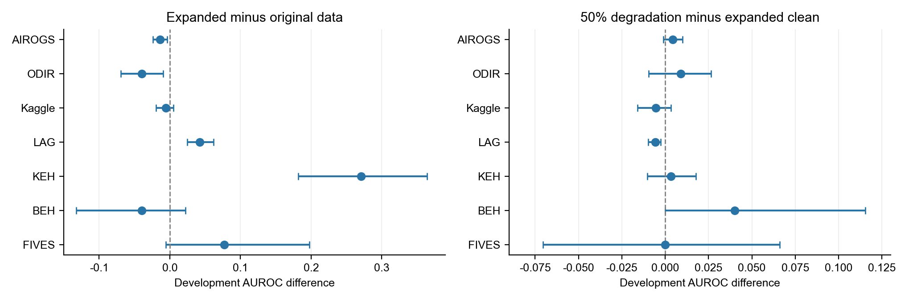
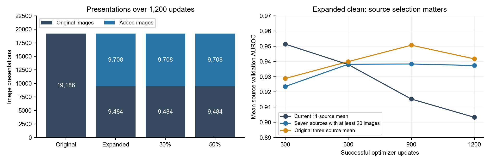
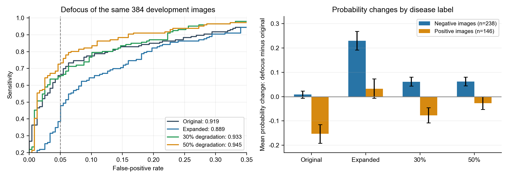
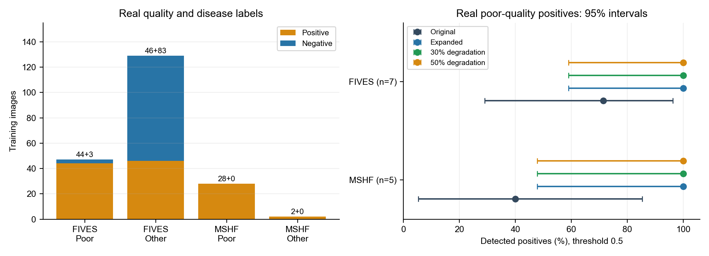

# Data expansion and degradation augmentation: experimental analysis

November 13, 2026 · [中文](experimental-analysis.zh.md) · [English PDF](experimental-analysis.en.pdf)

Data expansion improves glaucoma-image ranking in KEH and LAG, while performance declines in AIROGS and ODIR. Adding 50% degradation improves ranking under synthetic defocus and reduces false positives, with an increase in missed positives. All three expanded arms detect the same 12 real poor-quality development positives, so degradation adds no detections in that group.

This report follows the same-day [data and methods review](../data-review/data-and-degradation-review.en.md) and [training report](../training-results/training-results.en.md). It examines source differences, actual image presentations, checkpoint selection, and the association between real image quality and disease labels to inform the next controlled experiment.

## Data, models, and comparison method

All four arms use EfficientNet-B0, the same initialization, seed 20261113, and 1,200 successful optimizer updates. The original-data arm contains 10,338 training images; the expanded arms contain 15,480. The 30% and 50% settings are probabilities of applying mixed degradation to sampled images. Positive labels retain source definitions, including glaucoma diagnosis and AIROGS glaucoma-referral labels, so results are analyzed by source. Model validation contains 2,046 images, including 823 positives, and rule development contains 2,053 images, including 814 positives. Validation selects checkpoints and supplies source thresholds; rule development supports manual-review rules and supplies the results below. Final testing follows model and review-rule selection.

The training report uses checkpoints with the highest validation criterion: update 1,200 for original data, 30% degradation, and 50% degradation, and update 300 for expanded clean. This analysis mainly compares all update-1,200 checkpoints at an equal update budget. Selected-checkpoint results are retained in [analysis data](analysis.json). An epoch is a complete pass through a training set; an optimizer update adjusts model parameters after a batch. This round sets its budget in updates.

The 95% intervals use 4,000 paired bootstrap resamples of whole linked groups. The same groups are drawn for each model comparison. Groups retain known pairs of eyes, repeat photographs, or other linked images together, preserving dependence; metrics are image weighted. Intervals describe development-image sampling uncertainty. Variation from the single training seed will be assessed in subsequent multiseed experiments. Each interval is an individual percentile interval, and source contrasts are interpreted individually. [Paired source contrasts](paired-source-contrasts.csv) retain the full results.

## Source differences after data expansion

AUROC is the area under the receiver operating characteristic curve. For a randomly chosen positive and negative image, it is the probability that the model gives the positive a higher score, with ties counting half. An AUROC of 0.93 means about 93% of positive–negative pairs are ranked correctly; 0.5 corresponds to random ranking and 1 to perfect separation. Varying the classification threshold gives different sensitivity and false-positive rates, forming the ROC curve. AUROC summarizes ranking over that curve, while the chosen threshold determines actual detections and false positives. The table compares the same development originals within each source. Positive differences favor the first arm; +0.027 means an AUROC increase of 0.027.

| Source: images / positives / groups | Expansion − original: AUROC difference [95% interval] | 50% − expanded: AUROC difference [95% interval] |
|---|---:|---:|
| AIROGS: 773/380/772 | -0.0136 [-0.0239, -0.0040] | +0.0042 [-0.0011, +0.0100] |
| ODIR: 305/28/193 | -0.0397 [-0.0694, -0.0094] | +0.0089 [-0.0096, +0.0265] |
| Kaggle: 142/95/142 | -0.0058 [-0.0197, +0.0052] | -0.0054 [-0.0160, +0.0033] |
| LAG: 481/169/481 | +0.0425 [+0.0248, +0.0616] | -0.0058 [-0.0098, -0.0025] |
| KEH: 153/75/153 | +0.2706 [+0.1818, +0.3639] | +0.0034 [-0.0103, +0.0178] |
| BEH: 33/8/33 | -0.0400 [-0.1323, +0.0220] | +0.0400 [+0.0000, +0.1154] |
| FIVES: 27/13/27 | +0.0769 [-0.0056, +0.1975] | +0.0000 [-0.0706, +0.0659] |

KEH AUROC rises from 0.6627 to 0.9333, and LAG from 0.9465 to 0.9890, with both difference intervals above zero. KEH mainly contains optic-disc crops and LAG full fundus photographs, so gains span both fields of view. AIROGS and ODIR decline by 0.0136 and 0.0397, respectively, with both intervals below zero. The wider Kaggle, BEH, and FIVES intervals include changes in both directions.

At the selected update-300 expanded-clean checkpoint, AIROGS falls by 0.0312 relative to original training; the decline narrows to 0.0136 by update 1,200. ODIR falls by 0.0389 and 0.0397 in the two comparisons. Checkpoint timing therefore accounts for part of the AIROGS difference, while the ODIR decline persists at the end of the budget.

Figure 1 compares expanded clean with original data on the left and 50% degradation with expanded clean on the right. Points show AUROC differences, horizontal bars linked-group 95% intervals, and dashed lines zero difference. The panels use different horizontal ranges to show their respective changes clearly. Adding 50% degradation reduces LAG original-image AUROC by 0.0058 [−0.0098, −0.0025]; the AIROGS, ODIR, and KEH additional-change intervals include zero.

AUPRC is the area under the precision–recall curve. It describes precision and coverage of positive detections, varies with source prevalence, and supports comparisons within a source. The Brier score is the mean squared difference between predicted probabilities and 0/1 labels; lower values indicate more accurate probability predictions.

| Update 1,200: expansion − original | AUPRC difference [95% interval] | Brier difference [95% interval] |
|---|---:|---:|
| AIROGS | -0.0123 [-0.0231, -0.0023] | +0.0230 [+0.0110, +0.0356] |
| ODIR | -0.1604 [-0.2920, +0.0104] | +0.0217 [+0.0027, +0.0412] |
| LAG | +0.0735 [+0.0404, +0.1118] | -0.0571 [-0.0811, -0.0330] |
| KEH | +0.2578 [+0.1561, +0.3600] | -0.1482 [-0.1998, -0.0973] |

KEH and LAG improve in AUPRC and Brier, while AIROGS worsens in both, consistent with their AUROC directions. ODIR Brier increases, but its AUPRC difference interval includes zero. The 305 ODIR development images represent only 193 linked groups, including 19 positive groups, contributing to wider positive-detection intervals.

## How added sources affect sampling and checkpoint selection

Each optimizer update processes a sampled batch; an image can appear several times during training. The current sampler assigns each image the inverse square root of the number of images in its source-and-class combination. Larger combinations receive more total sampling weight, but the weight grows more slowly than image count. Adding sources reduces the sampling share allocated to original sources.

| Arm | Original presentations / distinct images | Added presentations / distinct images |
|---|---:|---:|
| Original | 19,186/8,339 | 0/0 |
| Expanded | 9,484/5,929 | 9,708/3,901 |
| 30% degradation | 9,484/5,929 | 9,708/3,901 |
| 50% degradation | 9,484/5,929 | 9,708/3,901 |

Distinct images in the table are images presented at least once. Original training makes 19,186 presentations, covering 8,339/10,338 training images (80.7%). Expanded training makes 9,484 original-image presentations, or 49.4%, covering 5,929 original images (57.4%). Added images contribute 9,708 presentations, or 50.6%, covering 3,901/5,142 added training images (75.9%). All three expanded arms have identical per-image presentation counts, supporting the augmentation comparison. Partial final batches cause the six-presentation difference in totals.

A single added image appears up to 30 times, versus 14 for original training. Expansion changes source composition, original-image presentations, and repetition frequency together. Controlling the original-image quota in the next round will help assess their effects on original-source performance.

Figure 2 shows original and added image presentations on the left and expanded-clean validation AUROC means over three source combinations on the right. This round selects checkpoints using an equal mean over 11 validation sources containing both classes. HRF, CRFO, Fundus-AVSeg, and LES-AV have just 4, 6, 3, and 2 validation images: 15 images account for 4/11, or 36.4%, of that mean's weight.

Between updates 300 and 1,200, expanded-clean HRF AUROC falls from 1.0 to 0.5, reducing the 11-source mean by 0.04545; the total decline is 0.04807. CRFO contributes another −0.01136, partly offset by other-source gains. In original training, CRFO rises from 0.5 to 1.0 and contributes +0.04545, compared with a total mean gain of 0.03241. A few validation images consequently have substantial influence on checkpoint selection.

Considering only the seven sources with at least 20 validation images, the expanded-clean mean rises from 0.9235 to 0.9373 and peaks at update 900. The original three-source mean also peaks at 900. This sensitivity analysis uses existing validation logs. Full update-600 and update-900 checkpoints were not saved, so development results use the saved update-300 and update-1,200 weights.

## Effects of augmentation under synthetic defocus

Synthetic degradation evaluation uses the same 384 development originals: 146 positives and 238 negatives, selected deterministically by image-identifier hashes. Defocus uses radius 2 for a 512-pixel fundus field, scaled to the actual field. Exposure variants multiply brightness by 0.70. Originals and degraded versions are paired. The table uses update-1,200 weights and labels an image positive when its probability exceeds 0.5, the display threshold for this round.

| Condition / measure | Original | Expanded | 30% | 50% |
|--------------------|--------:|--------:|--------:|--------:|
| Original: AUROC | 0.9423 | 0.9690 | 0.9702 | 0.9688 |
| Original: misses / false positives | 30/16 | 23/15 | 21/13 | 23/14 |
| Defocus: AUROC | 0.9193 | 0.8894 | 0.9332 | 0.9449 |
| Defocus: misses / false positives | 55/10 | 18/68 | 36/23 | 28/19 |
| Exposure 0.70: AUROC | 0.9382 | 0.9536 | 0.9611 | 0.9564 |
| Exposure 0.70: misses / false positives | 39/13 | 21/23 | 26/17 | 29/18 |

Under defocus, 50% degradation improves AUROC by 0.0555 [0.0308, 0.0817] and AUPRC by 0.1019 [0.0511, 0.1592], and reduces Brier by 0.0684 [0.0445, 0.0938], relative to expanded clean. False positives fall from 68/238 to 19/238: a 20.59-percentage-point reduction [15.25, 26.03]. Misses rise from 18/146 to 28/146: a 6.85-point increase [0.71, 13.33]. Ranking gains and the missed-positive/false-positive balance at a fixed threshold should be assessed together.

Figure 3 shows sensitivity versus false-positive rate over thresholds on the left, with AUROC in the legend. The right panel shows mean defocus-minus-original probability changes by disease label with 95% intervals. Expanded-clean negative scores rise by 0.2295 on average, versus 0.0622 with 50% degradation. Original-training positive scores fall by 0.1523, versus 0.0273 with 50% degradation. Augmentation reduces the effect of defocus on both classes' scores.

Matching specificity at 95.4% on the same degraded subset gives defocus sensitivities of 65.8%, 38.4%, 65.1%, and 72.6%. This exploratory comparison recalculates thresholds for each arm and condition to explain ranking. Within-source comparisons also show gains: adding 50% degradation improves defocused AIROGS AUROC by 0.0691 [0.0258, 0.1149] and LAG by 0.0835 [0.0341, 0.1455].

A separate comparison fixes each arm's source thresholds from original validation negatives and applies them to original and degraded images. Seven sources with both validation classes contribute 356 stress-evaluation images: 139 positives and 217 negatives. The other 28 images come from small sources missing one validation class. Entries below are misses / false positives.

| Condition: fixed validation thresholds | Original | Expanded | 30% | 50% |
|--------------------|--------:|--------:|--------:|--------:|
| Original | 34/11 | 27/7 | 30/10 | 30/11 |
| Defocus | 63/10 | 28/47 | 45/16 | 40/10 |
| Exposure 0.70 | 38/8 | 25/15 | 30/13 | 35/13 |

At fixed validation thresholds, adding 50% degradation reduces defocus false positives from 47 to 10 and increases misses from 28 to 40. With exposure multiplied by 0.70, the AUROC difference is +0.0028 [−0.0078, 0.0138] and misses increase from 25 to 35. Current augmentation gains concentrate on defocus. Separating defocus-only from mixed augmentation in the next round will help identify useful degradation types and strengths.

## Real poor-quality detections and label distribution

Real poor-quality development images comprise seven FIVES and five MSHF positives in 12 distinct linked groups. At threshold 0.5, original training detects 7/12, and all three expanded arms detect 12/12. The exact binomial 95% interval for 12/12 is 73.5%–100%; FIVES and MSHF intervals are 59.0%–100% and 47.8%–100%, respectively. Five additional detections comprise two FIVES and three MSHF images, with no additional misses. The exact McNemar test of changed decisions on the same images gives two-sided p=0.0625. The intervals indicate substantial sampling uncertainty for this small set.

Figure 4 shows training-image counts by source and original quality annotation on the left; labels above bars are positive + negative counts. The right panel shows detected proportions and exact binomial 95% intervals for each source's real poor-quality development positives. FIVES defines poor quality as at least one poor quality dimension, while MSHF uses overall quality. Other quality covers each source's remaining grades; source-specific annotation standards are retained.

Of 47 poor-quality FIVES training images, 44 are positive and three negative. Its other 129 images contain 46 positives and 83 negatives. All 28 poor-quality and two other-quality MSHF training images are positive. Actual training includes 413 poor-quality positive presentations from these sources and only ten negative presentations. Given this association between quality and disease labels, the next round should add same-source poor-quality negatives and compare quality-balanced sampling to distinguish source and quality cues from disease features.

At fixed source thresholds from validation, expanded clean and 50% degradation both detect all seven poor-quality FIVES positives. Comparing these arms, sensitivity over all 13 FIVES development positives rises from 76.9% to 92.3%, while specificity on 14 negatives falls from 100% to 78.6%. Thresholds come from just 14 validation negatives and select their maximum score; additional negatives are needed to stabilize threshold estimates. MSHF currently contains positives only, so source-specific specificity requires added negatives.

## Proposed next controlled experiment

Use one original-data control and four expanded arms combining two sampling methods, current sampling and a 65% original-image quota, with two augmentation settings, no degradation and 50% mixed degradation. Use three common seeds, equal initialization conditions, and 2,400 successful updates per arm. At 16 images per batch, the 65% quota provides about 24,960 original-image presentations, versus 19,186 in this round's control. Retain inverse-square-root weights within sources. Compare sampling and augmentation at equal budgets, and save update-1,200 and update-2,400 checkpoints to assess continued training.

Predeclare the equal AUROC mean over AIROGS, ODIR, Kaggle, LAG, and KEH as the primary checkpoint-selection criterion. Report the original three-source mean and source-specific sensitivity and specificity as well. Treat BEH, FIVES, and smaller sources as supplementary evaluations. Save full weights and predictions every 300 updates, and report development-image bootstrap intervals separately from variation across seeds.

Then compare defocus-only with mixed augmentation using the same application probability, sampling sequence, and update budget. Evaluate misses, false positives, real poor-quality negatives, and original-image AUROC and Brier at fixed validation thresholds. Use predeclared original-source performance, quality-stratified results, and review workload to select models and thresholds before final testing. These are proposed experiments and have not yet run.

## Analysis artifacts and reproduction

[Training results](../training-results/training-results.en.md) · [Data audit](../training-results/data-audit.en.md) · [Degradation audit](../training-results/degradation-audit.en.md) · [Image presentation counts](training-exposure.json) · [Figure data](figure-data.json) · [Analysis program](../../../../tools/analyze_expansion_results_20261113.py) · [Report generator](../../../../tools/report_expansion_analysis_20261113.py)

Run the analysis program with `--extract-draws` in the training environment to extract per-image presentation counts from checkpoints. Then run the analysis and report programs in the document environment. The analysis checks image identifiers, labels, sources, linked groups, and frozen-manifest metadata for all four arms, retaining input SHA256 hashes. Statistical tests cover tied scores, linked-group resampling, and same-image pairing.
