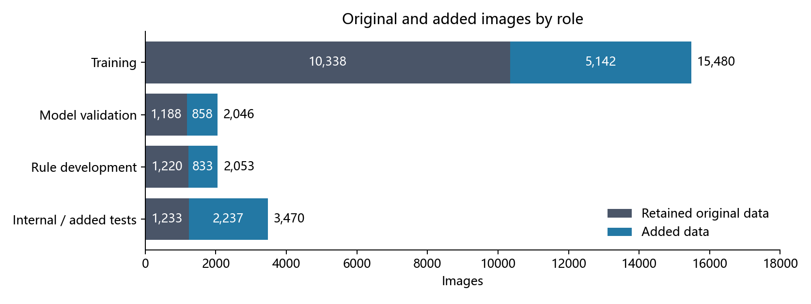
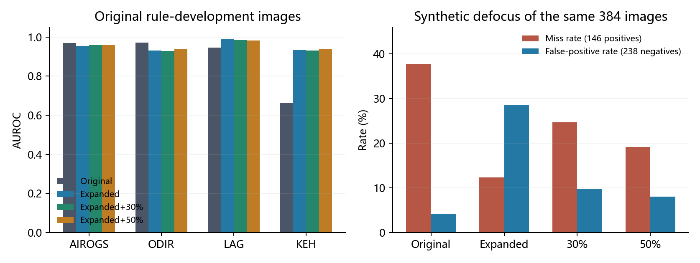
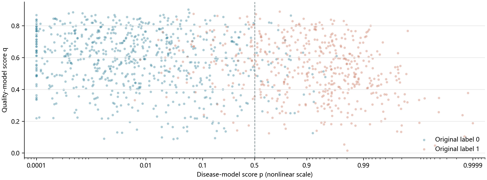

# New datasets and fundus degradation experiments: progress overview

November 13, 2026 · [中文](progress-overview.zh.md) · [PDF](progress-overview.en.pdf)

The project has completed this round of public-data review, image-label and identity checks, dataset allocation, and four glaucoma-classification experiments. Data expansion substantially improved ranking on the KEH and LAG development sets. Under synthetic defocus, 50% degradation augmentation improved ranking and reduced false positives while increasing positive misses at threshold 0.5. The next round will address original-source sampling, checkpoint selection, and real poor-quality negatives. Classification thresholds, quality-guided manual-review rules, and final testing remain to be completed.

This directory follows the experiment sequence: [data and methods review](data-review/data-and-degradation-review.en.md), [training results](training-results/training-results.en.md), and [statistical analysis](experimental-analysis/experimental-analysis.en.md). The three reports describe different stages of the same day's work. This overview uses the completed training release and checkpoints at update 1,200.

## Completed data preparation

The public-source review covers 45 datasets or dataset families. Image-level checks admitted 9,070 images to the additive pool, including 3,446 positives; another 204 suspect images are recorded separately. Positive labels retain source definitions: 3,443 are source-defined glaucoma positives and three are AIROGS referral positives. Optic-disc crops and full fundus photographs have separate domain annotations.

After grouping linked images, the additions and corrected original data form a 24,491-image disease-training and evaluation release. Eighteen original training or validation photographs linked to official EyeQ test images were excluded. The original rule-development portion contains 1,220 images following identity checks.

| Role | Retained original data | Added data | Total |
|---|---:|---:|---:|
| Disease-model training | 10,338 | 5,142 | 15,480 |
| Model validation | 1,188 | 858 | 2,046 |
| Manual-review rule development | 1,220 | 833 | 2,053 |
| Internal and added reserved tests | 1,233 | 2,237 | 3,470 |
| ACRIMA external test | 705 | 0 | 705 |
| HYGD external test | 737 | 0 | 737 |

Training includes 6,405 positives, model validation 823, and rule development 814. Known patients and confirmed linked photographs are allocated together. The entire admitted PAPILA source is reserved for testing, and official FIVES and Fundus-AVSeg test roles are retained. All 24,491 images passed file-hash checks and full RGB decoding.

Figure 1 shows image counts in the four main roles. Of the additive pool, 5,142 images enter training; the remainder enter model validation, rule development, or reserved tests. The table separately lists the 1,442 ACRIMA and HYGD external-test images.

## Experimental comparison

All four arms use EfficientNet-B0, the same initialization and seed 20261113, batches of up to 16 images, and 1,200 optimizer updates each. The original-data arm uses 10,338 corrected training images; the three expanded arms use 15,480. Expanded data are combined with 0%, 30%, or 50% probabilities of mixed degradation, covering uneven illumination, defocus, and scattering. Degradation augments disease training; quality-model targets remain tied to original images.

Models are evaluated every 300 updates on the same 2,046 model-validation images. The original selection rule averages AUROC equally over 11 sources with both classes. The original-data, 30%, and 50% arms select update 1,200; expanded data without degradation selects update 300. The comparisons below use update 1,200 for every arm to align training budgets.

## Observed results

AUROC stands for “area under the receiver operating characteristic curve.” Changing the disease-score threshold produces different sensitivities (the proportion of positives detected) and false-positive rates (the proportion of negatives classified as positive). The ROC curve plots their relationship, and AUROC measures the area beneath it.

AUROC also represents the probability that a randomly selected positive image receives a higher score than a randomly selected negative image, counting ties as half. An AUROC of 0.93 means this ranking probability is about 93%; 0.5 corresponds to random ranking and 1.0 to perfect separation. Actual misses and false positives are evaluated at a chosen threshold. The following results use original photographs from the same rule-development set, calculated separately within each source.

| Source | Original | Expanded | 30% degradation | 50% degradation |
|---|---:|---:|---:|---:|
| AIROGS | 0.9687 | 0.9551 | 0.9583 | 0.9593 |
| ODIR | 0.9712 | 0.9315 | 0.9281 | 0.9404 |
| LAG | 0.9465 | 0.9890 | 0.9844 | 0.9832 |
| KEH | 0.6627 | 0.9333 | 0.9321 | 0.9368 |

Development images / positives are AIROGS 773 / 380, ODIR 305 / 28, LAG 481 / 169, and KEH 153 / 75.

Expansion increases AUROC by 0.2706 on KEH and 0.0425 on LAG. Their 95% intervals from 4,000 paired resamples of linked groups are [0.1818, 0.3639] and [0.0248, 0.0616]. AIROGS and ODIR decrease by 0.0136 and 0.0397, with both intervals below zero. These intervals describe development-case sampling uncertainty; this round uses one training seed.

Stress evaluation creates defocus and reduced-exposure variants of a fixed subset of 384 rule-development originals: 146 positives and 238 negatives. Under defocus, 50% degradation improves AUROC from 0.8894 to 0.9449 relative to expanded data without degradation. At threshold 0.5, false positives fall from 68/238 to 19/238 and misses rise from 18/146 to 28/146. Reduced false positives and increased misses also occur when source thresholds set on model validation are held fixed.

Figure 2 shows original-image AUROC for four sources on the left and miss and false-positive rates on the same defocus subset at threshold 0.5 on the right. The two rates use positive and negative image counts as their respective denominators. Ranking, misses, and false positives jointly describe the effect of degradation augmentation.

Real poor-quality development cases comprise seven FIVES and five MSHF positive images. At threshold 0.5, original-data training detects 7/12 and all three expanded arms detect 12/12; the binomial 95% interval for 12/12 is 73.5%–100%. All images in this subset are positive, and detection counts are identical across the expanded arms. The observed real poor-quality detection gain therefore accompanies data expansion. Same-source negatives are needed to assess false positives.

## Disease and quality score distribution

The figure matches disease score p from the update-1,200 checkpoint of the 50% mixed-degradation arm with raw regression score q from the previously verified FTHNet-distilled quality student. It covers 1,220 retained original rule-development images (503 positive and 717 negative). Higher q indicates better predicted quality; it is neither a human quality grade nor a calibrated probability. The 833 added development images do not yet have verified scores from this same quality model and are excluded.

Figure 3 follows the earlier display: disease score p is on a nonlinear horizontal axis, quality score q is on the vertical axis, and colors show the original labels. For display, p is clipped to 0.0001–0.9999. The dashed line marks the illustrative threshold of 0.5: positives to its left are missed, and negatives to its right are false positives. These account for 90/503 and 39/717 images, respectively. This threshold is illustrative, and no review boundary has been selected. The [figure data](pq-distribution.json) contain counts and errors in linear p and q bins, together with input hashes; see also the [plotting program](../../../tools/plot_pq_overview_20261113.py).

## Priorities identified by the analysis

After expansion, original-source image presentations fall from 19,186 to 9,484; all three expanded arms have the same image-sampling sequence. Adaptation to added sources and reduced original-source sampling occur together. The next round will use an original-source sampling quota to separate their effects.

HRF, CRFO, Fundus-AVSeg, and LES-AV contribute only 15 validation images but account for four equally weighted sources, or 36.4% of the current checkpoint-selection mean. Ranking changes in a few images can therefore strongly affect checkpoint choice. The proposed next round uses AIROGS, ODIR, Kaggle, LAG, and KEH as primary selection sources, saves every validation checkpoint, and compares three common seeds at a budget of 2,400 updates.

Training quality annotations are strongly associated with disease class. Further work will add real poor-quality negatives, compare defocus-only and mixed augmentation, and set classification thresholds on model-validation data. Model selection and manual-review rule development will precede evaluation on reserved tests. The [statistical analysis](experimental-analysis/experimental-analysis.en.md) and [next-steps checklist](../../operations/next-steps.en.md) describe the proposed comparisons.

## Relationship to earlier training and evidence

The earlier `formal_v3` disease models, original quality model, and `eyeq_quality_v1` each completed 20 epochs. The November 12 report records disease checkpoints selected at epochs 16 and 18, with AIROGS model-validation AUROCs of 0.9766 and 0.9831. The selected epoch-17 EyeQ quality checkpoint achieved three-grade macro-F1 0.811 on 117 EyeQ validation images. This round uses a new data release and expanded evaluation sets; the two rounds have separate interpretations.

Evidence includes [frozen-cohort verification](../../../data/prepared/expanded_20261113/cohort_verification.json), [update-1,200 results](../../../runs/expanded_20261113/budget_end_comparison.json), [paired statistics](experimental-analysis/analysis.json), and the [overview build program](../../../tools/build_progress_overview_20261113.py). Image-level predictions, full logs, datasets, and weights reside in local data and run directories. Report tables, figures, and statistical summaries are saved with the repository.
