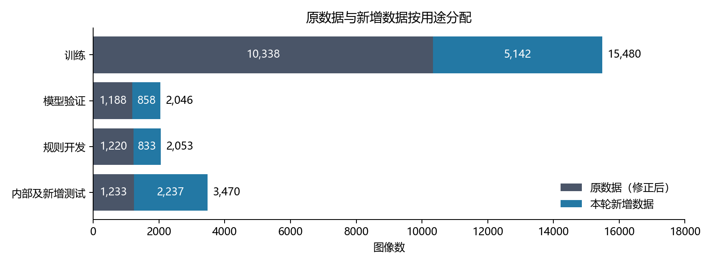
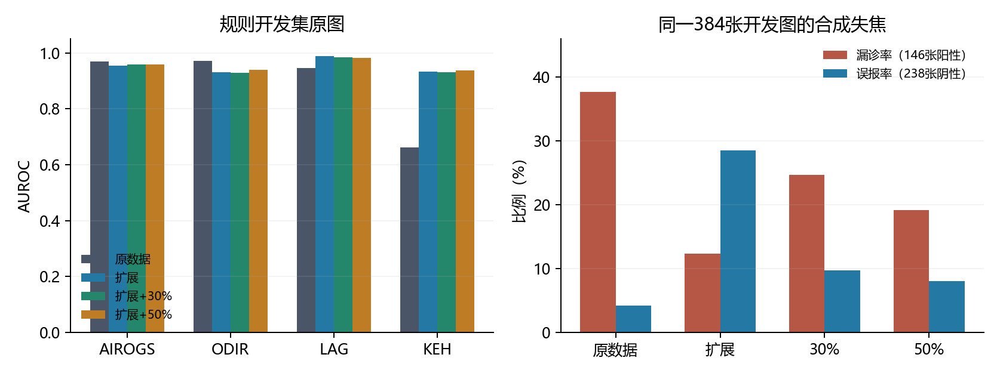

# 新数据集与眼底图像退化实验：进度总览

2026 年 11 月 13 日 · [English](progress-overview.en.md) · [PDF](progress-overview.zh.pdf)

项目已完成本轮公开数据审查、新增图像的标签和关联核验、训练数据划分，以及四组青光眼分类实验。扩展数据显著改善了 KEH 和 LAG 开发集的图像排序；在合成失焦条件下，50% 退化增强提高了排序表现并减少误报，同时增加了阈值 0.5 下的阳性漏诊。下一轮工作重点是保持原来源的训练采样量、改进模型选择规则，并补充真实低质量阴性病例。分类阈值、质量引导的人工复核规则及最终测试尚待完成。

本目录按实验顺序组织为[数据与方法审查](data-review/data-and-degradation-review.zh.md)、[训练结果](training-results/training-results.zh.md)和[统计分析](experimental-analysis/experimental-analysis.zh.md)。三份报告记录同一天工作的不同阶段。本总览以完成训练后的数据版本和第 1,200 次更新权重为准。

## 数据准备完成了什么

公开来源审查覆盖 45 个数据集或数据集系列。逐图核验后，新增池纳入 9,070 张图像，包括 3,446 张阳性图像；另有 204 张疑似图像单列记录。阳性标签保留各来源的原始定义，其中 3,443 张为来源定义的青光眼阳性，3 张为 AIROGS 的转诊阳性。视盘裁剪图与完整眼底照片分别标记。

新增池经关联分组后，与修正后的原数据组成 24,491 张图像的疾病训练与评价清单。原训练与验证部分中，18 张关联官方 EyeQ 测试图像的照片已移除；规则开发部分沿用身份关联核查后的 1,220 张原图。

| 用途 | 修正后原数据 | 新增数据 | 合计 |
|---|---:|---:|---:|
| 疾病模型训练 | 10,338 | 5,142 | 15,480 |
| 模型验证 | 1,188 | 858 | 2,046 |
| 人工复核规则开发 | 1,220 | 833 | 2,053 |
| 内部及新增保留测试 | 1,233 | 2,237 | 3,470 |
| ACRIMA 外部测试 | 705 | 0 | 705 |
| HYGD 外部测试 | 737 | 0 | 737 |

训练集含 6,405 张阳性，模型验证集含 823 张阳性，规则开发集含 814 张阳性。已知患者和确认的关联图像按组分配用途。PAPILA 整个纳入来源用于保留测试，FIVES 和 Fundus-AVSeg 的官方测试角色保留。全部 24,491 张图像通过文件哈希及完整 RGB 解码核验。

图 1 显示四项主要用途的数据组成；数字为原图数量。新增池的 5,142 张图像进入训练，其余进入模型验证、规则开发或保留测试。ACRIMA 和 HYGD 合计 1,442 张外部测试图另列于表中。

## 本轮实验如何比较

四组均使用 EfficientNet-B0、相同初始化和随机种子 20261113，每批最多 16 张图像，各完成 1,200 次优化更新。原数据组使用修正后的 10,338 张训练图像，其余三组使用 15,480 张。扩展数据分别配合 0%、30% 和 50% 的混合退化应用概率，退化包括照明不均、失焦和散射。质量模型的监督目标沿用原图，退化增强用于疾病模型训练。

模型每 300 次更新在共同的 2,046 张模型验证图像上评价。原选模规则对 11 个含正负两类的来源等权平均 AUROC。原数据、30% 和 50% 退化组的选中权重均来自第 1,200 次更新，扩展无退化组来自第 300 次更新。下面统一比较第 1,200 次更新，便于判断相同训练预算下的差异。

## 已观察到的结果

AUROC 的全称是“受试者工作特征曲线下面积”。模型输出疾病分数，改变判为阳性的分数阈值，可以得到一系列敏感度（检出的阳性比例）和误报率（被判为阳性的阴性比例）；ROC 曲线展示两者的关系，AUROC 是曲线下的面积。

它也可以理解为：随机抽取一张阳性和一张阴性图像，模型给阳性更高分的概率，并列分数计一半。例如 AUROC 为 0.93 表示这一排序概率约为 93%；0.5 相当于随机排序，1.0 表示完全区分。实际漏诊和误报需在选定阈值下另行评价。下表来自同一规则开发集的原图，各来源独立计算。

| 来源 | 原数据 | 扩展数据 | 30% 退化 | 50% 退化 |
|---|---:|---:|---:|---:|
| AIROGS | 0.9687 | 0.9551 | 0.9583 | 0.9593 |
| ODIR | 0.9712 | 0.9315 | 0.9281 | 0.9404 |
| LAG | 0.9465 | 0.9890 | 0.9844 | 0.9832 |
| KEH | 0.6627 | 0.9333 | 0.9321 | 0.9368 |

各来源开发图像数／阳性数分别为 AIROGS 773／380、ODIR 305／28、LAG 481／169、KEH 153／75。

扩展相对原数据的 AUROC 差，在 KEH 为 +0.2706，在 LAG 为 +0.0425；按关联组进行 4,000 次配对重采样所得的 95% 区间分别为 [0.1818, 0.3639] 和 [0.0248, 0.0616]。AIROGS 和 ODIR 分别下降 0.0136 和 0.0397，对应区间均低于零。这些区间表示开发病例抽样的不确定性；本轮使用一个训练种子。

压力评价对固定的 384 张规则开发原图生成失焦和曝光降低变体，包括 146 张阳性和 238 张阴性。50% 退化相对扩展无退化，在失焦条件下的 AUROC 从 0.8894 提高到 0.9449；阈值 0.5 下误报由 68/238 降至 19/238，漏诊由 18/146 升至 28/146。固定模型验证集设定的来源阈值后，误报减少与漏诊增加的方向一致。

图 2 左侧展示四个来源的原图 AUROC，右侧展示同一失焦开发子集在阈值 0.5 下的漏诊率和误报率。右侧两项比例分别以阳性和阴性图像数为分母。退化增强的作用需同时结合排序、漏诊和误报评价。

真实低质量开发病例为 FIVES 的 7 张和 MSHF 的 5 张阳性图像。在阈值 0.5 下，原数据组检出 7/12，三个扩展组均检出 12/12；12/12 的二项分布 95% 区间为 73.5%–100%。该子集全部为阳性，且三个扩展组的检出数一致，因此本轮的真实低质量检出改善主要体现在数据扩展。后续需结合相同来源的阴性图像评价误报。

## 分析指出的下一步

扩大训练池后，原来源图像的累计采样次数由 19,186 降为 9,484；三个扩展组使用相同的图像采样序列。新增来源适应与原来源采样量变化同时发生，下一轮将用原来源采样配额区分两者作用。

现有选模平均值中，HRF、CRFO、Fundus-AVSeg 和 LES-AV 合计只有 15 张验证图像，却占四个等权来源，即 36.4% 的权重。这使少数图像的排序变化明显影响权重选择。下一轮拟以 AIROGS、ODIR、Kaggle、LAG 和 KEH 为主要选模来源，保存每次验证权重，并采用三个共同随机种子与 2,400 次更新预算。

真实低质量训练图像的质量标记与疾病类别高度相关。后续还需补充真实低质量阴性图像，分别比较失焦增强与混合退化，并在模型验证数据上设定分类阈值。完成这些比较后，选择疾病模型和质量模型、开发人工复核规则，固定规则再评价保留测试集。详细实验安排见[统计分析](experimental-analysis/experimental-analysis.zh.md)与[下一步清单](../../operations/next-steps.md)。

## 与此前训练的关系及证据

此前 `formal_v3` 两套疾病模型、原质量模型和 `eyeq_quality_v1` 均已完成 20 轮训练。11 月 12 日报告记录的疾病权重选自第 16 和 18 轮，在 AIROGS 模型验证集上的 AUROC 为 0.9766 和 0.9831；EyeQ 质量模型选中第 17 轮权重，在 117 张 EyeQ 验证图像上的三档 macro-F1 为 0.811。本轮固定 1,200 次更新实验采用新的数据清单，评价集也已扩展；两轮结果分别解释。

可核查的证据包括[冻结清单核验](../../../data/prepared/expanded_20261113/cohort_verification.json)、[第 1,200 次更新结果](../../../runs/expanded_20261113/budget_end_comparison.json)、[配对统计](experimental-analysis/analysis.json)及[报告构建程序](../../../tools/build_progress_overview_20261113.py)。逐图预测、完整训练日志、数据文件与模型权重位于本地数据和运行目录；报告中的汇总表、图和统计结果随仓库保存。
