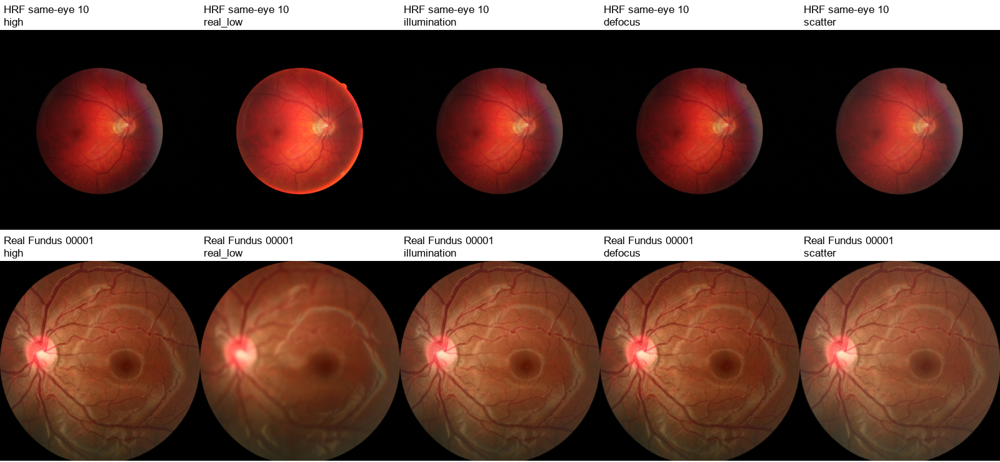

# Fundus degradation implementation and author-model audit

November 13, 2026 · [中文](degradation-audit.zh.md)

This audit verified five author releases, ran CoFe degradation functions and the published CUNSB-RFIE generator, and added reproducible acquisition simulation to disease training. The checks used CPU. The completed disease experiments and their development results are reported in the [training report](training-results.en.md).

## Author releases and executed checks

The downloaded versions are pinned to commits recorded in the [same-day review](../data-review/data-and-degradation-review.en.md). All five ZIP archives passed CRC checks. The [download inventory](degradation-downloads.json) records archive, source, and checkpoint SHA256 hashes. The local author packages are stored under `models/degradation_sources_20261113/`.

| Author work | Pinned commit | Evidence and use in this round |
|---|---|---|
| [CoFe-Net](https://github.com/joanshen0508/Fundus-correction-cofe-Net) | `5366d53808bc` | Original `DE_BLUR` and `DE_HALO` ran in Python 3.11.18 and Pillow 13.0.0. The code uses fixed dimensions and older random-number interfaces. The project implements the acquisition effects independently. |
| [ArcNet / SCR-Net](https://github.com/liamheng/ArcNet-Medical-Image-Enhancement) | `20821fb1116b` | The cataract simulator was inspected. It uses 512-pixel images, author-machine paths, and OpenCV BGR conventions. The project implementation uses RGB images and scales blur to the visible field. |
| [FD3](https://github.com/heeheee888/FD3) | `d9d1e65bdcd4` | `degradation.py` supplies paired interpolation and downsampling. The paper's full haze, shadow, and artifact synthesis pipeline is absent from this release, so training uses the project simulator. |
| [Catintell](https://github.com/HudenJear/Catintell) | `7994622b79da` | The package and README were verified. The published code centers on restoration inference; the project simulator supplies training degradation. |
| [CUNSB-RFIE](https://github.com/Retinal-Research/CUNSB-RFIE) | `fc0a00f1ade7` | D, E, F, and G checkpoints decoded with `weights_only=True`, with finite tensors throughout. G's 316 tensors matched the author DSCNet. A single t=0 forward pass on a 320×320 RGB image completed on CPU in 3.18 seconds. |

CUNSB's root LICENSE permits academic and non-commercial research. G contains 21,958,275 tensor elements, including buffers. The other four packages have no separate LICENSE file. The project module implements published acquisition mechanisms independently. The CUNSB run checks code–weight compatibility; execution covered one t=0 generator pass. The complete five-step stochastic restoration bridge is a separate restoration experiment. [Execution evidence](degradation-author-smoke.json) and [checkpoint evidence](degradation-checkpoints.json) record the exact scope.

The earlier review raised a compatibility concern about floating-point `randint` bounds in modern Python. The call ran in the current environment; this audit records that observed result.

## Disease-training interface and reproducibility

[`training/fundus_degradation.py`](../../../../training/fundus_degradation.py) provides `FundusDegradation(probability).augment(image, seed=...)`, returning an RGB image and recorded parameters. Processing follows RGB decoding, square black padding, resizing to model input dimensions, degradation, and ImageNet normalization. Image identity, epoch, and seed determine the transformation. A local random generator keeps these operations separate from model and worker random states.

The application probability is independent of disease label, source, and quality score. Each applied transformation selects one of three mechanisms with equal probability. With common seeds, the 30% arm's transformed images and parameters are a subset of the 50% arm's transformations.

| Mechanism | Initial range and processing |
|---|---|
| Exposure and uneven illumination | Exposure multiplier 0.72–1.12, gamma 0.90–1.15, and smooth edge attenuation of 5%–20%. Brightness changes continuously across the field. |
| Defocus and acquisition noise | Gaussian sigma 0.5–2.0 at a 512-pixel field reference, followed by either JPEG quality 75–95 or noise standard deviation 0.004–0.012. |
| Mild scatter | Reference sigma 0.5–1.0 and smooth veiling opacity of 3%–10%, applied continuously across the effective field. |

The field diameter is estimated from rows and columns with at least 10% nonblack coverage, limiting the effect of small border annotations. Blur sigma scales by field diameter/512. Disc crops use the visible crop extent and retain their imaging-domain label. Original black-border pixels retain their values.

Records retain image dimensions, field bounds, original RGB SHA256, mechanism, exposure/noise/compression parameters, and noise seed. `replay` checks the source image and reproduces the recorded transformation exactly. Four tests pass, covering replay, border preservation, local randomness, nested probability draws, scale conversion, and rejection of a different source image.

Synthetic degradation is applied to disease training. Quality training continues to use original images with their original teacher quality scores or EyeQ grades. This round uses mild, continuous transformations and evaluates their disease effect on real poor-quality development photographs.

## Comparison with real repeated photographs

The descriptive comparison uses 18 HRF and 120 Real Fundus same-eye high/low-quality pairs, both previously used in the November 11 development pilot. Each high-quality image generates three fixed-seed variants after resizing to 320×320. Originals and variants share the same case identity. These resources provide quality comparisons; disease labels come from the separate disease manifests. [Per-image statistics](degradation-pair-statistics.csv) and [parameters and summaries](degradation-calibration.json) retain the results.

The table gives the median green-channel Laplacian-variance ratio relative to the paired high-quality image. This statistic describes edges and fine detail, and also responds to noise, exposure, and sharpening. Clinical visibility of the optic disc requires separate human assessment.

| Development resource | Real low quality | Fixed defocus | Fixed scatter |
|---|---:|---:|---:|
| HRF, 18 same-eye pairs | 0.5155 | 0.8046 | 0.8490 |
| Real Fundus, 120 same-eye pairs | 0.1007 | 0.7191 | 0.7811 |

The synthetic examples show less detail attenuation than the stronger real blur in Real Fundus. This supports using the current ranges as mild training conditions. Severity follows image statistics and has not received expert grading.



The top row shows HRF pair 10, and the bottom row shows Real Fundus 00001. Columns are high quality, real low quality, illumination changes, defocus, and scatter. Technical review checks pair identities, RGB colors, dimensions, and border preservation. Human assessment of clinical disc structures is a separate evaluation.

## Relation to completed training

Following data integration, four arms completed 1,200 updates each using the common initialization, sampling rule, and development set. They compare original data, expanded data, and expanded data with 30% or 50% mixed degradation. CUNSB code and weights support a separate restoration experiment. The [training results](training-results.en.md) report disease outcomes, while the [experimental analysis](../experimental-analysis/experimental-analysis.en.md) examines sampling, selection, and source differences.

Verification commands:

```text
tools/training_python.cmd -m unittest tests.test_fundus_degradation -v
tools/training_python.cmd -u tools/validate_fundus_degradation_20261113.py
tools/training_python.cmd -u tools/smoke_downloaded_fundus_models_20261113.py
```
