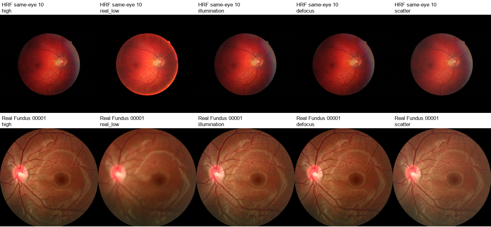

# 眼底退化代码与模型整合审计

2026 年 11 月 13 日 · [English](degradation-audit.en.md)

本次完成五个作者代码包的下载和核验，运行了 CoFe 的退化函数及 CUNSB-RFIE 的已发布生成器权重，并为疾病训练加入可重放的轻中度成像退化。全部验证使用 CPU。训练入口仅调用新的退化模块；质量模型继续以原图及其质量标签和教师分数训练。

## 1. 作者发布包与实际执行

下载版本固定为 11月13日 审查记录中的提交，不随作者后续更新变化。五个 ZIP 包均通过 CRC 检查；包、源码和权重的 SHA256 见 [下载清单](degradation-downloads.json)。代码包保存在 `models/degradation_sources_20261113/`，不纳入项目源码分发。

| 作者工作 | 本地固定提交 | 本次结论 |
|---|---|---|
| [CoFe-Net](https://github.com/joanshen0508/Fundus-correction-cofe-Net) | `5366d53808bc` | 实际提供退化生成和重放代码。原版 `DE_BLUR`、`DE_HALO` 在当前 Python 3.11.18、Pillow 13.0.0 环境运行成功；尺寸和随机数写法仍依赖旧接口，项目独立实现机制。 |
| [ArcNet / SCR-Net](https://github.com/liamheng/ArcNet-Medical-Image-Enhancement) | `20821fb1116b` | 下载并审阅白内障模拟。脚本固定 512 尺寸、作者电脑路径及 OpenCV BGR 接口，项目采用明确的 RGB 和相对视野尺寸。 |
| [FD3](https://github.com/heeheee888/FD3) | `d9d1e65bdcd4` | `degradation.py` 提供配对插值和降采样类，未发布论文所述完整雾化、阴影和伪影生成流程，未作为本轮增强器。 |
| [Catintell](https://github.com/HudenJear/Catintell) | `7994622b79da` | 作者包和 README 可核验，发布以恢复推理为主；本次审阅恢复推理代码，退化训练接口采用项目成像模拟。 |
| [CUNSB-RFIE](https://github.com/Retinal-Research/CUNSB-RFIE) | `fc0a00f1ade7` | D、E、F、G 四个权重已下载并以 `weights_only=True` 解码，全部张量有限。G 的 316 个张量严格匹配作者 DSCNet；320×320 RGB 输入的一次 t=0 前向计算在 CPU 上通过，耗时 3.18 秒。 |

CUNSB 根目录 LICENSE 明确允许学术及非商业研究。其 G 权重包含 21,958,275 个张量元素，此数包含缓冲区，不作为可训练参数数目。其余四个包没有独立 LICENSE；项目退化模块独立实现公开成像机制，不复制这些包的源码。CUNSB 单次前向检验说明权重与代码兼容；执行范围为一次 t=0 生成器前向运行，完整五步随机桥恢复留作后续恢复实验。[执行记录](degradation-author-smoke.json)和[权重解码记录](degradation-checkpoints.json)保留这些范围。

11月13日 原审查指出 CoFe 的浮点 `randint` 在现代 Python 中存在兼容问题。本次实际环境仍能执行该调用，本次记录以当前环境的实际执行结果为准。

## 2. 疾病训练接口与可重复性

新增 [`training/fundus_degradation.py`](../../../../training/fundus_degradation.py) 提供 `FundusDegradation(probability).augment(image, seed=...)`，输出 RGB 图像和 JSON 参数。处理顺序是 RGB 解码、补黑边为正方形、缩放至疾病输入尺寸、退化、ImageNet 标准化。每张图每轮的种子由训练入口确定；模块使用局部随机生成器，不改变模型或其他进程的随机状态。

三类退化等概率抽取，每次使用一类。退化概率的接口不接收疾病标签、来源标签或质量分数。0%、30%、50% 三方案使用相同种子时，30% 的退化样本及参数属于 50% 方案的一部分，便于配对比较。

| 类型 | 启动范围与处理 |
|---|---|
| 曝光与非均匀照明 | 曝光乘数 0.72–1.12，gamma 0.90–1.15，平滑边缘衰减 5%–20%；使用连续平滑的亮度变化。 |
| 失焦与采集噪声 | Gaussian sigma 在 512 像素视野参考尺度为 0.5–2.0；随后选 JPEG 质量 75–95，或标准差 0.004–0.012 的噪声，两者不同时叠加。 |
| 轻度散射 | 参考 sigma 0.5–1.0，平滑雾化透明度 3%–10%；散射覆盖整个有效视野并连续变化。 |

有效视野直径通过非黑像素的行列覆盖范围估计；行列需至少 10% 非黑覆盖，以减少小型边缘文字的影响。该估计用于缩放退化的空间尺度。视盘裁剪图使用其可见裁剪范围，保持清单中的成像域。实际模糊 sigma 按该直径/512 换算，并随 JSON 记录。原黑边像素保留原值。

记录还包括图像尺寸、视野范围、原 RGB SHA256、退化类别、曝光/噪声/压缩参数和噪声种子。`replay` 验证原图身份，精确重放 JSON 参数。四项测试验证全部类型的重放、原件与黑边保留、局部随机状态、概率嵌套、尺度换算及错误原图拒绝；全部通过。

该接口只用于疾病训练。质量模型的原图 `teacher_q` 和 EyeQ 等级不传给退化图。本轮使用温和且连续的强度范围，以真实低质量开发图上的疾病结果评价训练作用。

## 3. 与真实重拍图像的描述性比对

在 HRF 18 对和 Real Fundus 120 对同眼高/低质量照片上完成 CPU 统计。两套数据此前用于 11 月 11 日开发试验。本次把高质量原图统一到 320×320，每张生成三个固定种子的版本，合成版本与原图使用相同的病例归属。这两套数据提供质量对比材料，疾病标签来自单独的疾病清单。[逐图统计](degradation-pair-statistics.csv)与[参数及汇总](degradation-calibration.json)可复核。

下表报告低质量或合成版本相对同对高质量图的绿通道 Laplacian 方差比值的中位数。该量描述边缘和细节，也受噪声、曝光和锐化影响；临床视盘结构的可见性需要人工评价。

| 开发数据 | 真实低质量 | 固定失焦样例 | 固定散射样例 |
|---|---:|---:|---:|
| HRF，同眼 18 对 | 0.5155 | 0.8046 | 0.8490 |
| Real Fundus，同眼 120 对 | 0.1007 | 0.7191 | 0.7811 |

固定合成样例的高频衰减明显弱于 Real Fundus 中较强的真实模糊。这支持把本轮范围作为温和训练条件；强度按图像统计设定，严重度未进行专家分级。FIVES和MSHF的真实低质量阳性提供本轮疾病开发评价的质量分层。



上排为 HRF 同眼 10 号，下排为 Real Fundus 00001；各列依次为高质量、真实低质量、非均匀照明、失焦和散射。已检查全部十张图：图像尺寸、RGB 色彩、黑边和对应关系正确，合成变换连续覆盖有效视野。图像审阅核对技术处理和配对关系，临床视盘判读需要单独的人工评价。

## 4. 与已完成训练的关系

数据整合审计完成后，四组实验已使用冻结划分比较原数据、扩展数据、30% 和 50% 混合退化；各组共享初始化、抽样规则、1,200次优化更新预算和开发集。CUNSB 的权重与代码保留为独立恢复研究组件，本轮训练只改变成像增强，便于识别数据扩展和退化的实际影响。本审计说明增强实现和作者模型的执行范围；实测疾病结果见[训练报告](training-results.zh.md)，进一步的来源和采样解释见[实验分析](../experimental-analysis/experimental-analysis.zh.md)。

复核命令：

```text
tools/training_python.cmd -m unittest tests.test_fundus_degradation -v
tools/training_python.cmd -u tools/validate_fundus_degradation_20261113.py
tools/training_python.cmd -u tools/smoke_downloaded_fundus_models_20261113.py
```
