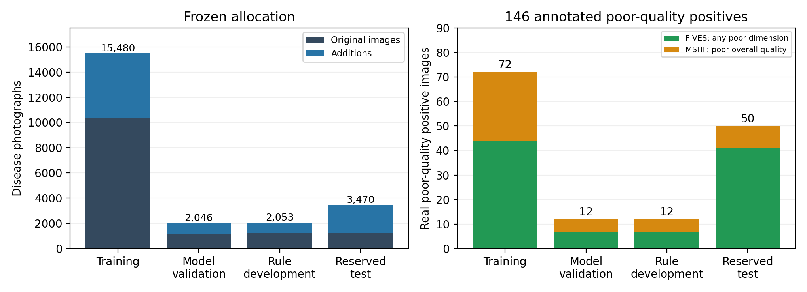
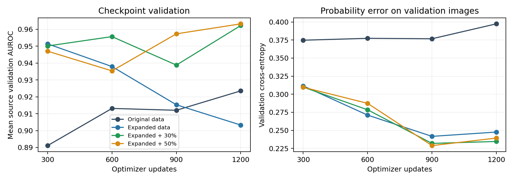
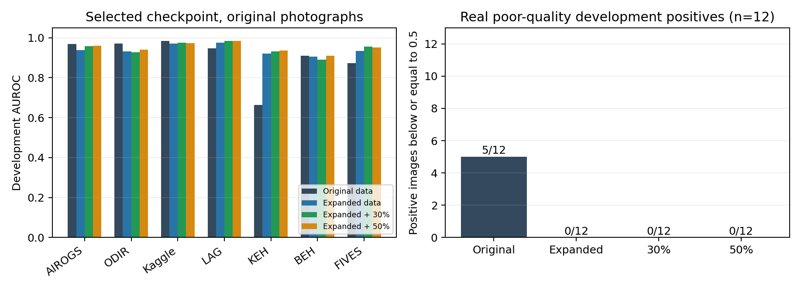

# Data integration, degradation audit, and new training results

November 13, 2026 · Eye Sentinel

[中文](training-results.zh.md) · [English PDF](training-results.en.pdf) · [Daily progress overview](../progress-overview.en.md)

## What this round completed

This report follows the same-day [data and degradation review](../data-review/data-and-degradation-review.en.md) and records the allocation, training, and development evaluation of the audited images. The [experimental analysis](../experimental-analysis/experimental-analysis.en.md) examines source differences, sampling, and checkpoint selection in more detail.

The fixed expanded_20261113 release combines the additions with the original disease cohort. Four EfficientNet-B0 arms start from the same ImageNet pretrained initialization and compare original data, expanded data, and expanded data with 30% or 50% degradation. Each completes 1,200 optimizer updates, or parameter adjustments, ending at that budget within the configuration's 20-epoch ceiling. Model validation selects checkpoints, while rule development supports post-training analysis and subsequent manual-review design. All arms use seed 20261113.

AUROC is the area under the receiver operating characteristic curve. It represents the probability that a randomly selected positive image scores above a randomly selected negative, with ties counting as half. A value of 0.5 corresponds to random ranking and 1 to complete separation. Misses and false positives are evaluated separately at specified screening thresholds.

The opening results use each arm's validation-selected checkpoint: update 300 for expanded clean and update 1,200 for the other arms. The matched update-1,200 comparison appears under “Additional check of checkpoint selection” and is also used in the daily overview and experimental analysis.

On the 305-image ODIR rule-development subset, with 28 positives, AUROC was 0.9712 for original-data training and 0.9323 for expanded-data training. The 30% and 50% degradation arms achieved 0.9281 and 0.9404. At the common display threshold of 0.5, misses among 12 real poor-quality positives were 5, 0, 0, 0, respectively. Expansion improves detection of these 12 poor-quality positives while reducing ranking on original ODIR photographs. The source-specific results and miss/false-positive counts below explain both changes.

On the 153-image KEH optic-disc-crop development subset, with 75 positives, the four AUROCs were 0.6627, 0.9212, 0.9321, 0.9368, respectively. KEH mainly contains optic-disc crops, with a different field of view from full fundus photographs. ODIR's 28 positive images form 19 confirmed positive linked groups; paired eyes and associated images in a group are handled together in statistical resampling.

## Data integration and the additional finding

The joint disease manifest contains 24,491 images. SHA256 checks image content, and full RGB decoding confirms that each image can be read. Every image passed these checks, and all 9,070 additions match the pixel identities recorded during the source review. Patient, same-eye, photograph-variant, and confirmed cross-source associations were combined before allocation. No linked group or identical decoded RGB image crosses roles. All 386 known patient identifiers have one role. Sources without patient identifiers are grouped by confirmed image relationships; their recorded group counts describe image groups.

Rebuilding the association graph independently found 18 original disease images linked to official EyeQ test groups. The new release removes 16 training and two model-validation images, and applies the existing 12-image rule-development repair. The same exclusions apply to the original-data control and all expanded arms. Historical models trained before this removal; subsequent evaluation involving these EyeQ groups uses this round's models.

| Role | Original images / positives | Additive images / positives | Total images / positives |
|---|---:|---:|---:|
| Training | 10,338 / 4,409 | 5,142 / 1,996 | 15,480 / 6,405 |
| Model validation | 1,188 / 487 | 858 / 336 | 2,046 / 823 |
| Rule development | 1,220 / 503 | 833 / 311 | 2,053 / 814 |
| Internal and new reserved tests | 1,233 / 489 | 2,237 / 803 | 3,470 / 1,292 |

ACRIMA's 705 images/396 positives and HYGD's 737 images/540 positives also retain their external-test roles. All 420 PAPILA images are held out as a complete source; its 87 positive images represent 47 known positive patients. The 105 official test images propagate test assignment to their entire linked groups. The 204 suspect images are retained separately; binary disease supervision uses explicit positive or negative labels. LAG, GRAPE, FIVES, Fundus-AVSeg, and MSHF use joint association grouping. KEH's optic-disc crop domain and source-specific clinical versus RG referral endpoints remain explicit.

Real poor-quality positives are allocated as 72 training, 12 model-validation, 12 rule-development, and 50 test images. FIVES uses at least one poor official quality dimension; MSHF uses official overall-quality code 0. Their definitions remain distinct. The 12 rule-development positives comprise seven FIVES and five MSHF images.

Figure 1 separates original and additive images by role, covering training, validation, development, and internal/new reserved tests. ACRIMA and HYGD external tests are listed separately in the text. The right panel shows the allocation of 146 real poor-quality positives by source and role, retaining each source's official quality definition.

## Degradation algorithms and author models

Five author releases were verified: CoFe-Net, ArcNet, FD3, Catintell, and CUNSB-RFIE. CUNSB's four checkpoints loaded with finite tensors; its generator matched the author code and ran once on a 320×320 image. The [degradation audit](degradation-audit.en.md) records version and execution details. This round uses the project acquisition simulator for disease training; the author network supports a separate restoration experiment.

Disease images are padded and resized to 320×320 before degradation and ImageNet normalization. Each draw selects illumination changes, defocus, or mild scatter with equal probability; defocus may add light noise or JPEG compression. Scatter reduces local contrast through smooth intensity mixing. Spatial blur scales with visible fundus-field diameter. Exposure spans 0.72–1.12, reference blur radius 0.5–2.0 at a 512-pixel field, and scatter opacity 0.03–0.10. Image identity, epoch, and seed determine replayable parameters; original black borders remain unchanged. Degradation probability is independent of disease label.

A descriptive comparison uses 18 HRF and 120 Real Fundus same-eye pairs. Median green-channel Laplacian-variance ratios relative to high-quality originals are 0.516 and 0.101 for real low-quality images, versus 0.805 and 0.719 for mild synthetic defocus. This statistic describes detail changes and also responds to noise and alignment. Quality training uses original images and their original quality targets; degradation applies to disease training.

## Training budget, sampling, and checkpoint selection

All arms share the manifest, validation roles, seed 20261113, 320-pixel inputs, batch size 16, AdamW learning rate 0.0001, and update budget. The original-data arm filters training origins only. Each image receives the inverse square root of its source/class image count as its sampling weight. Smaller combinations have higher individual draw probabilities. Adding sources changes the original sources' draw counts under this common rule. Distinct original images actually sampled were 8339, 9830, 9830, 9830, respectively; these counts remain separate from image variants. Realized degradation proportions were 30.1% and 50.1%.

Validation occurs every 300 updates. Checkpoints maximize the mean of 11 source-specific AUROCs where validation contains both classes; endpoints are evaluated within source before averaging. Resume and worker-loading consistency checks are retained in the supporting audit records.

| Arm | Training images | Selected update | Mean source validation AUROC | Real poor-quality positive misses |
|---|---:|---:|---:|---:|
| Original data | 10,338 | 1200 | 0.9235 | 5/12 |
| Expanded data | 15,480 | 300 | 0.9513 | 0/12 |
| Expanded + 30% | 15,480 | 1200 | 0.9622 | 0/12 |
| Expanded + 50% | 15,480 | 1200 | 0.9632 | 0/12 |

Figure 2 shows mean source AUROC on the left and cross-entropy over validation images on the right. Cross-entropy penalizes confident wrong probabilities. Nodes represent 300, 600, 900, and 1,200 updates. Expanded clean selects update 300; the other arms select update 1,200.

## Observed effects on rule-development photographs

The following AUROCs use each arm's selected checkpoint on the same rule-development originals. The complete results also retain AUPRC, the area under the precision–recall curve; Brier score, the mean squared difference between predicted probabilities and 0/1 labels; and calibration error. AUPRC depends on positive prevalence and is useful for comparisons within a source. Lower Brier scores indicate smaller probability errors.

| Source (images / positives) | Original | Expanded | 30% degradation | 50% degradation |
|---|---:|---:|---:|---:|
| AIROGS (773/380) | 0.9687 | 0.9374 | 0.9583 | 0.9593 |
| ODIR (305/28) | 0.9712 | 0.9323 | 0.9281 | 0.9404 |
| Kaggle (142/95) | 0.9830 | 0.9698 | 0.9742 | 0.9718 |
| LAG (481/169) | 0.9465 | 0.9750 | 0.9844 | 0.9832 |
| KEH (153/75) | 0.6627 | 0.9212 | 0.9321 | 0.9368 |
| BEH (33/8) | 0.9100 | 0.9050 | 0.8900 | 0.9100 |
| FIVES (27/13) | 0.8736 | 0.9341 | 0.9560 | 0.9505 |

Each arm also sets a source-specific threshold at the higher 95th percentile of its validation-negative scores, predicting positive only above the threshold. The table reports resulting sensitivity and specificity on rule development, distinguishing improved detection from a general score shift. The 95% target is set on validation; the development specificity in the table follows from the new case scores. With only 14 validation negatives, the FIVES rule selects the maximum negative score and achieves 100% validation specificity.

| Source | Original: sensitivity / specificity | Expanded | 30% degradation | 50% degradation |
|---|---:|---:|---:|---:|
| ODIR | 71.4% / 96.4% | 42.9% / 97.1% | 53.6% / 96.0% | 53.6% / 96.4% |
| AIROGS | 84.2% / 93.6% | 71.3% / 93.9% | 78.2% / 94.1% | 76.3% / 94.9% |
| FIVES | 61.5% / 92.9% | 61.5% / 100.0% | 76.9% / 92.9% | 92.3% / 78.6% |

All 49 admitted MSHF images are positive, so same-source specificity cannot be estimated. MSHF therefore contributes positive-detection results, while FIVES provides both positive detection and negative false positives.

Figure 3 compares seven major sources on the left and misses among 12 real poor-quality positives on the right. The common 0.5 threshold displays comparable counts; source validation thresholds are evaluated in the preceding table. The 12 poor-quality positives comprise seven FIVES and five MSHF images, and the combined count describes these fixed development photographs. Disease thresholds and manual-review rules will be chosen during subsequent development.

| Contrast (later arm minus reference) | Sensitivity change (percentage points) | Group-bootstrap 95% interval |
|---|---:|---:|
| Expanded − Original | +41.7 | [+16.7, +66.7] |
| 30% − Expanded | +0.0 | [+0.0, +0.0] |
| 50% − Expanded | +0.0 | [+0.0, +0.0] |

Intervals use 2,000 paired resamples of patient/linked image groups, comparing decisions on the same photographs. Only 12 positive images contribute. The experiment trains one seed, and the intervals describe case-sampling variation. Degradation and expanded clean make identical decisions on these 12 images, producing a zero difference in every resample. Differences in new cases require evaluation on a larger real-quality sample.

A fixed subset of 384 rule-development originals, comprising 146 positive and 238 negative images, was selected by identity hash. It was evaluated after defocus of radius 2 at a 512-pixel reference field and exposure multiplication by 0.70. Each cell is the count of misses / false positives, among 146 positives and 238 negatives respectively, at display threshold 0.5. Each original and its two variants belong to the same case observation.

| Condition | Original: misses / false positives | Expanded | 30% degradation | 50% degradation |
|---|---:|---:|---:|---:|
| Original | 30 / 16 | 28 / 20 | 21 / 13 | 23 / 14 |
| Mild defocus | 55 / 10 | 3 / 104 | 36 / 23 | 28 / 19 |
| Exposure multiplier 0.70 | 39 / 13 | 23 / 28 | 26 / 17 | 29 / 18 |

The expanded original-only arm misses just three defocused positives but produces 104/238 false-positive negatives, showing a general score shift on blurred images. The 30% and 50% degradation arms reduce these false positives to 23/238 and 19/238, with 36/146 and 28/146 misses. Under synthetic defocus, augmentation reduces false positives and increases misses. Real poor-quality positive results appear above, and real poor-quality negatives are a priority for the next evaluation. PAPILA, ACRIMA, HYGD, and the remaining reserved tests await the final model and review rules.

## Additional check of checkpoint selection

During training, a ranking change among HRF's four validation images shifted the mean source AUROC enough to select the expanded-data checkpoint at update 300. This observed issue motivated an additional development evaluation of all four budget-end checkpoints at update 1,200. The comparison retains the originally selected checkpoints and uses the same rule-development set.

| Arm at update 1,200 | ODIR AUROC | AIROGS AUROC | KEH AUROC | Poor-quality misses | Defocus false positives |
|---|---:|---:|---:|---:|---:|
| Original data | 0.9712 | 0.9687 | 0.6627 | 5/12 | 10/238 |
| Expanded data | 0.9315 | 0.9551 | 0.9333 | 0/12 | 68/238 |
| Expanded + 30% | 0.9281 | 0.9583 | 0.9321 | 0/12 | 23/238 |
| Expanded + 50% | 0.9404 | 0.9593 | 0.9368 | 0/12 | 19/238 |

This table is saved separately from selected-checkpoint results and helps identify how much of the original-source ranking decrease arises from earlier selection. The next experiment should predeclare primary sources with adequate positive/negative counts, increase seeds and update budgets, retain original/real poor-quality detection, specificity, and probability error, then lock disease thresholds and quality-guided review rules.

At update 1,200, expansion improves KEH AUROC from 0.6627 to 0.9333. Adding 50% degradation raises expanded-model ODIR AUROC from 0.9315 to 0.9404, below the original control's 0.9712. All expanded arms detect the 12 real poor-quality positives. The next comparison needs additional real-quality cases and a sampling design that maintains original-source training exposure.

At matched budgets under synthetic defocus, 50% degradation reduces false positives from 68/238 to 19/238 and increases misses from 18/146 to 28/146. The next experiment will evaluate fixed screening thresholds with real poor-quality negatives.

## Code, evidence, and reproduction

[Data audit](data-audit.en.md) · [Degradation audit](degradation-audit.en.md) · [Frozen cohort verification](../../../../data/prepared/expanded_20261113/cohort_verification.json) · [Complete comparison](../../../../runs/expanded_20261113/comparison.json) · [Budget-end checkpoint diagnosis](../../../../runs/expanded_20261113/budget_end_comparison.json) · [Four configurations](../../../../configs/expanded_20261113/) · [Launch script](../../../../tools/start_expansion_experiments_20261113.ps1)

Run directories retain best.pt, last.pt, step losses, validation curves, original and stress-condition development predictions, and degradation parameters. Weights bind configuration, initialization, manifest, release, and training-module fingerprints. Resume checks those inputs. Re-running the launch script verifies completed budgets and preserves these outputs. Use a new configuration and output directory for a changed budget or design.
