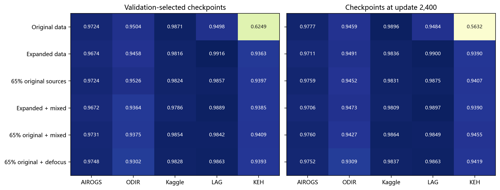
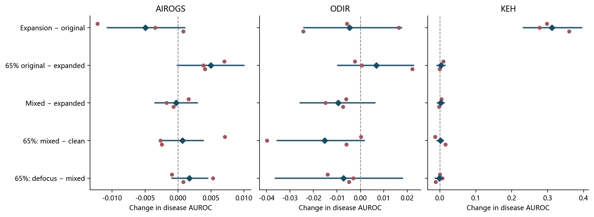
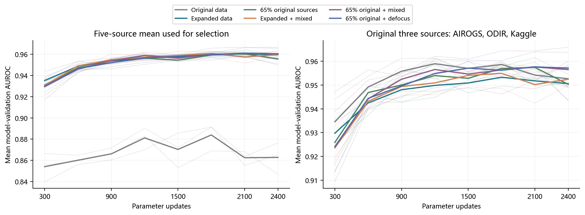
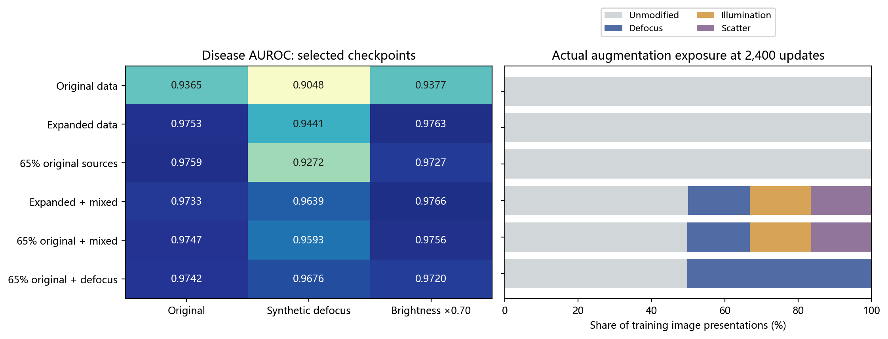
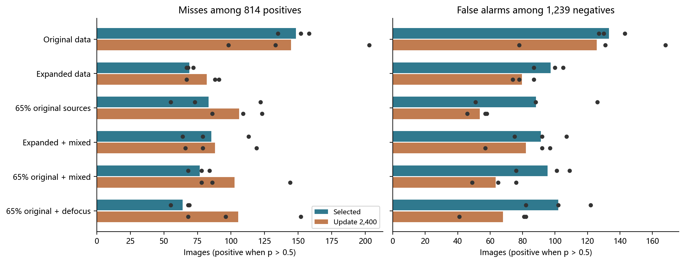
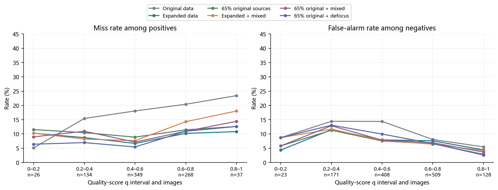
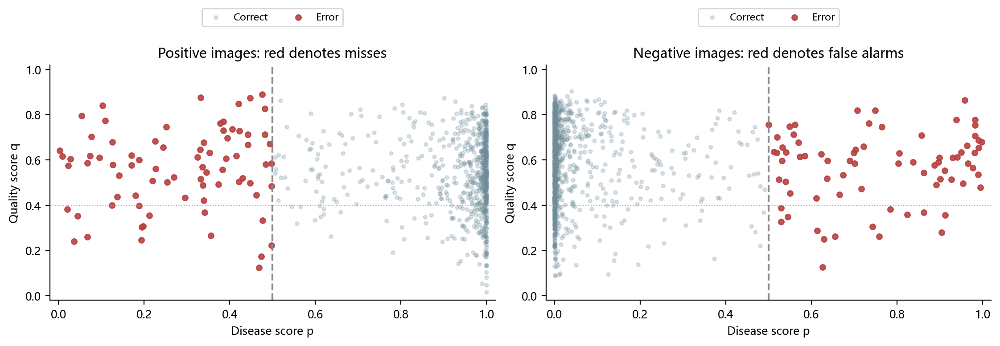
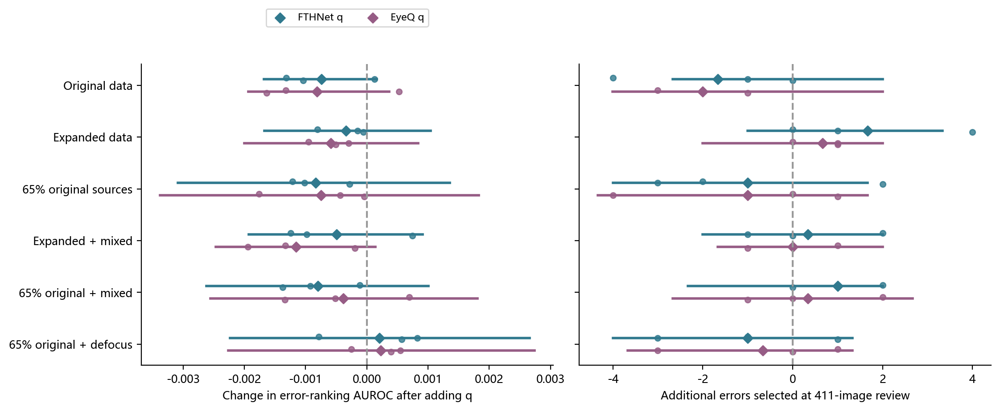
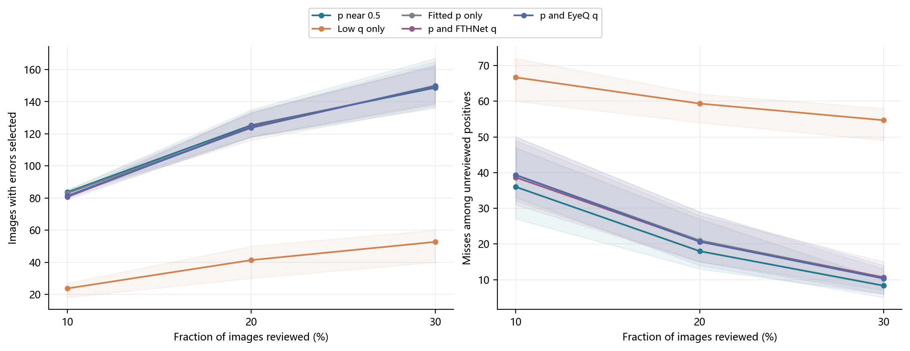
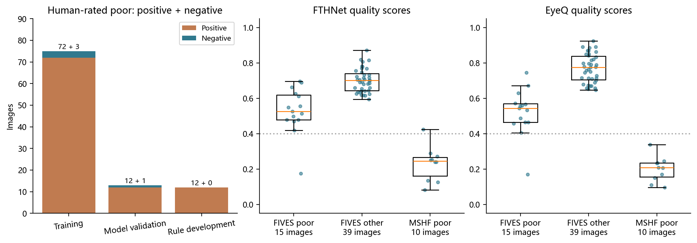

# Completed three-seed experiments: data expansion, degradation, and quality-guided review

November 15, 2026 · [中文](completed-results.zh.md) · [English PDF](completed-results.en.pdf)

Training and development evaluation are complete for all 18 runs: six conditions with three common random seeds, each trained for 2,400 parameter updates. The queue finished at 10:29 UTC. The complete results clarify the initial single-seed observations. Expansion consistently improves LAG and KEH. Restoring original-source sampling provides a small AIROGS gain, while ODIR changes direction across training stages. Degradation improves performance on synthetic defocus; classification on original photographs and manual-review gains require separate evaluation.

Across the 18 selected disease models, ranking errors by low quality scores gives AUROC 0.4923–0.5627, compared with 0.8248–0.8976 for ranking by proximity of the disease score to 0.5. When 411 images are reviewed, adding FTHNet quality scores selects between four fewer and four more errors than a fitted disease-score method. The main gains in this round come from disease-model and training-data improvements.

## Data and experiment design

The data version is expanded_20261113. The original-data control uses 10,338 training photographs; expanded conditions use 15,480. The shared model-validation set contains 2,046 photographs and selects checkpoints. The rule-development set contains 2,053 originals: 814 positives, 1,239 negatives, and 1,917 linked groups. Confirmed fellow-eye images, repeat photographs, and image variants are handled together within these groups. Higher disease scores p indicate a greater tendency to classify positive; higher quality scores q indicate better predicted photographic quality. The [project proposal](../../../../proposal-1106.pdf) uses both scores to select images for manual review; this round evaluates the additional value of q at equal review workloads. Final testing follows the selection of models, classification thresholds, and review rules.

The five principal sources contribute AIROGS 773 photographs (380 positives), ODIR 305 (28 positives in 19 positive linked groups), Kaggle 142 (95 positives), LAG 481 (169 positives), and KEH 153 (75 positives). The other sources contribute 199 photographs and enter the overall miss and false-alarm counts. AIROGS uses referral labels; the remaining sources retain their own disease definitions. Within-source AUROC compares positive and negative ranking within the same source.

All conditions use EfficientNet-B0 with the same ImageNet initialization, 320-pixel input, batches up to 16, and AdamW learning rate 0.0001. The seeds are 20261115, 20261116, and 20261117. Checkpoints and validation predictions are saved every 300 updates. One update adjusts model parameters using the errors in one sampled batch; the budget is 2,400 updates. Each run selects from eight saved validations using the equal mean AUROC over AIROGS, ODIR, Kaggle, LAG, and KEH.

“65% original” assigns approximately 65% of image presentations to original data sources and the rest to the added pool. Within each pool, sampling weights are the inverse square root of source-class counts. “Mixed” applies one randomly chosen illumination, defocus, or scattering transformation to approximately half of presentations. “Defocus” applies defocus to approximately half. Conditions without degradation retain the shared basic training transformations, including flipping.

The following table evaluates validation-selected checkpoints. Validation and development means are equal-weight five-source AUROCs. Misses and false alarms use p > 0.5 for positive classification; counts are averages across three seeds. Brier is the mean squared difference between the prediction score and the 0/1 disease label; lower values indicate smaller score errors.

| Condition | Selected updates (3 seeds) | Validation mean | Development mean | Misses | False alarms | Brier |
| --- | --- | --- | --- | --- | --- | --- |
| Original | 1800 / 1800 / 1200 | 0.8886 | 0.8969 | 148.3 | 133.3 | 0.1039 |
| Expanded | 2400 / 1800 / 2100 | 0.9619 | 0.9646 | 69.0 | 97.3 | 0.0615 |
| 65% original | 2100 / 1800 / 2100 | 0.9608 | 0.9666 | 83.3 | 88.3 | 0.0613 |
| Expanded + mixed | 2400 / 1800 / 1500 | 0.9610 | 0.9619 | 85.3 | 91.3 | 0.0631 |
| 65% + mixed | 2400 / 1200 / 2100 | 0.9634 | 0.9642 | 76.7 | 95.3 | 0.0608 |
| 65% + defocus | 2400 / 1500 / 2100 | 0.9623 | 0.9627 | 64.0 | 102.0 | 0.0617 |

## Expansion gains and the source-sampling tradeoff

Figure 1 shows three-seed mean disease AUROC within each source. The left panel uses validation-selected checkpoints; the right uses update 2,400 in every run. Darker cells indicate better ranking. These panels assess performance after the specified checkpoint-selection procedure and performance at a common update budget, respectively.

With selected checkpoints, clean expansion raises LAG from 0.9498 to 0.9916 and KEH from 0.6249 to 0.9363. The three LAG gains are +0.0472, +0.0383, and +0.0401; KEH gains are +0.2979, +0.2769, and +0.3593. Adding LAG and KEH as training sources provides a clear benefit from source coverage. Pooled development AUROC increases from 0.9365 to 0.9753.

Figure 2 shows paired changes for the three common seeds as red points, their mean as a diamond, and a 95% interval from 2,000 resamples of the same linked groups. Each resample uses the same cases for both conditions and averages changes across three fixed models. Intervals describe case sampling; individual points show training-seed variation. The expansion interval is [0.0280, 0.0555] for LAG and [0.2326, 0.3940] for KEH.

Under current expanded sampling, original-source photographs are presented 18,849 times on average by update 2,400, or 49.1% of presentations. The 65% condition presents them 24,950 times, approximately 32% more often. Restoring this exposure improves selected AIROGS AUROC in all three seeds, by +0.0070, +0.0038, and +0.0041, averaging +0.0050. LAG declines in all three seeds, averaging −0.0059. This is a tradeoff between training exposure to original and newly added sources.

Selected ODIR gains from expansion are −0.0057, +0.0164, and −0.0244. The 65% condition changes ODIR relative to current expanded sampling by −0.0023, +0.0006, and +0.0222. Direction varies substantially. ODIR has 28 positive photographs in 19 linked groups, with correspondingly broad case intervals. Further sampling comparisons should report sensitivity, false alarms, and training stage alongside AUROC.

## Selected checkpoints and end-of-budget results

Figure 3 uses the 2,046 model-validation photographs. Thick lines are means across three seeds; thin lines show individual seeds. The left panel is the five-source selection mean; the right uses only the original three sources. Expanded conditions improve five-source performance early, with smaller later gains. KEH has a substantial influence on the original-data control's five-source mean.

Selected updates range from 1,200 to 2,400. For 65% original plus mixed degradation, the selected updates are 2,400, 1,200, and 2,100; development misses are 78, 84, and 68. At the common update-2,400 budget, misses become 78, 144, and 86, while false alarms change from 76, 109, and 101 to 76, 49, and 65. In the second seed, 60 fewer false alarms accompany 60 additional misses, reflecting changes in scores and threshold behavior during training.

Source means at the common update-2,400 budget follow. Individual seeds and the information needed to calculate their standard deviations are retained in the [per-seed results](per-seed-results.csv).

| Condition | AIROGS | ODIR | Kaggle | LAG | KEH | Five-source mean |
| --- | --- | --- | --- | --- | --- | --- |
| Original | 0.9777 | 0.9459 | 0.9896 | 0.9484 | 0.5632 | 0.8850 |
| Expanded | 0.9711 | 0.9491 | 0.9836 | 0.9900 | 0.9390 | 0.9665 |
| 65% original | 0.9759 | 0.9452 | 0.9831 | 0.9875 | 0.9407 | 0.9665 |
| Expanded + mixed | 0.9706 | 0.9473 | 0.9809 | 0.9897 | 0.9390 | 0.9655 |
| 65% + mixed | 0.9760 | 0.9427 | 0.9864 | 0.9849 | 0.9455 | 0.9671 |
| 65% + defocus | 0.9752 | 0.9309 | 0.9837 | 0.9863 | 0.9419 | 0.9636 |

At this stage, the 65% condition improves AIROGS by an average +0.0048 and changes ODIR by −0.0039. The ODIR direction differs from the +0.0068 mean at selected checkpoints. Subsequent comparisons will use validation-selected checkpoints as the main result and update 2,400 as the common-budget supplement.

## Degradation: defocus gains and actual training exposure

Figure 4 uses selected checkpoints. Originals contain 2,053 photographs; each synthetic condition uses the same 384 parent images, including 146 positives and 238 negatives. Defocus applies Gaussian blur scaled to the visible field diameter; the brightness condition multiplies brightness by 0.70. The right panel summarizes the recorded composition of image presentations over all 2,400 updates.

Under current expanded sampling, mixed degradation improves defocus AUROC in all three seeds, with a mean gain of 0.0197, with case interval [0.0086, 0.0316]. Under 65% sampling, the mean gain is 0.0321. Defocus-only with 65% original sampling reaches defocus AUROC 0.9676, compared with 0.9593 for mixed degradation, improving all three seeds. Its five-source original-image mean decreases from 0.9642 to 0.9627, while brightness-condition AUROC decreases from 0.9756 to 0.9720.

Exposure frequency explains part of this comparison. Defocus accounts for approximately 17% of all presentations under mixed degradation and 50% under defocus-only. In the first seed these counts are 6,554 and 19,341, a 2.95-fold difference. The comparison changes both augmentation composition and defocus frequency. A defocus-only condition with approximately one-sixth application probability would match defocus exposure in the mixed condition and help separate these effects.

Defocus also moves positive and negative scores toward one another. In clean expanded models, applying synthetic defocus to the same parent images raises negative p by 0.0590 and lowers positive p by 0.0761 on average. With mixed degradation the changes are +0.0280 and −0.0617. Augmentation reduces these shifts, particularly the rise in negative scores. Detection in real poor-quality cases is assessed separately using human quality labels.

## Misses, false alarms, and classification thresholds

Figure 5 uses the same 2,053 rule-development originals and classification threshold 0.5. Bars show three-seed mean counts, with black points for individual seeds. Blue denotes selected checkpoints and brown update 2,400. Misses are counted among 814 positives; false alarms among 1,239 negatives.

At selected checkpoints, clean expansion averages 69.0 misses and 97.3 false alarms; 65% original plus mixed degradation averages 76.7 and 95.3; defocus-only averages 64.0 and 102.0. At this threshold, defocus-only detects more positives at the cost of more false alarms. At update 2,400, clean 65% sampling yields 26.0 fewer false alarms and 24.0 more misses than clean expanded sampling, changing total errors by -2.0. Total errors should be read alongside both components.

A second operating-point comparison sets each source threshold to the 95th percentile of its model-validation negative scores, then holds it fixed for rule-development originals. Results below are means across three seeds. The table reports the specificity actually achieved in rule development.

| Condition / source | Sensitivity | Specificity |
| --- | --- | --- |
| Expanded / AIROGS | 83.7% | 94.3% |
| Expanded / ODIR | 57.1% | 96.4% |
| 65% + mixed / AIROGS | 84.6% | 94.5% |
| 65% + mixed / ODIR | 48.8% | 97.1% |
| 65% + defocus / AIROGS | 87.3% | 94.1% |
| 65% + defocus / ODIR | 46.4% | 96.4% |

For ODIR, sensitivity under this procedure is 57.1% with clean expansion, 48.8% with 65% plus mixed degradation, and 46.4% with defocus-only. High classification AUROC can coexist with low sensitivity at a particular threshold. Threshold selection should specify the acceptable miss rate and show the associated false alarms and review workload.

## Quality and errors across the complete experiment

Figure 6 uses the original FTHNet quality score q and the 18 selected disease models. Lines show each condition's three-seed mean error rates. The n values below the axis are positive or negative image counts within each interval; the same cases are evaluated in every seed. Misses and false alarms use separate disease-class denominators.

Positive and negative composition differs across q intervals. Only 26 positives and 23 negatives have q < 0.2, while 654 positives and 1,045 negatives have q ≥ 0.4. Many errors in moderate-to-high q regions first reflect the large number of cases there. Positive miss rates remain substantial in the highest-q interval: 65% plus mixed degradation misses 6/37, 6/37, and 4/37 across seeds. Good overall image quality can accompany difficult disease classification.

Figure 7 shows the first seed's update-2,400 rule-development results for the condition with the highest mean validation score: 65% original plus mixed degradation. Blue-gray points denote correct classifications and red points errors, with positives on the left and negatives on the right. The vertical p=0.5 line is the classification threshold; q=0.4 marks a quality-score range for comparison. Misses and false alarms occur at multiple quality levels, so review regions require evaluation of p, q, and both error types.

## Additional review value of quality scores

For each fixed disease model, error ranking is fitted using five-fold group cross-validation. All images in one linked group stay in the same fold. The other four folds fit a model and generate predictions for the held-out fold. Logistic regression learns how input scores relate to the probability of error. The p-only method represents the direction of the disease score and its distance from 0.5; adding q learns how quality and disease scores act together. Both methods use the same folds within each disease model; standardization is fitted within the training folds. The comparison is repeated with the EyeQ quality model selected at epoch 17.

The AUROC below measures error ranking: the probability that a randomly drawn error image ranks above a randomly drawn correct image, with 0.5 indicating chance. The first three metrics are three-seed means. The final column lists the three seeds' additional errors selected after adding FTHNet q to fitted p, when reviewing the same 411 images.

| Condition | Low-q AUROC | p uncertainty AUROC | Adding q: AUROC change | Adding q: extra errors |
| --- | --- | --- | --- | --- |
| Original | 0.5433 | 0.8277 | -0.0007 | -4 / -1 / +0 |
| Expanded | 0.5235 | 0.8822 | -0.0003 | +0 / +1 / +4 |
| 65% original | 0.5402 | 0.8859 | -0.0008 | -2 / -3 / +2 |
| Expanded + mixed | 0.5110 | 0.8821 | -0.0005 | +2 / -1 / +0 |
| 65% + mixed | 0.5364 | 0.8879 | -0.0008 | +2 / +1 / +0 |
| 65% + defocus | 0.5392 | 0.8749 | +0.0002 | -1 / -3 / +1 |

Figure 8 includes FTHNet and EyeQ comparisons for every condition. Points denote seeds, diamonds means, and lines 95% intervals from 2,000 paired linked-group resamples. Each resample reranks images and keeps the reviewed count equal between methods. These intervals fix the disease models and generated out-of-fold risks, describing variation from case sampling.

For 65% plus mixed degradation, adding FTHNet q changes mean error AUROC by -0.00080, with case interval [-0.00262, +0.00101]. At 20% review it selects 2, 1, and 0 additional errors, averaging +1, with interval [−2.33, +2.00]. EyeQ also provides small increments. Adding source indicators to error models leaves the direction of q gains varying across seeds.

Figure 9 uses the three selected models from 65% plus mixed degradation. Lines are means; shading spans the minimum and maximum across seeds. The left panel counts errors referred for review, while the right counts positive misses left outside review. Both use photographs as the counting unit.

At the same 411-image workload, the following table summarizes the methods. Averaging integer counts across three models produces fractional values.

| Review ranking | Errors selected | Misses selected | Unreviewed misses |
| --- | --- | --- | --- |
| p near 0.5 | 125.3 | 58.7 | 18.0 |
| Low q only | 41.3 | 17.3 | 59.3 |
| Fitted p only | 123.7 | 55.7 | 21.0 |
| p and FTHNet q | 124.7 | 56.0 | 20.7 |
| p and EyeQ q | 124.0 | 56.0 | 20.7 |

Simple ranking by proximity of p to 0.5 selects 125.3 errors and 58.7 misses on average, leaving 18.0 unreviewed misses. Fitted p,q selects 124.7 errors and 56.0 misses, leaving 20.7. Photographic-quality recognition and disease-error recognition are different tasks; disease-score information accounts for most review gains in this round. The proposal comparison will retain simple p ranking and fitted p within the same classifier as controls, judging q by additional errors or misses captured at a specified review workload.

## How real poor-quality samples affect interpretation

Figure 10 summarizes the disease-label composition and allocation of human-rated poor-quality FIVES and MSHF photographs on the left; labels are positive + negative. The score panels use 54 FIVES and 10 MSHF originals from model validation and rule development. Points are photographs, boxes the interquartile range, and lines medians. FIVES defines poor quality as at least one poor dimension; MSHF uses its official overall quality grade.

Training contains 72 human-rated poor-quality positives and three negatives. Rule development contains 12 positives and no negatives; model validation contains one poor-quality negative. All 15 expanded models detect these 12 positives, while original-data controls miss 5, 5, and 4. Clean expansion also achieves 12/12, showing that detection improvement in this group already accompanies data expansion. Zero misses in 12 independent cases gives a one-sided 95% upper miss-rate bound of 22.1%. Poor-quality false alarms require independent negative cases for estimation.

The shortage has two components: few real poor-quality cases overall, and strong association of poor quality with disease label and source. Resampling increases presentations of the same cases; synthetic degradation adds transformations of existing cases. Real poor-quality negative acquisition can improve both training composition and false-alarm evaluation. Acquisition should prioritize independent cases with the same source and collection conditions, an explicit negative glaucoma diagnosis, and human quality labels. Under zero errors, at least 59 independent positives and separately 59 negatives would put each one-sided 95% error-rate bound below 5%; these are minimum planning references.

Human grades and continuous quality scores also require source-specific interpretation. The 15 human-rated poor FIVES development images have median q 0.5261, with only one below 0.4. The ten poor MSHF images have median 0.2453, with nine below 0.4. Within FIVES, FTHNet distinguishes poor human quality with AUROC 0.9026; EyeQ reaches 0.9641. Both models distinguish photographic quality; the weak result here is their additional ranking information for disease errors. Further human review should record overall image quality and the visibility of diagnostic optic-disc information.

## Next steps

Under the existing five-source validation criterion, 65% original plus mixed degradation is the candidate for subsequent work, with three-seed mean 0.9634. Its highest validation score is seed 20261117 at update 2,100, with mean 0.9665. Clean expansion remains the principal control for data expansion and quality review. The candidate condition's mean pooled development AUROC is 0.9747; at classification threshold 0.5 it averages 76.7 misses and 95.3 false alarms.

The priorities are to acquire real poor-quality negatives and independent positives with source-specific quality evaluation; select classification thresholds and compare residual misses and false alarms at equal review workloads while retaining disease-score controls; and match defocus presentations to separate defocus frequency from the other mixed transformations. Once models, thresholds, and review regions are specified, final testing will follow the frozen allocations.

Evidence is available in the [analysis JSON](completed-analysis.json) and [per-seed CSV](per-seed-results.csv); methods are implemented in the [analysis program](../../../../tools/analyze_completed_followup_20261115.py) and [report generator](../../../../tools/report_completed_followup_20261115.py). The [execution status](../../../../runs/followup_20261115/pipeline/status.json) records 18 completed runs. The [earlier quality analysis](../quality-and-training.en.md) preserves the training-launch snapshot. Chinese and English Markdown, PDF, LaTeX, and ten sets of bilingual figures share this directory.
