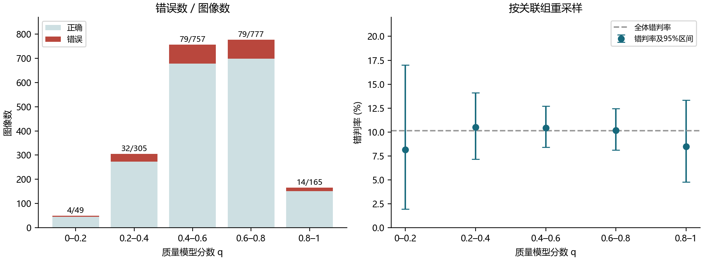
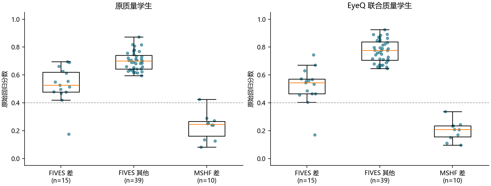
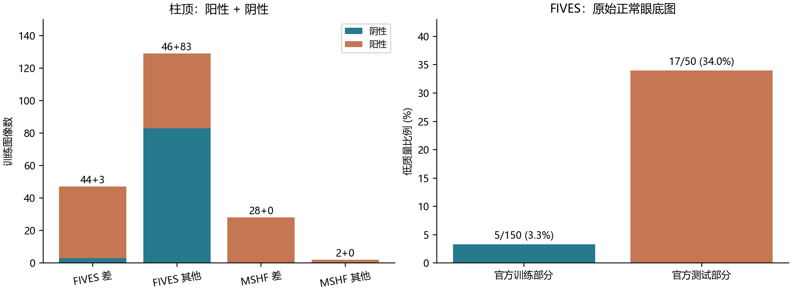
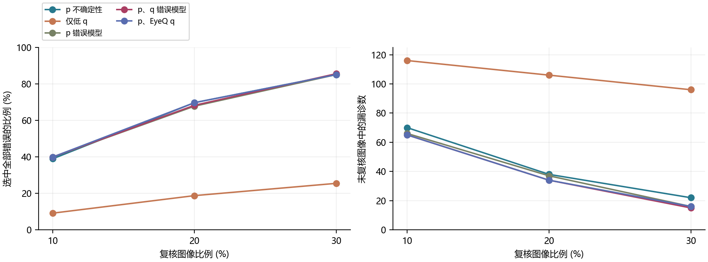

# 训练推进与质量相关错判分析

2026 年 11 月 15 日 · [English](quality-and-training.en.md) · [中文 PDF](quality-and-training.zh.pdf)

当前扩大数据集上的错判分布确实没有呈现出“质量越低，错误越集中”的简单关系。低质量病例不足限制了这一关系的估计。现有证据更直接地显示：真实低质量训练图像几乎全为阳性，质量评分标准在来源之间不同，而且疾病分数本身已包含较强的错误排序信息。现有开发结果尚未支持质量分数在疾病分数之外提供稳定的复核收益。

新一轮六方案、三种子训练已启动，计划每组完成 2,400 次有效优化更新。本文同时记录本轮训练状态和针对上述现象的统计分析，承接 [11 月 13 日实验](../2026-11-13/README.md)。

此前两套疾病模型、原质量模型与 EyeQ 质量模型均已完成 20 轮训练，见 [11 月 12 日记录](../2026-11-12/训练进展报告.md)；11 月 13 日四个固定预算实验也已全部完成。复核边界及最终测试尚待模型和规则确定。

## 数据与 proposal 的关系

[原 proposal](../../../proposal-1106.pdf)提出检验青光眼分数 p 和图像质量分数 q 能否共同定义人工复核区域；它没有预先保证错误必然集中在低 q 一侧。需要检验的是：相同复核量下，加入 q 能否比只用 p 更有效地选中错误和漏诊。

主要分析使用冻结版本 expanded_20261113 的 2,053 张规则开发原图，包括 814 张阳性、1,239 张阴性和 1,917 个关联组。关联组将已确认的双眼、同眼重拍或同图变体共同处理，用于划分和统计抽样。疾病分数来自 50% 混合退化方案第 1,200 次更新的预算结束权重；q 来自此前选中的 FTHNet 蒸馏质量学生：该模型学习既有质量模型的连续评分，数值越大表示预测质量越好。另以 2,046 张模型验证原图检查分布，并在相同 4,099 张原图上评价 EyeQ 质量模型。模型验证集已用于选模，规则开发集用于本次探索，最终保留测试尚未推理。

展示分类以 p 大于 0.5 判阳性。此阈值下，规则开发集有 124/814 张阳性漏诊、84/1,239 张阴性误报。各来源保留自己的疾病定义，例如 AIROGS 的转诊标签与其他来源的诊断标签；来源内结果用于解释差异。

## 分布变化：数量、比例和疾病类别

| q 区间 | 图像数 | 漏诊 / 阳性 | 误报 / 阴性 | 错判率 |
| --- | --- | --- | --- | --- |
| 0–0.2 | 49 | 3/26 | 1/23 | 8.2% |
| 0.2–0.4 | 305 | 13/134 | 19/171 | 10.5% |
| 0.4–0.6 | 757 | 50/349 | 29/408 | 10.4% |
| 0.6–0.8 | 777 | 48/268 | 31/509 | 10.2% |
| 0.8–1 | 165 | 10/37 | 4/128 | 8.5% |

图 1 左侧标注每个 q 区间的错误数 / 图像数；右侧为错判率及按关联组进行 2,000 次重采样的 95% 区间。q 小于 0.2 只有 49 张图像，占开发集 2.4%，其中错误 4 张。q 不低于 0.4 的图像占 82.8%，容纳 82.7% 的错误。中高 q 区域错误多，主要与该区域原图多一致；按区间计算的错判率约为 8%–10%，没有持续随 q 增大而下降。

低 q 对阴性误报和阳性漏诊的排序方向也不同：错误排序 AUROC 分别为 0.5950 和 0.4082。高 q 不能排除漏诊。例如 q 在 0.8–1 的区间有 37 张阳性，其中漏诊 10 张。开发集另有 50 个错误的 p 位于两端，即 p 不大于 0.1 或不小于 0.9；其中 41 个的 q 不低于 0.4。质量分数无法单独覆盖这些病例。

这类 AUROC 评价错误识别，含义是随机抽取一张错误图和一张正确图时，排序分数把错误图排在更前面的概率；0.5 表示随机排序。它与疾病分类 AUROC 是两个不同指标。仅按低 q 排序的开发 AUROC 为 0.5092 [0.4703, 0.5476]，模型验证集为 0.5238；原数据对照为 0.5683，扩展无退化为 0.5111，30% 和 50% 退化分别为 0.5154 和 0.5092。变化在扩展无退化中已经出现，不能单独归因于退化增强。

## 真实质量标注与 q 的尺度

图 2 使用模型验证集和规则开发集合计的 FIVES 54 张及 MSHF 10 张原图。FIVES 以至少一个质量维度为差定义低质量；MSHF 使用官方总体质量。各点是一张原图，箱体为四分位范围，中线为中位数；0.4 虚线只是方便比较数值，不是人工质量等级边界。

FIVES 的 15 张人工低质量图 q 中位数为 0.5261，39 张其他质量图为 0.7008；只有 1/15 张低质量图的 q 小于 0.4。MSHF 的 10 张总体低质量图中位数为 0.2453，9/10 张低于 0.4。FIVES 内部以低 q 区分人工差质量的 AUROC 为 0.9026，因此这些结果更支持“评分尺度和质量定义存在来源差异”，不能把它们概括为质量模型完全失效。全图质量也不直接等于视盘诊断信息的可见程度。

对同一批 4,099 张开发原图另行运行第 17 轮选中的 EyeQ 联合质量模型后，FIVES 人工质量的区分 AUROC 为 0.9641；加入该质量分数的错误模型 AUROC 为 0.8775，相对 p 模型差为 -0.0005，95% 区间为 [-0.0020, +0.0010]。两套质量模型均输出原始回归分数，后文在相同复核量下比较错误和漏诊检出。

本轮还核对两套质量训练清单与这批疾病开发图像的文件哈希，精确文件交集均为零；这项检查说明没有字节完全相同的训练图，其他已确认关联沿用冻结数据审计。

## 样本不足首先表现为低质量阴性缺失

图 3 左侧使用本次冻结训练清单，柱顶为阳性数 + 阴性数。FIVES 低质量训练图为 44 阳性、3 阴性；其他质量为 46 阳性、83 阴性。MSHF 低质量训练图为 28 阳性、0 阴性，其他质量也只有 2 张阳性。合计低质量训练图 75 张，72 张为阳性。FIVES 内低质量与阳性标签关联的优势比为 26.46：以阳性数除以阴性数得到的阳性优势，在低质量组是其他质量组的约 26 倍。这种组成让模型可能利用质量或来源线索，现有检出结果不能确定它只依据疾病特征。重复采样提高的是既有图像出现次数；此前实测低质量阳性出现 413 次、阴性仅 10 次。

图 3 右侧核对 FIVES 原始官方质量表。正常眼底图的低质量比例在官方训练部分为 5/150，即 3.3%；官方测试部分为 17/50，即 34.0%。这解释了开发数据缺少低质量阴性的部分原因。冻结后的规则开发集有 FIVES 7 张和 MSHF 5 张低质量阳性，没有低质量阴性；模型验证集仅有 1 张 FIVES 低质量阴性。因此，12/12 阳性被检出不能评价这一组的误报，也不足以证明质量鲁棒性已经稳定。

若 12 个独立阳性病例均无漏诊，精确二项分布的单侧 95% 漏诊率上界仍为 22.1%。在无错误的理想条件下，要把该上界压到 5% 以下，至少需 59 个独立病例；阴性误报率需要另有至少 59 个独立阴性病例。若错误率约 10%，希望 95% 区间半宽约 5 个百分点，常规近似需要约 139 个病例。这些数是每个拟评价层的规划参照，真实阳性和阴性应分别计数；关联图像不能当作新增独立病例。

本地 MSHF Healthy 工作表的 26 张图总体质量全部为良好。已有审计中，20 张为新来源内重复，另 6 张同时存在同图标签冲突，全部被排除。因此，本地 Healthy 文件无法直接补充新的低质量阴性。现有 FIVES 测试用途图像应继续用于最后评价。下一轮补样优先寻找同来源、同采集条件、有明确疾病阴性标签且带真实质量标注的病例；其他眼病图不能仅因文件夹未写青光眼就改标为阴性。

## 加入 q 后，复核效果是否改善

为减少在同一批图上拟合和评价边界的偏差，本轮使用五折关联组交叉验证：同一关联组的图像始终在同一折。用其余四折训练低复杂度逻辑回归错误模型，学习分数与错判之间的关系，再为留出折生成错误风险分数。p 模型使用 p 的对数几率、绝对对数几率及平方项，以表示分数朝向阳性还是阴性，以及离 0.5 多远；p、q 模型在此基础上增加 q 和两项交互。标准化只在每折训练部分拟合。疾病模型本身已经固定，这项交叉验证评价的是错误排序模型。

下面在相同 411/2,053 张图，即约 20% 的复核量下比较。仅 p 不确定性按 p 接近 0.5 排序，仅低 q 按 q 从低到高排序；其余为折外预测。并列分数按图像标识固定处理。

| 排序方式 | 错误 AUROC | 选中错误 / 208 | 选中漏诊 / 124 | 未复核错误 / 图像数 |
| --- | --- | --- | --- | --- |
| p 不确定性 | 0.8772 | 145/208 | 86/124 | 63/1642 |
| 仅低 q | 0.5092 | 39/208 | 18/124 | 169/1642 |
| p 错误模型 | 0.8780 | 141/208 | 87/124 | 67/1642 |
| p、q 错误模型 | 0.8783 | 142/208 | 90/124 | 66/1642 |
| p、EyeQ q | 0.8775 | 145/208 | 90/124 | 63/1642 |

图 4 分别展示选中的错误比例和留在自动结果中的漏诊数。加入 q 相对同结构 p 模型的错误 AUROC 差仅 +0.00029，按关联组配对重采样的 95% 区间为 [−0.00158, +0.00225]；AUPRC 汇总错误检出的精确率与召回率，分别表示选中图像有多少确实错误，以及全部错误中有多少被选中。其差为 +0.0067 [−0.0142, +0.0277]。在 20% 复核量下多选中 1 个错误；每次病例重采样都重新按分数排序，并为两种方法选中相同复核张数，所得 95% 区间为 [-2, +7]。加入来源指标后的增益同样很小，另两个分折种子也未显示明显增益。

EyeQ 分数对应的错误模型在约 20% 复核量下选中 145 个错误，其中 90 个为漏诊。与 p 不确定性相比，总错误数相同，但多选中 4 个漏诊，未复核漏诊由 38 降至 34。这项取舍值得后续检验，当前只是一次开发数据上的结果，不能由它推断稳定优势。

这些结果支持以 p 不确定性作为必要对照，继续检验 q 的额外信息。本轮容量匹配是在规则开发数据上做的探索，并未锁定部署阈值；自助区间固定了已经生成的折外分数，反映病例抽样，不包含重新拟合边界的全部不确定性。表中只计算哪些错误被送去复核，未假定真实专家一定纠正它们。

## 新训练正在检验什么

计划包含原数据无退化、扩展无退化、65% 原来源配额无退化、当前采样加 50% 混合退化、65% 配额加 50% 混合退化、65% 配额加 50% 仅失焦，共六个方案；随机种子为 20261115、20261116、20261117。所有方案均从相同 ImageNet 权重初始化 EfficientNet-B0，采用 320 像素输入、批量最多 16、AdamW 学习率 0.0001，各自训练 2,400 次有效参数更新，不是 20 个完成轮次。一次更新根据一批采样图像的误差调整参数；本实验的一轮按与训练池图像数相同的采样次数计，同一图像可重复出现。

原数据对照使用 10,338 张训练图，其余使用 15,480 张。每 300 次更新，在同一 2,046 张模型验证图上计算结果并保存完整权重和逐图预测。权重按 AIROGS、ODIR、Kaggle、LAG、KEH 的等权 AUROC 均值选择，避免此前四个极小来源占选模均值 36.4% 的情况。保留第 1,200 和 2,400 次更新，区分预算结束与选中权重。

65% 配额在原数据和新增数据内部继续使用来源与类别计数的平方根倒数采样。配额分散到连续的采样位置，截断训练预算也保持约 65% 原来源占比。上一轮原来源图像的出现次数由 19,186 降至 9,484。该设计可以检验恢复原来源出现次数是否改善 AIROGS 和 ODIR；它没有增加真实低质量病例数。仅失焦方案与混合方案使用相同应用概率和采样序列，以区分退化机制。

状态快照时间为 2026-11-15T06:28:42.791150+00:00。已完成训练预算 2/18 组，已完成开发评价 2/18 组，当前为 `seed20261115/quota65_clean`，驱动状态为 `training`。训练使用隐藏后台进程，结束当前对话后继续执行；断点恢复核对输入指纹。

| 运行 | 已评价更新数 | 五来源验证 AUROC 均值 |
| --- | --- | --- |
| seed20261115/expanded_clean | 2400 | 0.9610 |
| seed20261115/original_clean | 2400 | 0.8651 |
| seed20261115/quota65_clean | 900 | 0.9462 |

下表为已完成方案在规则开发原图上的疾病分类 AUROC：AIROGS 773 张（380 阳性）、ODIR 305 张（28 阳性）、Kaggle 142 张（95 阳性）、LAG 481 张（169 阳性）、KEH 153 张（75 阳性）。标为“选中”的权重由模型验证集决定。

| 运行 | 更新数 | AIROGS | ODIR | Kaggle | LAG | KEH |
| --- | --- | --- | --- | --- | --- | --- |
| 20261115 / 原数据 | 1200 | 0.9743 | 0.9375 | 0.9888 | 0.9426 | 0.5889 |
| 20261115 / 原数据 | 1800（选中） | 0.9793 | 0.9531 | 0.9892 | 0.9434 | 0.6431 |
| 20261115 / 原数据 | 2400 | 0.9796 | 0.9381 | 0.9937 | 0.9450 | 0.5593 |
| 20261115 / 扩展无退化 | 1200 | 0.9644 | 0.9569 | 0.9747 | 0.9893 | 0.9443 |
| 20261115 / 扩展无退化 | 2400（选中） | 0.9670 | 0.9474 | 0.9789 | 0.9907 | 0.9410 |

本轮首个种子 20261115 在相同 2,400 次更新下，扩展数据相对原数据的疾病 AUROC 变化为：AIROGS -0.0125、LAG +0.0457、KEH +0.3817、ODIR +0.0093。ODIR 的方向与前一轮第 1,200 次更新对照不同，两轮种子与预算也不同，因此它的变化需等待本轮三个共同种子完成后判断。低质量的 12 张开发阳性在本轮原数据对照仍漏诊 5 张，扩展无退化组为零；该组仍没有阴性病例。

另在第 2,400 次更新的疾病权重上，用同一批规则开发图像及原质量学生分数复查错误排序，结果如下。这里比较低 q 和 p 不确定性两个单独排序，未重新拟合 p、q 边界。

| 运行 | 错误数 / 图像数 | 低 q 错误 AUROC | p 不确定性错误 AUROC |
| --- | --- | --- | --- |
| 20261115 / 原数据 | 264/2053 | 0.5412 | 0.8301 |
| 20261115 / 扩展无退化 | 154/2053 | 0.5375 | 0.8717 |

这里的最新验证行表示相应更新时的结果；已有开发 AUROC 表按来源、按保存的更新权重报告。三种子全部完成后，才汇总种子间差异并判断采样及退化收益。最终保留测试仍等待模型、分类阈值和复核规则确定。

## 复现与证据

[统计数据](quality-error-analysis.json) · [训练快照](training-snapshot.json) · [分析程序](../../../tools/analyze_quality_errors_20261115.py) · [报告程序](../../../tools/report_quality_training_20261115.py) · [训练入口](../../../tools/start_followup_experiments_20261115.ps1) · [实时执行状态](../../../runs/followup_20261115/pipeline/status.json)

逐图连接与折外风险分数保存在本地 `runs/followup_20261115/error_ranking/`；质量分数推理、计划、每次验证权重和训练日志保存在新运行目录。报告数据记录输入文件 SHA256。中英文 Markdown、PDF、LaTeX 与图表放在同一日期目录，历史实验保持原样。
