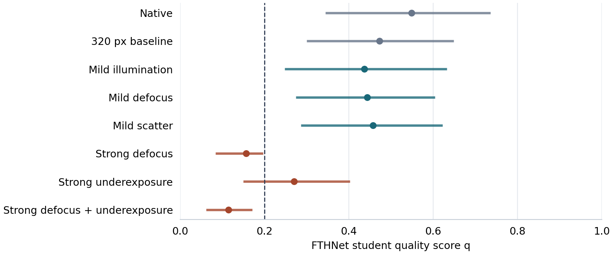

# Eye Sentinel quality scores and defocus training

November 16, 2026 · [Chinese](quality-alignment.zh.md) · [PDF](quality-alignment.en.pdf)

Three runs of defocus-only training with matched exposure are complete. When the number of defocus applications was similar, defocus-only and mixed training performed similarly on synthetic defocus. Defocus-only training improved on the unaugmented control in all three seeds. In the November 13 q–p plots, the distilled quality model scored about 2.4% of original images below 0.20. On validation images with paired FTHNet scores, the teacher and student assigned low scores to similar numbers of images.

## How defocus augmentation affects the disease model

The original 18 runs across six arms are complete. The new 16.7% defocus-only arm adds three training runs, each with 2,400 optimizer updates and a completed development evaluation. The four arms below use the same data splits, three seeds, and 65% sampling quota for the original sources. In the 50% mixed arm, illumination, defocus, and scatter are equally likely when an augmentation is applied. About one in six training presentations receives defocus. In table order, the average counts of defocus applications are 0, 6,547, 6,458, and 19,283. Each run contains about 38,384 image presentations, including repeat draws. [Training status](../../../runs/followup_20261115/matched_defocus/status.json)

Checkpoints were selected on 2,046 model-validation images using mean AUROC across AIROGS, ODIR, Kaggle, LAG, and KEH. The table averages the results for the selected checkpoint in each of the three seeds. The original rule-development set contains 2,053 images, with 814 positives and 1,239 negatives. Both synthetic conditions use the same 384 development images, including 146 positives. AUROC measures how well the model ranks positives above negatives.

| Training arm | Five-source validation mean | Development originals | Synthetic defocus | Synthetic underexposure |
|---------------------|----------------:|----------------:|-----------:|-------------:|
| No degradation | 0.9608 | 0.9759 | 0.9272 | 0.9727 |
| 50% mixed | 0.9634 | 0.9747 | 0.9593 | 0.9756 |
| 16.7% defocus only | 0.9635 | 0.9727 | 0.9628 | 0.9741 |
| 50% defocus only | 0.9623 | 0.9742 | 0.9676 | 0.9720 |

**Applying defocus about one sixth of the time gives results close to mixed augmentation on synthetic defocus.** The 16.7% defocus-only arm improved over the unaugmented control by 0.0356, with gains of +0.0547, +0.0354, and +0.0167 across the three seeds. The 95% case-sampling interval was [+0.0222, +0.0506]. The same arm was 0.0035 above mixed augmentation, with an interval of [−0.0028, +0.0097]. The intervals come from 2,000 paired resamples of linked case groups with the training seeds held fixed.

**Applying defocus more often brings a smaller additional gain.** At the common endpoint of 2,400 updates, the unaugmented, 16.7% defocus-only, and 50% defocus-only arms reached 0.9289, 0.9659, and 0.9724 on synthetic defocus. The first increase adds about 6,458 defocus applications and raises AUROC by 0.0371. The next adds about 12,825 applications and raises AUROC by 0.0064, with gains in all three seeds. Using the validation-selected checkpoints, the 50% arm averaged 0.0048 above the 16.7% arm, with a case-sampling interval that includes zero. These comparisons inform the choice of augmentation intensity in the next round. [Per-seed results and paired intervals](completed-matched-defocus.json)

**Original, underexposed, and real poor-quality images show where the gains apply.** On originals, the selected 16.7% defocus model averaged 0.0032 below the unaugmented control, with the same direction in all three seeds. At 2,400 updates, the difference narrowed to −0.0015 and its case-sampling interval included zero. At the 0.5 decision threshold, selected weights from the 16.7% arm averaged 74.0 misses and 109.3 false positives, compared with 83.3 and 88.3 for the unaugmented arm. The four arms performed similarly on underexposed images. All detected the same 12 human-rated poor-quality positives, which came from 12 linked groups. This human-rated subset contains zero negatives. The clearest training gain is improved performance under synthetic defocus.

## Low scores from the FTHNet teacher and student

The vertical axis in the November 13 q–p figures is the distilled quality model’s continuous score $q$. A higher score indicates better predicted overall image quality. Both development sets use original images. The independent test is scheduled after model and evaluation choices are fixed. [q–p figures and data description](../2026-11-13/progress-overview.en.md)

| Dataset | Images | $q<0.20$ | $q<0.10$ |
|---------------------------|----------:|----------------:|----------:|
| Rule development | 2,053 | 49 (2.39%) | 9 |
| Model validation | 2,046 | 50 (2.44%) | 12 |

Of the 49 low scores in rule development, 46 come from AIROGS, ODIR, and Kaggle. The low-score rate is 46/1,220 (3.77%) in those sources and 3/833 (0.36%) in the other sources. There are 26 positives and 23 negatives in the low-score group. At the 0.5 decision threshold, the selected 16.7% defocus models missed 0, 2, and 1 positives and produced 1, 1, and 3 false positives across the three seeds. These results mostly describe a small set of low-scoring originals from the three original sources.

File hashes matched the archived teacher and student scores for 1,188 model-validation images from the three original sources. FTHNet assigned scores below 0.20 to 41 images (3.45%), and the student did so for 44 (3.70%). The two scores fell below 0.20 together for 39 images, with two below the cutoff only for the teacher and five only for the student. The median absolute difference was 0.019. Low scores were already uncommon in the teacher output, and the student retained 39 of the teacher’s 41 low scores. Paired scores from the added sources would show how that comparison varies by source. [Paired score counts](completed-matched-defocus.json) · [Archived teacher and student scores](../../../data/audit/session_20261110/selected_validation/quality_student/validation_predictions.csv)

The cutoff $q<0.20$ identifies one range of the model score. Among 120 real same-eye pairs from Real Fundus, the student consistently gave the better photo a higher score, while just four of the poorer photos fell below 0.20. Pairwise ranking and low-score frequency describe different properties of the score. For glaucoma, the visibility of the disc and cup also determines how much information is available for interpretation. [Quality inventories](quality-inventories.json)

## Degradation strength and the quality score

The paired experiment used 12 images per disease class from each of five main development sources. The 120 photos come from distinct linked groups. Each photo received each of the listed degradations. The baseline used the disease model’s padding and 320-pixel resize, followed by resampling to the quality model’s input size. Strong defocus used Gaussian sigma 5 at a reference field diameter of 512 pixels. Strong underexposure multiplied brightness by 0.40. Misses use the 60 positive images and a decision threshold of 0.5.

| Condition, 120 images per row | Median change in $q$ | Newly below 0.20 | Misses |
|--------------------------|------------:|----------------:|--------:|
| 320 px baseline | 0.000 | 0 | 6 |
| Mild illumination | −0.026 | 2 | 6 |
| Mild defocus | −0.022 | 1 | 9 |
| Mild scatter | −0.018 | 2 | 5 |
| Strong defocus | −0.323 | 105 | 26 |
| Strong underexposure | −0.218 | 26 | 9 |
| Strong combined | −0.358 | 111 | 24 |

{width=95%}

Dots mark medians, bars span the 10th to 90th percentiles, and the dashed line marks $q=0.20$. Padding and resampling via 320 pixels shifted the median paired score by −0.058, more than any mild augmentation. With common preprocessing, each mild condition added just one or two images below 0.20. Strong defocus populated the low-score range and reduced disease AUROC from 0.974 to 0.907. Both measurements inform the choice of severity by showing low-score coverage and the change in disease discrimination. [Per-condition results](paired-summary.json)

## Implications for the next experiments

**Expand coverage with real poor-quality originals.** The training set has 72 positive and three negative photos rated poor by human graders. Rule development has 12 positives. Prioritize real poor-quality negatives with an independent diagnosis, then enrich positives by source and device. The local worklist already has 54 low-score photos and 30 controls drawn from 682 prescreened AIROGS NRG candidates. NRG denotes non-referral. To add clinically confirmed negatives, retain first-attempt failures and retakes from the same screening workflow, verify disease status against an independent same-eye reference, and keep associated photos in the same split. [Local candidate list](../../../runs/quality_alignment_20261116/airogs_blinded_quality_review.csv) · [AIROGS paper](https://arxiv.org/html/2302.01738)

**Set augmentation severity using real images.** Use same-eye retakes to establish realistic ranges for defocus, underexposure, and local occlusion, and document whether the disc and cup remain interpretable. Compare clean and degraded versions with common preprocessing and report quality scores, gradability, and disease metrics together. Use moderate variants with preserved diagnostic structures for disease training, then evaluate original, real poor-quality, and synthetic images separately. This comparison connects the observed defocus robustness to the quality measurements in the proposal. [Project proposal](../../../proposal-1106.pdf)

[Analysis script](../../../tools/analyze_matched_defocus_20261116.py) · [Training entry point](../../../tools/run_matched_defocus_20261116.py) · [Results and input hashes](completed-matched-defocus.json)
