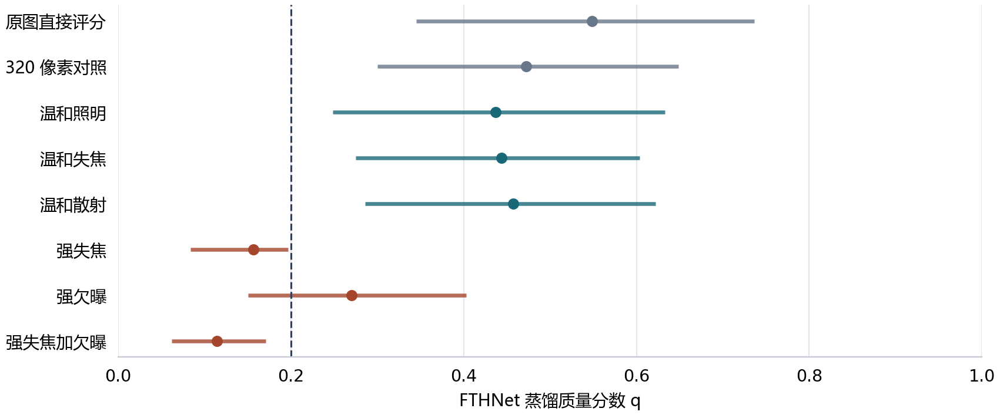

# Eye Sentinel 质量评分与失焦增强结果

2026 年 11 月 16 日 · [English](quality-alignment.en.md) · [PDF](quality-alignment.zh.pdf)

本轮完成三组匹配失焦次数的对照实验。以相近次数施加失焦，纯失焦训练和混合退化训练在合成失焦图上的结果接近。纯失焦训练相对无退化训练的收益在三个随机种子上均有体现。11 月 13 日 q–p 图中，蒸馏质量头约有 2.4% 的原图评分低于 0.20。在可与 FTHNet 教师配对的模型验证图上，两者给出的低分样本数接近。

## 失焦增强对疾病模型的影响

原六方案共 18 组训练已完成。本轮新增三个随机种子的 16.7% 纯失焦方案，每组训练 2,400 次参数更新并完成开发集评价。下表四个方案均使用相同的数据划分、三个随机种子和 65% 原来源采样比例。50% 混合方案每次从照明、失焦和散射中等概率选一种，失焦约占全部训练采样的六分之一。四个方案的平均失焦施加次数分别为 0、6,547、6,458 和 19,283 次。每组约有 38,384 次图像采样，其中包含对同一图像的重复采样。[训练完成记录](../../../runs/followup_20261115/matched_defocus/status.json)

疾病模型在 2,046 张模型验证图上选权重，标准是 AIROGS、ODIR、Kaggle、LAG 和 KEH 五个来源的平均 AUROC。表中开发结果用各次训练选出的权重计算，再对三个种子取平均。原图为规则开发集全部 2,053 张，含 814 张阳性和 1,239 张阴性。两种合成条件分别作用于同一批 384 张开发图，含 146 张阳性。AUROC 衡量模型将阳性排在阴性之前的能力。

| 训练方案 | 验证五来源平均 | 开发原图 | 合成失焦 | 合成欠曝 |
|-------------------|-------------:|---------:|---------:|---------:|
| 无退化 | 0.9608 | 0.9759 | 0.9272 | 0.9727 |
| 50% 混合退化 | 0.9634 | 0.9747 | 0.9593 | 0.9756 |
| 16.7% 纯失焦 | 0.9635 | 0.9727 | 0.9628 | 0.9741 |
| 50% 纯失焦 | 0.9623 | 0.9742 | 0.9676 | 0.9720 |

**以约六分之一的概率施加失焦，合成失焦结果与混合增强接近。** 16.7% 纯失焦组相对无退化组提高 0.0356，三个种子的增量为 +0.0547、+0.0354 和 +0.0167。病例抽样的 95% 区间为 [+0.0222, +0.0506]。该组相对混合组高 0.0035，区间为 [−0.0028, +0.0097]。区间由 2,000 次关联组配对重抽样计算，三个训练种子固定。

**增加失焦次数还有收益，平均增量较小。** 在相同的第 2,400 次更新处，无退化、16.7% 纯失焦和 50% 纯失焦的合成失焦 AUROC 分别为 0.9289、0.9659 和 0.9724。前一次增加约 6,458 次失焦，AUROC 提高 0.0371。再增加约 12,825 次，AUROC 提高 0.0064，三个种子均有提高。用验证选中的权重比较两个纯失焦组，50% 方案平均高 0.0048，病例抽样区间包含零。失焦次数的这组比较为下一轮选择训练强度提供了依据。[逐种子结果与配对区间](completed-matched-defocus.json)

**原图、欠曝和真实低质量结果决定增强能用到哪里。** 选中权重下，16.7% 纯失焦组的原图 AUROC 比无退化低 0.0032，三个种子方向一致。固定比较第 2,400 次更新时差距为 −0.0015，病例抽样区间包含零。在 0.5 的分类阈值下，选中的 16.7% 纯失焦权重平均漏诊 74.0 张、误报 109.3 张，无退化组为 83.3 和 88.3 张。合成欠曝下各组 AUROC 接近。四个方案都检出了开发集中同样 12 张人工标为低质量的阳性图，来自 12 个关联组。该人工分层中的阴性数为 0。现阶段的训练成果主要体现在合成失焦条件。

## FTHNet 教师与蒸馏质量头的低分分布

11 月 13 日 q–p 图的纵轴是蒸馏质量头的连续分数 $q$，分数越高表示模型预测的全图质量越好。规则开发集和模型验证集均使用原图。独立保留测试安排在模型与评价规则确定之后。[q–p 图及数据说明](../2026-11-13/progress-overview.zh.md)

| 数据 | 图像数 | $q<0.20$ | $q<0.10$ |
|---------------------------|----------:|----------------:|----------:|
| 规则开发集 | 2,053 | 49（2.39%） | 9 |
| 模型验证集 | 2,046 | 50（2.44%） | 12 |

规则开发集的 49 张低分图中，46 张来自 AIROGS、ODIR 和 Kaggle。三个原来源的低分比例为 46/1,220（3.77%），其余来源为 3/833（0.36%）。低分组有 26 张阳性、23 张阴性。在 0.5 的分类阈值下，选中的 16.7% 纯失焦模型在三个种子中分别漏诊 0、2、1 张，误报 1、1、3 张。结果主要反映这三个来源的少量低分原图。

在模型验证集中，教师历史评分与学生评分按文件哈希配对，共 1,188 张，来自上述三个来源。FTHNet 教师有 41 张（3.45%）低于 0.20，学生有 44 张（3.70%），其中 39 张两者都低于 0.20。另有 2 张仅教师低于 0.20，5 张仅学生低于 0.20。两者分数的绝对差中位数为 0.019。这批照片说明低分稀少在教师端就已存在，学生保留了教师低分的 39/41 张。后续可用同图评分判断新增来源是否也有这样的分布。[同图统计](completed-matched-defocus.json) · [原教师和学生记录](../../../data/audit/session_20261110/selected_validation/quality_student/validation_predictions.csv)

$q<0.20$ 对应质量模型的一个分数区间。作为真实图像上的参照，在 120 对 Real Fundus 同眼图中，学生每次都给较好图更高的分数，但较差图中只有 4 张低于 0.20。质量排序和低分数量各自反映分数的不同方面。拟评价的青光眼判读任务还需要知道视盘和杯盘区保留了多少诊断信息。[质量分数统计](quality-inventories.json)

## 退化强度与质量评分

将规则开发集的五个主要来源按疾病类别各取 12 张，共 120 张，来自 120 个关联组。每张图分别接受各种退化。对照图使用疾病模型训练的补边和 320 像素输入，然后按质量模型输入尺寸重采样。强失焦和强欠曝分别使用参考视野直径为 512 像素时的高斯标准差 5 和亮度乘数 0.40。疾病漏诊以 60 张阳性为分母，分类阈值为 0.5。

| 条件，每行 120 张 | $q$ 中位变化 | 新进入 $q<0.20$ | 漏诊 |
|--------------------------|------------:|----------------:|--------:|
| 320 像素对照 | 0.000 | 0 | 6 |
| 温和照明 | −0.026 | 2 | 6 |
| 温和失焦 | −0.022 | 1 | 9 |
| 温和散射 | −0.018 | 2 | 5 |
| 强失焦 | −0.323 | 105 | 26 |
| 强欠曝 | −0.218 | 26 | 9 |
| 强失焦加欠曝 | −0.358 | 111 | 24 |

{width=95%}

点为中位数，横线为第 10 至第 90 百分位，竖虚线标出 $q=0.20$。仅经过补边和 320 像素中间缩放，配对 $q$ 的中位变化为 −0.058，绝对值超过任一温和增强的中位变化。统一评分前处理后，三种温和增强各自只新增 1 至 2 张低分图。强失焦则使大量图像落入低分区，同时使疾病 AUROC 从 0.974 降至 0.907。两个结果一起提供了选强度的依据：记录低分覆盖，也记录疾病信息随退化减弱的程度。[逐条件结果](paired-summary.json)

## 对项目下一步的意义

**先扩大真实低质量原图的覆盖。** 训练集已人工标为低质量的图有 72 张阳性、3 张阴性。规则开发集有 12 张阳性，下一批优先补充有独立诊断标签的真实低质量阴性，再按来源和设备补阳性。当前已从 682 张预筛 AIROGS NRG 候选中整理出 54 张低分图和 30 张对照。NRG 表示未达到转诊标准。补充临床确诊阴性时，应优先保留同一筛查流程里的首拍失败图和同眼重拍，用同眼参考检查确认疾病状态，并把关联照片放在同一数据划分。[本地候选清单](../../../runs/quality_alignment_20261116/airogs_blinded_quality_review.csv) · [AIROGS 论文](https://arxiv.org/html/2302.01738)

**按真实图确定增强的强度。** 先用同眼重拍图确定失焦、欠曝和局部遮挡的范围，记录视盘与杯盘区是否可判读。对同一批原图比较原始输入和不同强度的变体，统一前处理，同时报告质量分数、可判读性和疾病指标。将保留诊断线索的中度变体用于疾病训练，并在原图、真实低质量原图和合成图上分别评价。这一步将把已经观察到的抗失焦收益与提案使用的质量分数联系起来。[项目提案](../../../proposal-1106.pdf)

[分析脚本](../../../tools/analyze_matched_defocus_20261116.py) · [训练入口](../../../tools/run_matched_defocus_20261116.py) · [结果与输入哈希](completed-matched-defocus.json)
