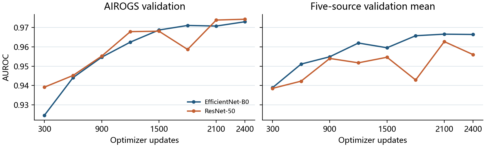

# Eye Sentinel matched backbone comparison

November 18, 2026 · [中文](backbone-comparison.zh.md) · [PDF](backbone-comparison.en.pdf)

**The matched ResNet-50 left 14 fewer misses on AIROGS development.** At 78 uncertainty-ranked reviews, misses fell from 35 with EfficientNet-B0 to 21 with ResNet-50 (paired 95% interval for the difference [-25, -3]). Both left 10 false positives. The pooled difference was -3 misses [-18, 12]. Adding quality to AIROGS review left 1 fewer miss with EfficientNet-B0 and 2 more with ResNet-50.

## Matched training

The historical ResNet-50 left fewer AIROGS misses in the gray-zone evaluation. It used the original training data and a different training protocol from the expanded EfficientNet-B0. We trained a ResNet-50 on the frozen `expanded_20261113` release, using EfficientNet-B0's seed 20261117, 65% original-source sampling quota, 50% mixed degradation probability, image size, batch size, and optimizer settings. Both models completed 2,400 optimizer updates. We compared their update-2,400 checkpoints. The architecture change includes the corresponding ImageNet initialization.

## Development results

The AIROGS cohort contains 773 photographs, of which 380 met the referral criterion. The pooled cohort contains 2,053 originals, including 814 positives under the respective source definitions. Each model used the 95th percentile of negative scores in the corresponding model-validation cohort as its classification threshold. The validation cohorts contained 767 and 2,046 photographs, respectively. All policies reviewed the same number within each development cohort, including 206 pooled.

| Model and review rule | AIROGS AUROC | AIROGS misses / false positives | Pooled AUROC | Pooled misses / false positives |
|---|---:|---:|---:|---:|
| EfficientNet-B0 · uncertainty | 0.9744 | 35 / 10 | 0.9776 | 56 / 26 |
| EfficientNet-B0 · + quality | 0.9744 | 34 / 11 | 0.9776 | 55 / 25 |
| Matched ResNet-50 · uncertainty | 0.9756 | 21 / 10 | 0.9766 | 53 / 26 |
| Matched ResNet-50 · + quality | 0.9756 | 23 / 10 | 0.9766 | 53 / 27 |
| Historical ResNet-50 · uncertainty | 0.9818 | 14 / 9 | 0.9361 | 134 / 25 |

AUROC measures discrimination across the full development cohort. Misses and false positives count photographs outside the review list. Uncertainty ranking gives priority to scores closest to the classification threshold on the log-odds scale. The quality rule adds `1 − q` to that ranking score, giving extra priority to lower-quality images. The joint EyeQ and FTHNet model supplies `q`, clipped to 0–1.

\newpage

## Paired differences and training curves

| Comparison | AIROGS misses | AIROGS total errors | Pooled misses | Pooled total errors |
|---|---:|---:|---:|---:|
| Matched ResNet-50 minus EfficientNet-B0 | -14 [-25, -3] | -14 [-26, -1] | -3 [-18, +12] | -3 [-21, +13] |
| Adding quality to EfficientNet-B0 | -1 [-3, +3] | +0 [-3, +5] | -1 [-4, +3] | -2 [-5, +5] |
| Adding quality to matched ResNet-50 | +2 [+0, +6] | +2 [+0, +6] | +0 [-3, +4] | +1 [-3, +5] |

A negative difference indicates fewer remaining errors for the first method. Brackets give 95% intervals from 2,000 paired resamples of linked groups. Each resample matches review capacity at about 10% across policies. These intervals capture variation across development cases. Replication is needed to estimate between-seed variation.

{width=96%}

The models matched on per-image draw counts, draws by source and class, and degradation exposure. Each run made 38,384 image draws, including repeats. Synthetic degradation was applied on 19,224 draws. ResNet-50 took about 21.5 minutes and skipped 0 updates under mixed precision. Their AIROGS validation AUROC values at update 2,400 were 0.9729 and 0.9743, respectively.

## Next validation priorities

Repeat the matched comparison using the other two established seeds to check whether the reduction in AIROGS misses recurs and extends to pooled development. Real poor-quality originals remain scarce. The earlier development audit found 12 human-graded poor-quality positives and zero such negatives. Before independent testing, specify the primary cohort, freeze thresholds and review rules, and define routing for positive calls and disposition after a same-eye retake. The reserved test cohorts remain sealed.

[Results and input hashes](backbone-results.json) · [Training configuration](../../../configs/backbone_20261118/resnet50.json) · [Analysis script](../../../tools/analyze_matched_backbones_20261118.py) · [Gray-zone evaluation](gray-zone.en.md)
