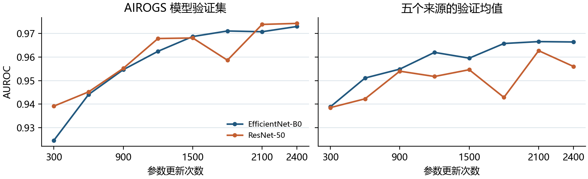

# Eye Sentinel 同协议模型对照

2026 年 11 月 18 日 · [English](backbone-comparison.en.md) · [PDF](backbone-comparison.zh.pdf)

**在 AIROGS 开发集上，同协议 ResNet-50 比 EfficientNet-B0 少漏诊 14 例。** 两种不确定性规则各复核 78 张原图，漏诊从 35 例降到 21 例，配对差值的 95% 区间为 [-25, -3]，两者各留下 10 例误报。合并开发集的漏诊差为 -3 例，区间为 [-18, 12]。在 AIROGS 上加入质量分后，EfficientNet-B0 少漏 1 例，ResNet-50 多漏 2 例。

## 训练对照

上一轮灰区分析中，历史 ResNet-50 在 AIROGS 上的漏诊较少。它使用原始训练数据，训练流程也与扩展版 EfficientNet-B0 不同。本轮在冻结的 `expanded_20261113` 数据上补训 ResNet-50，沿用 EfficientNet-B0 的种子 20261117、65% 原来源采样配额、50% 混合退化概率、输入尺寸、批大小和优化器设置。两者各完成 2,400 次参数更新，比较各自第 2,400 步检查点。架构与相应的 ImageNet 初始化一并变化。

## 开发集结果

AIROGS 有 773 张图，其中 380 张达到转诊标准。合并开发集有 2,053 张原图，其中 814 张按各来源标签定义为阳性。各模型使用对应验证集阴性分数的第 95 百分位作分类阈值，验证集规模分别为 767 和 2,046 张。每种规则在同一队列中复核相同数量，合并集为 206 张。

| 模型与复核规则 | AIROGS AUROC | AIROGS 漏诊 / 误报 | 合并 AUROC | 合并漏诊 / 误报 |
|---|---:|---:|---:|---:|
| EfficientNet-B0 · 不确定性 | 0.9744 | 35 / 10 | 0.9776 | 56 / 26 |
| EfficientNet-B0 · 加质量分 | 0.9744 | 34 / 11 | 0.9776 | 55 / 25 |
| 同协议 ResNet-50 · 不确定性 | 0.9756 | 21 / 10 | 0.9766 | 53 / 26 |
| 同协议 ResNet-50 · 加质量分 | 0.9756 | 23 / 10 | 0.9766 | 53 / 27 |
| 历史 ResNet-50 · 不确定性 | 0.9818 | 14 / 9 | 0.9361 | 134 / 25 |

AUROC 衡量整个开发队列的排序能力。漏诊与误报只统计复核名单之外的照片。疾病分数越接近分类阈值，按不确定性复核的优先级越高，距离在对数几率尺度上计算。质量规则再加 `1 − q`，所以质量越低，复核优先级越高。`q` 由联合 EyeQ 与 FTHNet 模型给出，并截断到 0–1。

\newpage

## 差值与训练过程

| 比较 | AIROGS 漏诊差 | AIROGS 总错误差 | 合并漏诊差 | 合并总错误差 |
|---|---:|---:|---:|---:|
| 同协议 ResNet-50 减 EfficientNet-B0 | -14 [-25, -3] | -14 [-26, -1] | -3 [-18, +12] | -3 [-21, +13] |
| EfficientNet-B0 加质量分 | -1 [-3, +3] | +0 [-3, +5] | -1 [-4, +3] | -2 [-5, +5] |
| 同协议 ResNet-50 加质量分 | +2 [+0, +6] | +2 [+0, +6] | +0 [-3, +4] | +1 [-3, +5] |

负值表示左列方法留下的错误较少。括号为 2,000 次按关联组配对重采样所得的 95% 区间。每次重采样都为各规则匹配约 10% 的复核容量。区间衡量这批开发照片的变异。种子间变异仍需补训估计。

{width=96%}

两个模型的逐图采样次数、来源与类别分布、各类退化次数一致。每组训练共采样 38,384 次，其中 19,224 次施加合成退化。ResNet-50 用时约 21.5 分钟，混合精度训练跳过更新 0 次。第 2,400 步的 AIROGS 验证 AUROC 分别为 0.9729 和 0.9743。

## 下一轮验证重点

先用另外两个既定种子复现 AIROGS 的漏诊差异，并检查合并队列是否也有收益。真实低质原图仍是独立缺口。上一轮开发集只有 12 张有人工低质标记的阳性原图，阴性为零。独立测试前仍需确定主队列、锁定阈值和复核规则，并明确阳性分流与同眼重拍后的处置。预留测试集继续封存。

[汇总数据与输入哈希](backbone-results.json) · [训练配置](../../../configs/backbone_20261118/resnet50.json) · [分析脚本](../../../tools/analyze_matched_backbones_20261118.py) · [灰区评估](gray-zone.zh.md)
