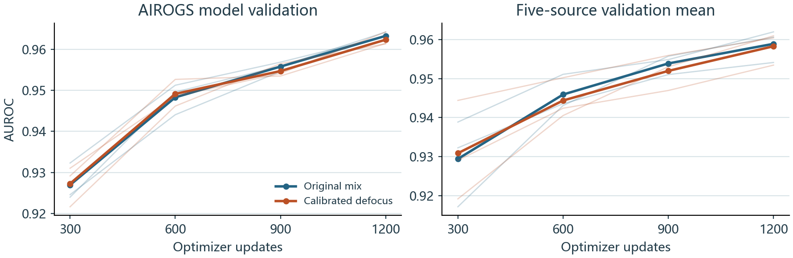
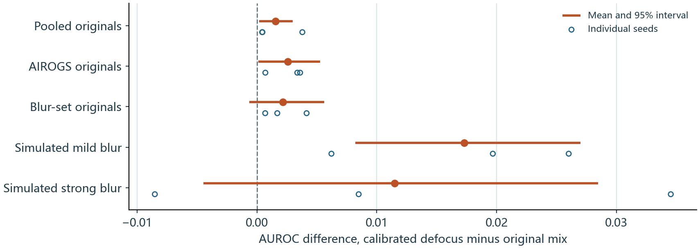
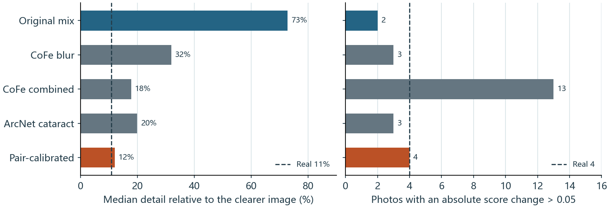
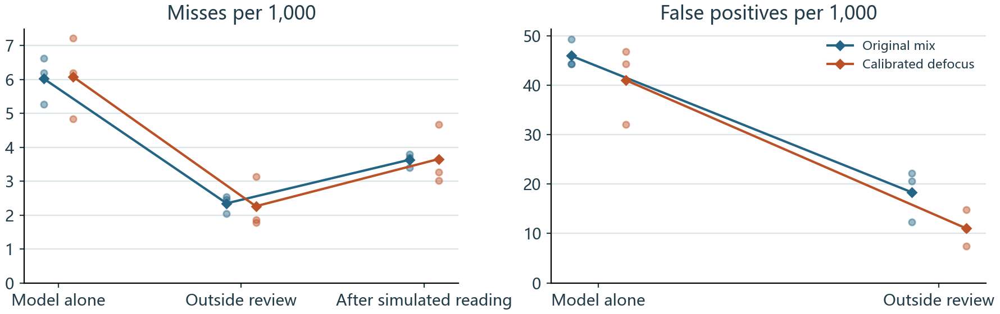
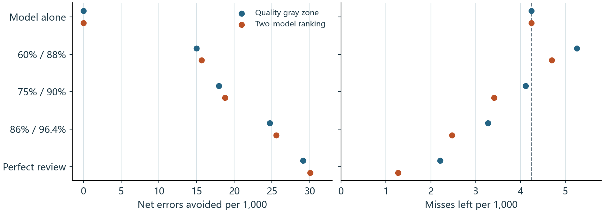

# Same-eye calibration of fundus degradation and review

Eye Sentinel · November 18, 2026 · [中文](calibrated-defocus.zh.md) · [PDF](calibrated-defocus.en.pdf)

**Calibrated defocus reduced the loss in ranking performance under mild simulated blur.** Across three matched training runs, AUROC on original AIROGS development images rose from **0.9687 to 0.9713**. With 3.2% referral positives and 10% review, false positives outside review fell from **18.3 to 11.0 per 1,000 photos**. Misses changed from **2.35 to 2.26 per 1,000**, with an interval that includes zero. Each comparison lists the original mix first.

## Matched training

| Item | Setting |
|---|---|
| Disease classifier | EfficientNet-B0 with 320 × 320 pixel fundus inputs |
| Training and model validation | 15,480 training images and 2,046 validation images |
| Comparison point | Three existing random seeds, weights at exactly 1,200 optimizer updates |
| Original mix | Augment about half of training draws, equally across illumination, defocus and scatter |
| Calibrated defocus | Keep the same draws and replace the image operation for the defocus cases |

Original defocus combines Gaussian blur with noise or JPEG compression. Calibrated defocus applies blur and exposure drawn from a parameter bank fitted on 60 Real Fundus pairs. The experiment compares the full change to the defocus recipe. The calibrated median radius is 1.7 pixels at a 512-pixel field and the median exposure multiplier is 0.99. The three seeds drew defocus 3,292 / 3,228 / 3,306 times, respectively. Per-image sampling, source and label counts, and degradation-family draws matched the control in every seed.

{width=98%}

**AUROC** is the probability that a randomly chosen positive receives a higher score than a randomly chosen negative, with ties counted as half. Validation was run every 300 updates. The pilot compares the prespecified update-1,200 checkpoints on development data. The reserved independent tests remain sealed. [Frozen data release](../../../data/prepared/expanded_20261113/README.en.md) · [Calibration profile](../../../configs/calibrated_defocus_20261118/profile.json) · [Training code](../../../tools/run_calibrated_defocus_20261118.py) · [Evaluation code](../../../tools/evaluate_calibrated_defocus_20261118.py)

\newpage

## Originals, simulated blur and real low-quality images

| Development condition | Images | Original mix AUROC | Calibrated defocus AUROC |
|---|---:|---:|---:|
| All development originals | 2,053 | 0.9716 | 0.9731 |
| AIROGS development originals | 773 | 0.9687 | 0.9713 |
| Originals in blur subset | 384 | 0.9755 | 0.9777 |
| Mild blur | 384 | 0.9496 | 0.9669 |
| Strong blur | 384 | 0.9000 | 0.9115 |

{width=98%}

We kept the same 384 images and applied both blur levels to each. At a 512-pixel field, Gaussian blur radii were 2 and 5 pixels. After accounting for the difference on those same originals, the **difference in AUROC change** was **+0.0151** [+0.0070, +0.0236] under mild blur and **+0.0093** [-0.0060, +0.0251] under strong blur. A positive value means the calibrated arm lost less AUROC. Intervals use 2,000 paired linked-group resamples with the three seeds fixed. A linked group keeps photographs of the same known patient or related images together.

AIROGS positives met the reference criteria for glaucoma referral. Pooled originals and the blur subset also include other sources with their own label definitions. They measure comparative model behavior across this group of datasets.

| Quality group in real originals | Positive | Negative | Positive calls at a disease score > 0.5 by seed |
|---|---:|---:|---|
| Human-labeled low quality | 12 | 0 | Original 12 / 12 / 11 · Calibrated 12 / 12 / 12 |
| Model quality score below 0.20 | 29 | 38 | Original 25 / 27 / 26 · Calibrated 24 / 27 / 28 |

FIVES marks poor focus, illumination or contrast. MSHF uses a poor overall quality grade. The low model-quality group has an EyeQ–FTHNet score below 0.20. The human-labeled subgroup contains no negatives, so it cannot estimate false positives there. [FIVES dataset](https://www.nature.com/articles/s41597-022-01564-3) · [MSHF dataset](https://www.nature.com/articles/s41597-023-02188-x)

\newpage

## What the simulation reproduces

We fit a profile on 60 Real Fundus pairs and compared image versions on 60 other pairs. The split uses photo-pair IDs because patient IDs are unavailable. Starting from the clearer photograph, we compared the real poorer photo with the original mix, the author versions of CoFe and ArcNet, and calibrated blur plus exposure.

{width=98%}

The median detail statistic relative to the clearer same-eye photo was **11%** for real poorer photos, **73%** for the original mix, and **12%** for calibrated blur plus exposure. The combined CoFe simulation and ArcNet cataract simulation retained **18%** and **20%**. Their outputs were respectively darker and brighter than the real poorer photos on the mean luminance measure. They provide distinct acquisition stress tests. [Real Fundus](https://arxiv.org/abs/2201.00466) · [CoFe-Net](https://arxiv.org/abs/2005.05594) · [ArcNet](https://arxiv.org/abs/2203.07737)

Calibration improved agreement on the detail statistic. Under the same frozen disease classifier, an absolute score change greater than 0.05 occurred in **4/60** real pairs, **2/60** using the original mix and **4/60** using calibrated blur plus exposure. The original mix was slightly closer across the full distribution of score changes. These pairs have quality comparisons and lack glaucoma reference outcomes. A Rotterdam population study inspected 100 ungradable photographs and found incomplete optic disc capture in 98. The next acquisition study should record whether the disc is fully in frame. [Population screening study](https://www.aaojournal.org/article/S0161-6420%2826%2900846-8/fulltext) · [Image metrics and scores](review-degradation-benchmark.json)

\newpage

## At a 10% review budget

We reweighted 773 AIROGS development photos to **3.2% referral positives** and reviewed 100 per 1,000. Each model used the 95th percentile of its negative validation scores as its classification threshold. The gray zone prioritized scores close to that threshold and lower quality. A miss is a negative call on a reference-positive photo. A false positive is a referral call on a reference-negative photo. Outside review refers to photos omitted from the review list.

{width=92%}

Per 1,000 photos, misses outside review changed by **−0.08**, with a 95% interval of [−0.47, +0.40]. False positives changed by **−7.30**, with an interval of [−14.27, −1.46]. The gray zone routed **60.3%** and **70.1%** of initial model errors. Under the reader scenario, final missed referrals were **3.63 to 3.65** per 1,000.

{width=92%}

The trained EyePACS readers achieved 86% sensitivity and 96.4% specificity, used here as a scenario for the review list. Sensitivity is the share of positives read correctly. Specificity is the share of negatives read correctly. At lower sensitivity, total errors can fall while missed referrals rise. Clinical benefit requires patient-level evaluation with independent reference examinations and final referral outcomes. [EyePACS reader study](https://pubmed.ncbi.nlm.nih.gov/37113471/) · [Earlier two-model analysis](review-failures.en.md) · [Results and hashes](calibrated-defocus-results.json)
