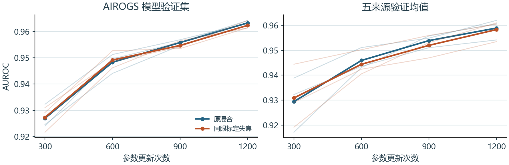
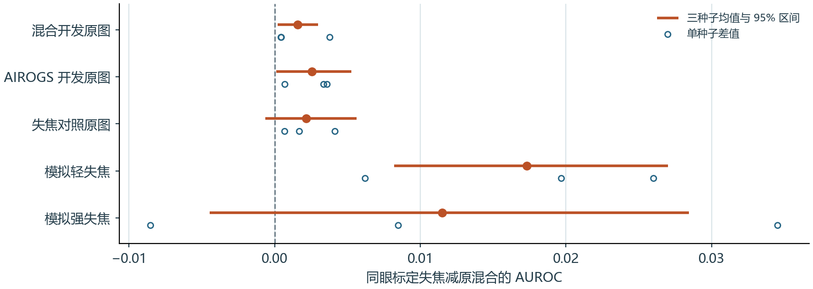
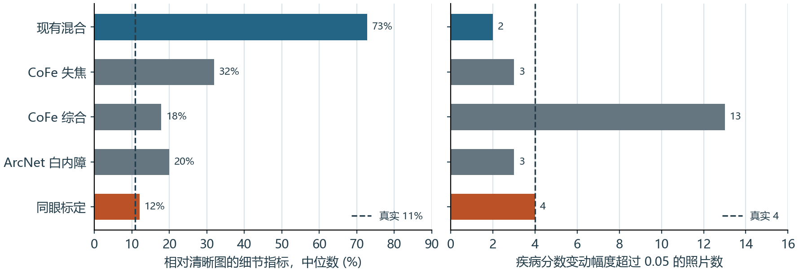
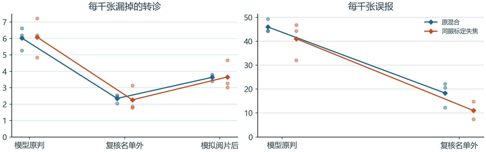
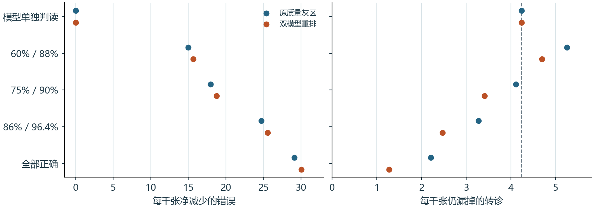

# 同眼照片标定的眼底退化训练与复核评估

Eye Sentinel · 2026 年 11 月 18 日 · [English](calibrated-defocus.en.md) · [PDF](calibrated-defocus.zh.pdf)

**同眼标定失焦让模型在轻失焦下的排序表现下降得更少。** 三组配对训练后，AIROGS 开发原图的 AUROC 从 **0.9687 升至 0.9713**。在 3.2% 转诊阳性、10% 复核的情景下，每千张留在复核名单外的误报从 **18.3 降至 11.0**，漏诊从 **2.35 到 2.26**，漏诊差值的区间包含零。下文箭头均从原混合指向同眼标定失焦。

## 训练怎样配对

| 条件 | 固定设置 |
|---|---|
| 疾病模型 | EfficientNet-B0，输入为 320 × 320 像素眼底图 |
| 训练与模型验证 | 15,480 张训练图；2,046 张模型验证图 |
| 比较时间点 | 三个既定随机种子，每种方案比较第 1,200 次参数更新的权重 |
| 原混合退化 | 约半数训练抽样施加退化，照明、失焦、散射三类等概率 |
| 同眼标定失焦 | 沿用原抽样；只替换原来抽到失焦时的图像处理 |

原失焦用随机高斯模糊并加噪声或 JPEG 压缩。同眼标定失焦根据 60 对 Real Fundus 照片拟合的参数，施加模糊和曝光变化。因为二者一起变化，本轮比较的是整套失焦处理。按 512 像素视野换算，标定模糊的中位半径为 1.7 像素，曝光倍率中位数为 0.99。三种子抽到失焦的次数依次为 3,292 / 3,228 / 3,306。每个种子的逐图抽样次数、来源和类别、各退化类型次数均与对照完全一致。

{width=98%}

**AUROC** 衡量分数排序，等于随机抽一张阳性和一张阴性时，阳性分数排在前面的概率，同分计一半。每 300 次更新记录一次。本轮按预定的第 1,200 次更新比较，开发集用于评估方案，预留独立测试集仍封存。 [冻结数据说明](../../../data/prepared/expanded_20261113/README.md) · [标定参数](../../../configs/calibrated_defocus_20261118/profile.json) · [训练脚本](../../../tools/run_calibrated_defocus_20261118.py) · [评估脚本](../../../tools/evaluate_calibrated_defocus_20261118.py)

\newpage

## 原图、模拟失焦和真实低质量图

| 开发图条件 | 图像数 | 原混合 AUROC | 同眼标定失焦 AUROC |
|---|---:|---:|---:|
| 全部开发原图 | 2,053 | 0.9716 | 0.9731 |
| AIROGS 开发原图 | 773 | 0.9687 | 0.9713 |
| 失焦子集的原图 | 384 | 0.9755 | 0.9777 |
| 轻失焦 | 384 | 0.9496 | 0.9669 |
| 强失焦 | 384 | 0.9000 | 0.9115 |

{width=98%}

同一批 384 张照片分别保留原图并生成两种模拟失焦图。轻、强失焦的高斯模糊半径分别为 512 像素视野下的 2 和 5。比较模糊前后变化后，标定组比原混合组的 **AUROC 变化差**，轻失焦为 **+0.0151** [+0.0070, +0.0236]，强失焦为 **+0.0093** [-0.0060, +0.0251]。正值表示标定组的降幅较小。区间来自 2,000 次按关联组配对重抽样，固定三个训练种子。关联组把已知同一患者或有关联的照片作为一个抽样单位。

AIROGS 的阳性表示达到青光眼转诊标准。混合开发图和失焦子集还含其他来源，各自沿用原标签，因此这些合并结果用于比较模型行为。

| 真实原图质量分层 | 阳性 | 阴性 | 两方案三种子检出的阳性（分类分数 > 0.5） |
|---|---:|---:|---|
| 原数据人工标为低质量 | 12 | 0 | 原混合 12 / 12 / 11 · 标定 12 / 12 / 12 |
| 模型质量分低于 0.20 | 29 | 38 | 原混合 25 / 27 / 26 · 标定 24 / 27 / 28 |

FIVES 在模糊、照明或低对比度任一维度标差时计入；MSHF 按整体质量标差计入。模型低质量分层是联合 EyeQ 与 FTHNet 的评分低于 0.20。真实人工标注组没有阴性，测不了该组误报率。 [FIVES 数据论文](https://www.nature.com/articles/s41597-022-01564-3) · [MSHF 数据论文](https://www.nature.com/articles/s41597-023-02188-x)

\newpage

## 模拟在哪些方面接近实拍

用 60 对 Real Fundus 照片拟合参数，再用另 60 对比较。数据按照片对划分，缺少患者标识。在每对中，以较清晰照片为起点，比较真实较差照片、原混合退化、按作者实现生成的 CoFe 和 ArcNet 退化，以及同眼标定的模糊加曝光。

{width=98%}

真实较差图的细节指标中位数为同眼较清晰图的 **11%**，原混合为 **73%**，同眼标定为 **12%**。CoFe 综合退化和 ArcNet 白内障模拟分别为 **18%** 和 **20%**，但平均亮度比实际照片偏暗、偏亮。作者方案能作为不同成像问题的对照。 [Real Fundus](https://arxiv.org/abs/2201.00466) · [CoFe-Net](https://arxiv.org/abs/2005.05594) · [ArcNet](https://arxiv.org/abs/2203.07737)

同眼标定改善了细节指标的接近程度。用已训练的同一疾病模型比较时，真实较差照片有 **4/60** 分数变动幅度超过 0.05，原混合为 **2/60**，同眼标定为 **4/60**。按分数变化的全分布比较，原混合略近。该照片集提供同眼质量对照，缺少青光眼参考标签。鹿特丹人群研究对 100 张不可判读照片的抽查中，98 张视盘取景不全。下一轮应记录视盘是否完整入镜。 [真实筛查取景研究](https://www.aaojournal.org/article/S0161-6420%2826%2900846-8/fulltext) · [逐指标结果](review-degradation-benchmark.json)

\newpage

## 放回 10% 复核流程

在 773 张 AIROGS 开发图上，按 **3.2% 转诊阳性照片比例**重加权，每千张复核 100 张。每个模型用自己验证集阴性分数的第 95 百分位作分类阈值。灰区优先选分数靠近阈值或质量分数较低的照片。漏诊指参照标签为转诊而模型判阴，误报指参照标签为阴性而模型判转诊。名单外指未进入复核的照片。

{width=92%}

名单外每千张的漏诊差值为 **−0.08**，95% 区间为 [−0.47, +0.40]。误报差值为 **−7.30**，区间为 [−14.27, −1.46]。两组分别把 **60.3%** 和 **70.1%** 的原判错误送入复核。按上述阅片假设，每千张最终仍漏掉 **3.63 → 3.65** 个转诊。

{width=92%}

EyePACS 的受训阅片者灵敏度 86%、特异度 96.4%，在图中作为假设用于复核名单。灵敏度表示阳性被正确识别的比例，特异度表示阴性被正确识别的比例。较低阅片灵敏度时，总错误可能减少，漏诊仍可能增加。临床收益还要以患者为单位，用独立参考检查确认最终转诊结果。 [EyePACS 阅片研究](https://pubmed.ncbi.nlm.nih.gov/37113471/) · [此前双模型分析](review-failures.zh.md) · [完整汇总和哈希](calibrated-defocus-results.json)
