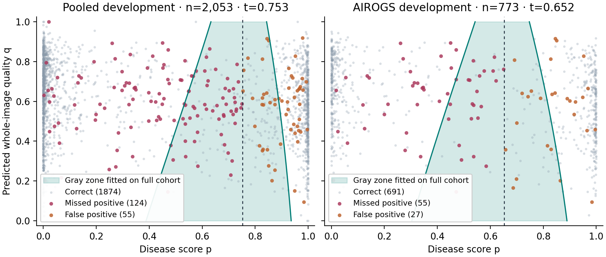
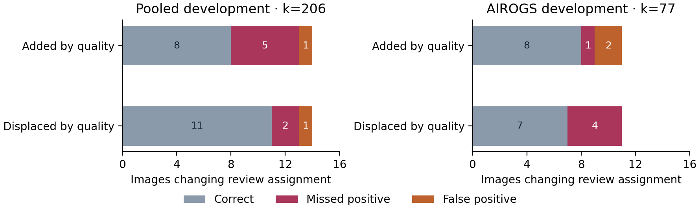
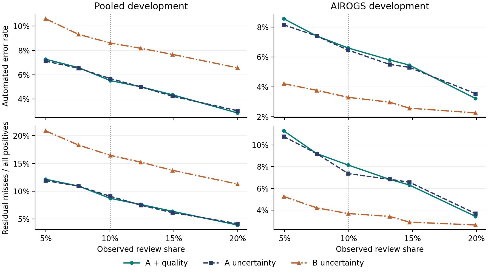
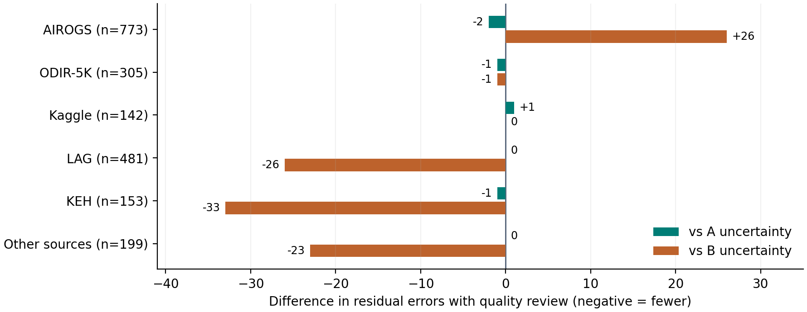

# Eye Sentinel gray-zone evaluation and proposal review

November 18, 2026 · [中文](gray-zone.zh.md) · [PDF](gray-zone.en.pdf)

## Current results

**Quality scores made a small improvement on pooled development data and left three more misses on AIROGS.** The pooled development set includes 2,053 original photographs, 814 positive. With all methods reviewing 206 images, adding quality to the same EfficientNet-B0 left three fewer errors, all missed positives. The automated error rate changed by −0.16 percentage points, with a paired linked-group bootstrap 95% interval of [−0.44, +0.17]. With AIROGS-only calibration, all methods reviewed 77 of 773 development images, of which 380 met the referral criterion. Adding quality left one more error, comprising three more misses and two fewer false positives.

| Development set | Method | Reviewed | Automated errors (rate) | Misses left | False positives left |
|---|---|---:|---:|---:|---:|
| Pooled | A + quality | 206 | 102 (5.52%) | 71 | 31 |
| Pooled | A uncertainty | 206 | 105 (5.68%) | 74 | 31 |
| Pooled | B uncertainty | 206 | 159 (8.61%) | 134 | 25 |
| AIROGS | A + quality | 77 | 46 (6.61%) | 31 | 15 |
| AIROGS | A uncertainty | 77 | 45 (6.47%) | 28 | 17 |
| AIROGS | B uncertainty | 77 | 23 (3.30%) | 14 | 9 |

The automated error rate uses the 1,847 and 696 unreviewed images as denominators. Remaining misses are positives that retain an automated negative decision. A is EfficientNet-B0 at update 2,100. B is ResNet-50 at epoch 18, trained on the original data. Each disease cutoff is its 95th percentile among validation negatives. Quality comes from the joint EyeQ and FTHNet model. The main operating points reproduce the November 16 estimates and retain their intervals. The new analysis examines case swaps, gray-zone limits, and sensitivity to review workload and quality weight.

## Progress against the proposal

| Proposal commitment | Current evidence |
|---|---|
| Train disease and quality models | Eighteen disease-model runs cover six conditions and three seeds, with three additional matched-dose defocus runs. Expansion improved ranking on LAG and KEH across seeds. The main augmentation gains appeared on synthetic defocus. Two quality models are available. |
| Map correct and incorrect cases and define the review boundary | Original-image score maps and held-fold comparisons are complete. Lower quality widens the band around the disease threshold. Some misses have scores too far away to enter it. |
| Freeze the boundary, run an independent test, and match review workloads | Two candidate cutoffs and an inventory of the reserved images are ready. The equal-workload comparison has been rehearsed on development data. Independent scoring is pending. |
| Review about 10% and prompt actionable retakes | The current analysis measures triage into review. The proposal diagram also calls for defining how high-scoring positives are handled and assessing gradability and referral after retakes. |

[Proposal, pp. 1–4](../../../proposal-1106.pdf) · [Training results](../2026-11-15/completed-experiments/completed-results.en.md) · [Defocus and quality](../2026-11-16/quality-alignment.en.md) · [November 16 rehearsal](../2026-11-16/proposal-review.en.md)

\newpage

## Which photographs enter the gray zone

The review score is \(s=-|\operatorname{logit}(p)-\operatorname{logit}(t)|+1-q\), where \(t\) is A's disease threshold and \(q\) is clipped to 0–1. Review is triggered when \(s\) reaches the cutoff. Figure 1 shows the candidate boundary fitted on the full development cohort. The results table and case swaps use five held folds that keep each linked group together.

{width=98%}

In pooled development, lowering \(q\) from 1 to 0 widens the eligible \(p\) interval from 0.633–0.843 to 0.388–0.936. Even at \(q=0\), 46 of the 124 original misses have disease scores too low to enter the candidate gray zone. The corresponding AIROGS count is 17 of 55. This limit matters when designing a separate route for severe defocus or underexposure.

{width=98%}

The pooled review lists share 192 of their 206 images. Quality adds five missed positives and one false positive, while displacing two missed positives and one false positive. AIROGS lists share 66 of 77. Quality adds one missed positive and two false positives while displacing four missed positives. These swaps account for the opposite changes in misses.

\newpage

## Workload and source

{width=92%}

Across six review targets from 5% to 20%, quality changed the remaining error count relative to A uncertainty by −3 to +3 pooled and −2 to +3 on AIROGS. At about 10% review, quality weights of 0.5, 1, and 2 changed pooled errors by −2, −3, and +1. On AIROGS they changed errors by +1, +1, and +2 and increased misses by two, three, and four. The weight sweep assesses sensitivity.

{width=90%}

On pooled data, A with quality left 57 fewer errors than B. A uncertainty alone left 54 fewer. LAG and KEH contributed a combined −59, while AIROGS contributed +26. The historical B did not train on LAG or KEH. With AIROGS-only calibration, B left fewer errors and fewer misses at all six operating points. This comparison reflects the classifiers, their training data, and their review policies.

\newpage

## Candidate cutoffs and independent test

| Candidate cohort | A disease cutoff | B disease cutoff | Gray-zone cutoff \(s\) | Validation / development |
|---|---:|---:|---:|---:|
| Pooled | 0.752843 | 0.581313 | −0.568675 | 2,046 / 2,053 |
| AIROGS | 0.651953 | 0.815315 | −0.457006 | 767 / 773 |

Each candidate cutoff is taken from the upper tail of review scores on its full development cohort, targeting about 10%. Before independent evaluation, define the primary cohort and fix its thresholds, weight, checkpoints, preprocessing, and tie-breaking rule. The fixed boundary then produces the actual test workload \(k\), and both controls review \(k\) photographs in that cohort. AIROGS labels describe whether a case meets the referral criterion. [Official AIROGS evaluation](https://airogs.grand-challenge.org/data-and-challenge/)

| Reserved cohort | Images | Positives | Linked groups | Recorded poor-quality positive / negative |
|---|---:|---:|---:|---:|
| Internal and new holdouts | 3,470 | 1,292 | 3,045 | 50 / 18 |
| AIROGS within those holdouts | 770 | 385 | 770 | 0 / 0 |
| ACRIMA external | 705 | 396 | 705 | 0 / 0 |
| HYGD external | 737 | 540 | 283 | 0 / 0 |

The audit used manifest metadata only. The reserved images show no recorded group or file SHA-256 overlap with A's training, model validation, or rule development, no original group or file hash overlap with B's training or validation, and no hash overlap with joint quality training or validation. These checks cover recorded links and identical files. FIVES contributes all 18 poor-quality negatives and 41 positives using its official quality dimensions. MSHF adds nine positives rated poor overall. A zero means that no cases were recorded by these definitions.

**The proposal needs an explicit route for positive calls.** Page 4 depicts about 10% manual review, a retake branch, and automated classification for high-confidence normals. The current gray zone leaves 634 A-positive calls in the pooled automated branch and 306 on AIROGS. Sending them all to manual review would raise workloads to 840/2,053 (40.9%) and 383/773 (49.5%). These figures use the current development cohorts. The evaluation should specify direct referral, manual grading, and disposition after a retake.

The current evidence supports progress on disease ranking in some sources and reproducible gray-zone triage. The incremental value of whole-image quality still needs independent testing. A retake evaluation requires first and repeat photographs of the same eye with a reference diagnosis. The development set has 12 human-graded poor-quality positives and zero such negatives, and retake recovery remains unmeasured.

[Full operating points, candidate cutoffs, and data hashes](gray-zone-results.json) · [Analysis script](../../../tools/audit_gray_zone_20261118.py) · [Plot script](../../../tools/plot_gray_zone_20261118.py)
