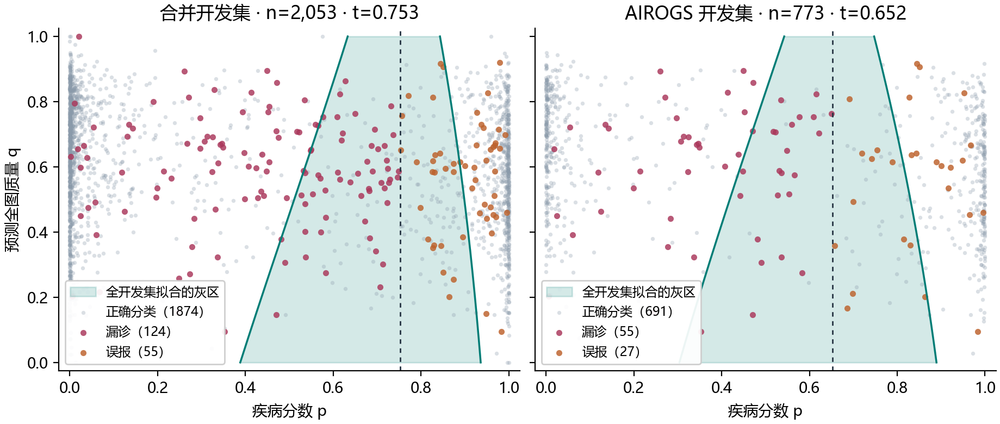
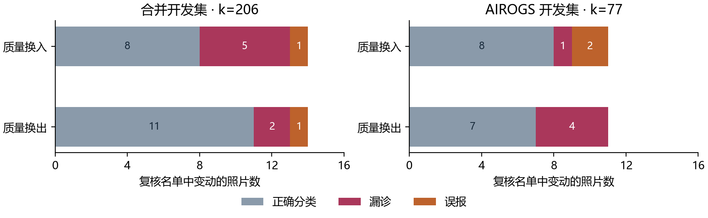
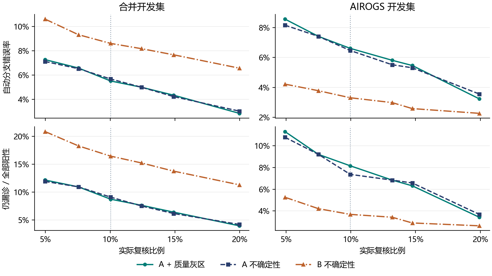
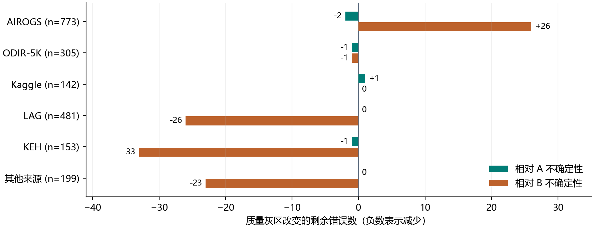

# Eye Sentinel 灰区评估与提案核对

2026 年 11 月 18 日 · [English](gray-zone.en.md) · [PDF](gray-zone.zh.pdf)

## 当前结果

**质量分数在合并开发集上只带来小幅收益，在 AIROGS 上多漏诊了 3 张。** 合并开发集有 2,053 张原图（814 张阳性）。各方法复核 206 张时，同一个 EfficientNet-B0 加入质量分数后，少留 3 个错误，全部为漏诊。自动分支错误率差为 −0.16 个百分点，关联组配对重抽样的 95% 区间为 [−0.44, +0.17]。单独用 AIROGS 校准时，在 773 张开发图（380 张转诊阳性）中各复核 77 张，加入质量分数后多留 1 个错误。漏诊多 3 张，误报少 2 张。

| 规则开发集 | 方法 | 复核数 | 自动错误数（率） | 剩余漏诊 | 剩余误报 |
|---|---|---:|---:|---:|---:|
| 合并 | A 加质量灰区 | 206 | 102（5.52%） | 71 | 31 |
| 合并 | A 按不确定性 | 206 | 105（5.68%） | 74 | 31 |
| 合并 | B 按不确定性 | 206 | 159（8.61%） | 134 | 25 |
| AIROGS | A 加质量灰区 | 77 | 46（6.61%） | 31 | 15 |
| AIROGS | A 按不确定性 | 77 | 45（6.47%） | 28 | 17 |
| AIROGS | B 按不确定性 | 77 | 23（3.30%） | 14 | 9 |

自动错误率的分母分别为 1,847 和 696 张未复核原图。剩余漏诊指真实阳性且仍留在自动分支的阴性判定。A 为第 2,100 次更新的 EfficientNet-B0，B 为原数据上第 18 轮的 ResNet-50。两者分别使用模型验证集中阴性分数的第 95 百分位设定分类阈值。质量分数来自 EyeQ 与 FTHNet 联合训练的质量模型。主工作点复现了 11 月 16 日结果，沿用当时的区间。本轮新增逐图换入换出、灰区范围、工作量和质量权重敏感性分析。

## 对照提案

| 提案承诺 | 当前证据 |
|---|---|
| 训练疾病和质量模型 | 已完成六方案、三个种子的 18 次训练，以及 3 次等剂量纯失焦训练。扩展数据的排序收益在 LAG 和 KEH 上跨种子复现。增强的主要收益来自合成失焦。已有两套质量模型。 |
| 同图展示正确与错误分布，定义复核灰区 | 已完成原图的 \(p\)–\(q\) 图和分组留出比较。较低 \(q\) 会扩大阈值周围的区间，远离阈值的部分漏诊仍在外面。 |
| 固定边界后做独立测试，按实际复核量匹配对照 | 已计算两套候选固定阈值并核对预留清单。等量对照已在开发集演练，独立测试尚未评分。 |
| 约 10% 人工复核与可操作的重拍提示 | 目前测了自动与人工复核的分流。提案流程图还需明确高分阳性如何处置，以及重拍后的可判读性和最终转诊结果。 |

[原提案，第 1–4 页](../../../proposal-1106.pdf) · [11 月 15 日训练结果](../2026-11-15/completed-experiments/completed-results.zh.md) · [失焦与质量实验](../2026-11-16/quality-alignment.zh.md) · [11 月 16 日灰区演练](../2026-11-16/proposal-review.zh.md)

\newpage

## 灰区覆盖了哪些照片

每张照片的复核分数为 \(s=-|\operatorname{logit}(p)-\operatorname{logit}(t)|+1-q\)。\(t\) 是 A 的疾病阈值，\(q\) 截断到 0–1。分数 \(s\) 达到灰区阈值就送人工复核。图 1 用全开发集拟合的候选边界展示形状。表格与换入换出结果使用五折留出阈值，同一关联组放在同一折。

{width=98%}

合并开发集中，\(q\) 从 1 降到 0 时，可复核的 \(p\) 区间由 0.633–0.843 扩到 0.388–0.936。即使 \(q=0\)，合并队列仍有 46/124 个原始漏诊因疾病分数过低而无法进入这条候选灰区。AIROGS 对应为 17/55。这个几何限制会影响对严重失焦或欠曝的分流设计。

{width=98%}

合并队列的两份名单重合 192/206 张。质量换入 5 个漏诊和 1 个误报，换出 2 个漏诊和 1 个误报。AIROGS 名单重合 66/77 张，质量换入 1 个漏诊和 2 个误报，换出 4 个漏诊。这解释了为什么两队列的漏诊变化方向相反。

\newpage

## 工作量与来源

{width=92%}

在目标 5%–20% 的六个工作点上，质量灰区相对同一个 A 的剩余错误差，合并队列为 −3 至 +3，AIROGS 为 −2 至 +3。约 10% 时，把质量权重设为 0.5、1 和 2，合并队列相对 A 分别少 2、少 3、多 1 个错误。AIROGS 分别多 1、1、2 个错误，漏诊分别多 2、3、4 张。这里的权重扫描用于判断稳健性。

{width=90%}

合并队列中，加入质量的 A 比 B 少 57 个错误，同一个 A 只按不确定性已少 54 个。LAG 和 KEH 合计贡献 −59，AIROGS 贡献 +26。历史 B 未在 LAG 或 KEH 上训练。AIROGS 单独校准时，B 在六个工作点的剩余错误和漏诊都更少。跨模型差异同时包含了训练数据、疾病模型和分流规则的影响。

\newpage

## 候选阈值与独立测试

| 候选队列 | A 疾病阈值 | B 疾病阈值 | 灰区阈值 \(s\) | 验证／规则开发图 |
|---|---:|---:|---:|---:|
| 合并 | 0.752843 | 0.581313 | −0.568675 | 2,046／2,053 |
| AIROGS | 0.651953 | 0.815315 | −0.457006 | 767／773 |

候选灰区阈值使用整组开发原图的复核分数，按约 10% 目标取上尾分界。独立评价应先确定主要队列，再写定对应的阈值、权重、模型文件、预处理和并列顺序。测试时直接应用该边界，得到实际复核数 \(k\)，两项对照在同一队列各取 \(k\) 张。AIROGS 的标签是是否达到转诊标准，独立结论应与相应标签定义一致。[AIROGS 官方评价说明](https://airogs.grand-challenge.org/data-and-challenge/)

| 预留队列 | 图像 | 阳性 | 关联组 | 已标低质量阳性／阴性 |
|---|---:|---:|---:|---:|
| 内部及新增留出 | 3,470 | 1,292 | 3,045 | 50／18 |
| 其中 AIROGS | 770 | 385 | 770 | 0／0 |
| ACRIMA 外部 | 705 | 396 | 705 | 0／0 |
| HYGD 外部 | 737 | 540 | 283 | 0／0 |

本轮只核对清单。与 A 的训练、验证及规则开发集比较，预留图在已记录的关联组和文件 SHA-256 上均无交叉。与 B 的历史训练及模型验证没有文件或原始关联组交叉，与联合质量模型的训练及验证没有文件哈希交叉。18 张低质量阴性均来自 FIVES，按其官标质量维度分层。FIVES 有 41 张同口径低质量阳性，MSHF 另有 9 张整体质量为低的阳性。表中 0 表示按这两套规则未记录病例。

**流程图需要明确阳性去向。** 提案第 4 页画出约 10% 人工复核、重拍和高置信正常自动分类。本轮灰区之外仍有 A 判阳的 634 张（合并）和 306 张（AIROGS）。若把这些结果全部再送人工，工作量分别达到 840/2,053（40.9%）和 383/773（49.5%）。这是现有开发队列上的工作量估算。直接转诊、人工判读及重拍后的处置需要在评价口径中明确。

现阶段适合汇报疾病模型在部分数据来源的进展和灰区分流的可复现性。质量分数的额外收益仍需独立验证。重拍评价需要有同眼首拍、重拍和参考诊断的病例。当前开发集只有 12 张人工低质量阳性与 0 张阴性，重拍恢复率还无法估计。

[完整工作点、候选阈值及数据哈希](gray-zone-results.json) · [分析脚本](../../../tools/audit_gray_zone_20261118.py) · [出图脚本](../../../tools/plot_gray_zone_20261118.py)
