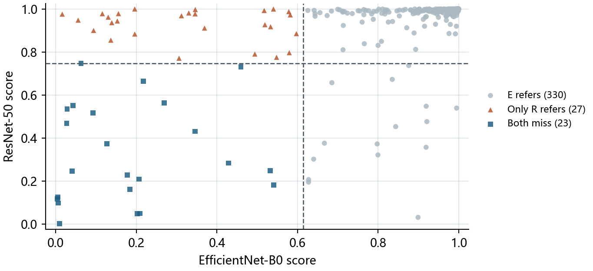

# Eye Sentinel | Missed referrals and paired photographs

November 18, 2026 · [中文](review-failures.zh.md) · [PDF](review-failures.en.pdf)

**Using a second model to reorder negative calls increased the missed referrals sent to review from 16 to 24.** Each rule reviewed 78 of 773 development photographs from AIROGS, a public glaucoma screening dataset. EfficientNet-B0 made the initial calls. ResNet-50 helped prioritize negative calls for review. The reference label indicates whether a photo warrants referral. A miss is a negative call on a referable photo, and a false positive is a referral call on a nonreferable photo.

Uncertainty ranking prioritizes scores closest to the referral threshold. The quality gray zone also gives priority to photos with lower quality scores. Quality scores range from 0 to 1, with higher values indicating better estimated quality. Two-model ranking keeps the quality gray zone's positive review list and the number of negative calls it reviews.

| Photo mix | Review rule | All errors reviewed | Misses reviewed | Misses left per 1,000 |
|---|---|---:|---:|---:|
| Original mix | Uncertainty | 32.8% | 30.0% | 45.3 |
|   | Quality gray zone | 32.8% | 32.0% | 44.0 |
|   | Two-model ranking | 44.8% | 48.0% | 33.6 |
| 3.2% positive | Uncertainty | 57.5% | 44.0% | 2.4 |
|   | Quality gray zone | 63.2% | 48.0% | 2.2 |
|   | Two-model ranking | 65.2% | 70.0% | 1.3 |

The development set contained 380 referable photos. The 3.2% scenario changes their weight to match the public AIROGS training share and reviews 100 photos per 1,000. Coverage divides reviewed errors by the initial errors of that type. Misses left per 1,000 uses all photos. Compared with the quality gray zone, two-model ranking sent 8 extra misses to review, with a 95% interval of [1, 12]. At 3.2% positives, the gain was 0.93 per 1,000 [0.09, 1.60]. To estimate the intervals, we resampled same-patient or related photos together and compared both rules on each draw. [Original AIROGS study](https://arxiv.org/html/2302.01738)

{width=88%}

EfficientNet-B0 initially missed 50 photographs. ResNet-50 flagged 27, including 15 of the 34 misses outside the quality gray zone. Both models called the other 19 outside-review misses negative. Both saved models came from update 2,400. We fit the combined score on 767 validation photos and evaluated it on a separate set of 773 development photos. [Matched training record](backbone-comparison.en.md)

\newpage

## How image quality moves the score

We applied two levels of simulated blur to the same 773 AIROGS photos and kept the original disease classification threshold. Misses changed from **50/380** on original photos to **109/380** and **230/380**. Under strong blur, scores fell on 348/380 and rose on 32/380 reference-positive photos. 185 crossed from a positive call to a miss and 5 changed in the reverse direction. Scores rose on 340/393 reference-negative photos. The scores moved in opposite directions across the two reference classes, making the initially high-scoring positives and low-scoring negatives harder to tell apart.

{width=98%}

Among **120 real same-eye pairs** in Real Fundus, the poorer photo scored **lower in 45 pairs and higher in 75**. Only 1 pair crossed the threshold, from a negative call on the clearer photo to a positive call on the poorer photo. Real pairs can vary in focus, illumination and framing. The release supplies image-quality pairs without a glaucoma reference for this analysis. The results measure sensitivity to the choice of photo. [Real Fundus study](https://arxiv.org/abs/2201.00466)

One referable photo had distinct vessel outlines and a quality score of 0.89. Its referral scores of 0.35 and 0.43 were below both models' thresholds, and the photo remained outside review. A reader could assess the optic disc, where the optic nerve leaves the eye, and its central depression, the optic cup, without seeing the model calls.

## Next validation

Keep the current quality gray zone as the comparison. Collect first and repeat photos with an independent clinical reference and record whether the disc and cup can be judged. In consecutive patients at the intended site, measure misses and net corrections at ten reviews per hundred patients. Net corrections are model errors the reader fixes minus new reader errors. This analysis measures which photos reach review using one training run per model. Reader corrections and the benefit of retakes remain to be measured. The independent test sets remain sealed.

[Results and input hashes](review-failures-results.json) · [Analysis](../../../tools/analyze_review_failures_20261118.py) · [Figures](../../../tools/plot_review_failures_20261118.py)
