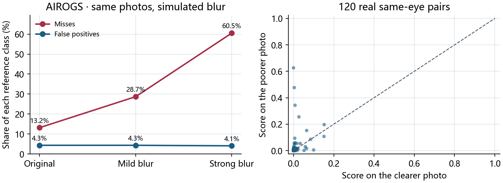

# Eye Sentinel | Missed referrals and paired photographs

November 18, 2026 · [中文](review-failures.zh.md) · [PDF](review-failures.en.pdf)

**A second model identified some referable photographs missed by the gray zone.** Each rule reviewed 78 of 773 AIROGS development photographs. We kept EfficientNet-B0's original calls and the review list for positive calls. Reranking the negative calls changed the number of missed referrals sent to review from 16 to 24. The table also shows an image-level scenario weighted to the 3.2% positive share in the original AIROGS public training set.

| Photo mix | Review rule | All errors reviewed | Misses reviewed | Misses left per 1,000 |
|---|---|---:|---:|---:|
| Original mix | Uncertainty | 32.8% | 30.0% | 45.3 |
|   | Quality gray zone | 32.8% | 32.0% | 44.0 |
|   | Two-model ranking | 44.8% | 48.0% | 33.6 |
| 3.2% positive | Uncertainty | 57.5% | 44.0% | 2.4 |
|   | Quality gray zone | 63.2% | 48.0% | 2.2 |
|   | Two-model ranking | 65.2% | 70.0% | 1.3 |

The development set contained 380 referable photographs. Reranking sent 8 additional missed referrals to review, with a paired 95% interval of [1, 12] photographs from linked-group resampling. At 3.2% positives, the difference was 0.93 per 1,000, with an interval of [0.09, 1.60]. The weighting preserves the development score distribution within each reference class. [Original AIROGS study](https://arxiv.org/html/2302.01738)

{width=94%}

EfficientNet-B0 initially missed 50 photographs. ResNet-50 flagged 27 of those, including 15 of the 34 misses outside the quality gray zone. Both models called the remaining 19 negative. Both checkpoints used 2,400 updates under the matched training protocol. Logistic regression combined the two models' log-odds scores on 767 AIROGS validation images and used to reorder negative calls on development data. Negative-side capacity and the positive review list matched the quality gray zone. [Matched training record](backbone-comparison.en.md)

\newpage

## How image quality moves the score

We applied two levels of simulated blur to the same 773 AIROGS photos and kept the original disease classification threshold. Misses changed from **50/380** on original photos to **109/380** and **230/380**. Under strong blur, scores fell on 348/380 and rose on 32/380 reference-positive photos. 185 crossed from a positive call to a miss and 5 changed in the reverse direction. Scores rose on 340/393 reference-negative photos. The scores moved in opposite directions across the two reference classes, making the initially high-scoring positives and low-scoring negatives harder to tell apart.

{width=98%}

Among **120 real same-eye pairs** in Real Fundus, the poorer photo scored **lower in 45 pairs and higher in 75**. Only 1 pair crossed the threshold, from a negative call on the clearer photo to a positive call on the poorer photo. Real pairs can vary in focus, illumination and framing. The release supplies image-quality pairs without a glaucoma reference for this analysis. The results measure sensitivity to the choice of photo. [Real Fundus study](https://arxiv.org/abs/2201.00466)

In the image review, one referable photograph had distinct vessel outlines and a quality score of 0.89. The two disease scores were 0.35 and 0.43, and the photo remained outside review after reranking. It is a candidate for blinded expert assessment of the disc and cup.

## Next validation

Keep the current quality gray zone as the baseline, and study the missed referrals that both models called negative. Prioritize first and repeat photos with an independent clinical reference and a record of whether the disc and cup are gradable. Evaluate consecutive patients from the intended site. At ten reviews per hundred patients, report both missed referrals remaining per thousand and the net number of errors experts actually correct. These experiments measure selection for review. Expert corrections and the clinical benefit of retakes remain to be measured. The analyses used one training seed and image-level development data. The reserved independent tests remain sealed.

[Results and input hashes](review-failures-results.json) · [Analysis](../../../tools/analyze_review_failures_20261118.py) · [Figures](../../../tools/plot_review_failures_20261118.py)
