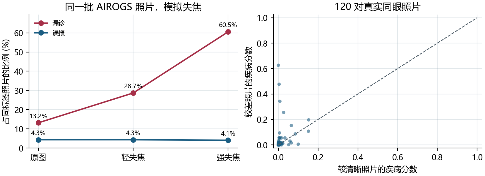

# Eye Sentinel 漏诊复核与同眼照片分析

2026 年 11 月 18 日 · [English](review-failures.en.md) · [PDF](review-failures.zh.pdf)

**用第二个模型给判阴照片重新排序后，进入复核的漏诊从 16 张增到 24 张。** 在公开青光眼筛查数据集 AIROGS 的 773 张开发照片上，各规则均复核 78 张。EfficientNet-B0 负责原判，ResNet-50 帮助确定哪些判阴照片优先复核。阳性表示参照标签要求转诊，阴性表示无需转诊。漏诊是应转诊却被判阴的照片，误报是无需转诊却被判阳的照片。

按不确定性选图时，模型分数越接近转诊阈值，复核优先级越高。质量灰区在此基础上优先考虑质量分较低的照片。质量分用 0 到 1 表示，越高表示模型估计的图像质量越好。双模型规则沿用质量灰区的判阳名单和判阴复核名额，只调整判阴照片的顺序。

| 人群情景 | 复核规则 | 全部错误进复核 | 漏诊进复核 | 每千张仍漏诊 |
|---|---|---:|---:|---:|
| 原开发比例 | 不确定性 | 32.8% | 30.0% | 45.3 |
|   | 质量灰区 | 32.8% | 32.0% | 44.0 |
|   | 加入第二模型，重排判阴 | 44.8% | 48.0% | 33.6 |
| 3.2% 阳性 | 不确定性 | 57.5% | 44.0% | 2.4 |
|   | 质量灰区 | 63.2% | 48.0% | 2.2 |
|   | 加入第二模型，重排判阴 | 65.2% | 70.0% | 1.3 |

开发集中 380/773 张为转诊阳性。3.2% 来自 AIROGS 公开训练集，此情景只改变阳性与阴性的比重，按每千张复核 100 张估算。表中的覆盖率以复核前相应类型的错误数为分母，剩余漏诊以全部照片为分母。相对质量灰区，双模型规则多送 8 张漏诊进复核，95% 区间为 [1, 12]。在 3.2% 情景中每千张多送 0.93 张，区间为 [0.09, 1.60]。区间来自将同一患者或有关联的照片一起抽样后，成对比较两条规则。 [AIROGS 原论文](https://arxiv.org/html/2302.01738)

{width=88%}

EfficientNet-B0 原判漏掉 50 张，ResNet-50 将其中 27 张判阳。质量灰区名单外的 34 个漏诊中，ResNet-50 判阳 15 张，其余 19 张两个模型都判阴。两者都使用第 2,400 次参数更新时保存的模型。组合分数用 767 张模型验证照片拟合，在另外的 773 张开发照片上评估。 [同协议训练记录](backbone-comparison.zh.md)

\newpage

## 照片变糊时，分数怎样动

在同一批 773 张图上模拟轻、强两档失焦，并沿用原来的转诊阈值。原图、轻失焦和强失焦分别漏掉 **50/380、109/380 和 230/380** 张阳性。强失焦后，348/380 张阳性分数下降，32/380 张上升。185 张从判阳变成漏诊，5 张反向跨过阈值。同一档强失焦下，340/393 张阴性的分数上升，两类因此更难区分。

{width=98%}

在 **120 对 Real Fundus 真实同眼照片**中，较差照片的疾病分数有 **45 对下降、75 对上升**。只有 1 对跨过阈值，较差照片由判阴变为判阳。图像质量变化包含失焦、光照和取景差异。发布数据缺少对应的青光眼参考标签，所以这些数值回答的是模型对同眼不同照片有多敏感。 [Real Fundus 数据论文](https://arxiv.org/abs/2201.00466)

逐图检查发现一张转诊阳性照片的血管轮廓清楚，质量分为 0.89。两个模型给出的转诊分数分别为 0.35 和 0.43，均低于各自阈值，重排后仍在复核名单外。后续可请阅片者在看不到模型原判的情况下检查视盘及其中央凹陷，也就是视杯。

## 对下一轮验证的决定

以现有质量灰区为对照，优先收集带独立参考检查结果的首拍和重拍，记录视盘和视杯能否判读。在目标站点连续纳入患者，按每百人复核十人，统计剩余漏诊及专家净纠正的错误，也就是改对的数量减去新判错的数量。本轮用一组训练得到的模型在开发照片上评估选图，实际阅片和重拍收益仍待测。预留独立测试集仍封存。

[汇总数据与输入哈希](review-failures-results.json) · [分析脚本](../../../tools/analyze_review_failures_20261118.py) · [绘图脚本](../../../tools/plot_review_failures_20261118.py)
