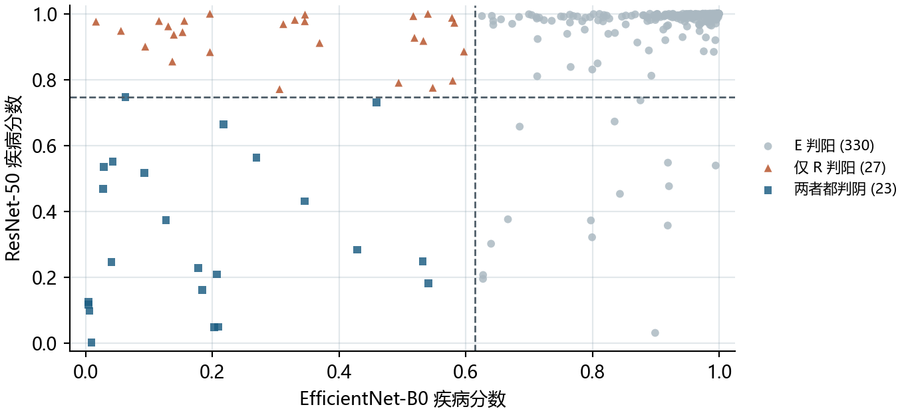

# Eye Sentinel 漏诊复核与同眼照片分析

2026 年 11 月 18 日 · [English](review-failures.en.md) · [PDF](review-failures.zh.pdf)

**第二个模型找到了原灰区漏掉的一部分阳性照片。** 在 773 张 AIROGS 开发照片上，两种规则各复核 78 张。保留 EfficientNet-B0 的原判和判阳侧复核名单，只给判阴照片重新排序，进入复核的漏诊从 16 增到 24。按原始 AIROGS 的 3.2% 阳性比例重加权时，结果见下表。两种情景都以照片为单位。

| 人群情景 | 复核规则 | 全部错误进复核 | 漏诊进复核 | 每千张仍漏诊 |
|---|---|---:|---:|---:|
| 原开发比例 | 不确定性 | 32.8% | 30.0% | 45.3 |
|   | 质量灰区 | 32.8% | 32.0% | 44.0 |
|   | 加入第二模型，重排判阴 | 44.8% | 48.0% | 33.6 |
| 3.2% 阳性 | 不确定性 | 57.5% | 44.0% | 2.4 |
|   | 质量灰区 | 63.2% | 48.0% | 2.2 |
|   | 加入第二模型，重排判阴 | 65.2% | 70.0% | 1.3 |

原开发集有 380 张转诊阳性。第二规则多送进复核的漏诊为 8 张，关联组配对重采样的 95% 区间为 [1, 12] 张。3.2% 情景的相应差值为每千张 0.93，区间为 [0.09, 1.60]。阳性比例取自 AIROGS 公开训练集，重加权沿用开发照片两类各自的分数分布。 [AIROGS 原论文](https://arxiv.org/html/2302.01738)

{width=94%}

EfficientNet-B0 在复核前漏掉 50 张，ResNet-50 将其中 27 张判阳。质量灰区之外的 34 个漏诊中，ResNet-50 判阳 15 张，还有 19 张两个模型都判阴。两个模型均用同一训练协议下第 2,400 步的权重。在 767 张 AIROGS 模型验证图上用逻辑回归合并两个模型的对数几率分数，开发集按组合分数重排判阴侧，保留灰区原有的判阴名额和判阳名单。 [同协议训练记录](backbone-comparison.zh.md)

\newpage

## 照片变糊时，分数怎样动

在同一批 773 张图上分别模拟两档失焦，沿用原来的疾病阈值。真阳性漏诊从 **50/380** 变为 **109/380** 和 **230/380**。强失焦后，348/380 张真阳性的分数下降，32/380 张上升。185 张从判阳变为漏诊，5 张从漏诊变为判阳。同一档强失焦下，340/393 张真阴性的分数上升。两类分数向相反方向移动，原先高分的阳性和低分的阴性因此更难区分。

{width=98%}

在 **120 对 Real Fundus 真实同眼照片**中，较差照片的疾病分数有 **45 对下降、75 对上升**。只有 1 对跨过阈值，较差照片由判阴变为判阳。图像质量变化包含失焦、光照和取景差异。发布数据缺少对应的青光眼参考标签，所以这些数值回答的是模型对同眼不同照片有多敏感。 [Real Fundus 数据论文](https://arxiv.org/abs/2201.00466)

逐图检查中，一张原灰区漏掉的转诊阳性照片，质量分为 0.89，血管轮廓清楚，但两个模型的疾病分数仅为 0.35 和 0.43，重排后仍在复核名单外。这个例子适合请专家盲审视盘和杯盘区，查找照片质量分之外的线索。

## 对下一轮验证的决定

保留现有质量灰区作为基线，继续核查两模型都判阴的高置信漏诊。优先补充有独立参考检查的真实首拍和重拍，记录视盘与杯盘区是否可判读。用连续入组的目标站点患者做患者级评估，固定每百人复核十人，同时报告每千人剩余漏诊和专家实际净纠正的错误。本轮只验证选图，实际人工纠错和重拍收益待测。当前结果来自单个训练种子、图像级开发分析。预留独立测试集仍封存。

[汇总数据与输入哈希](review-failures-results.json) · [分析脚本](../../../tools/analyze_review_failures_20261118.py) · [绘图脚本](../../../tools/plot_review_failures_20261118.py)
