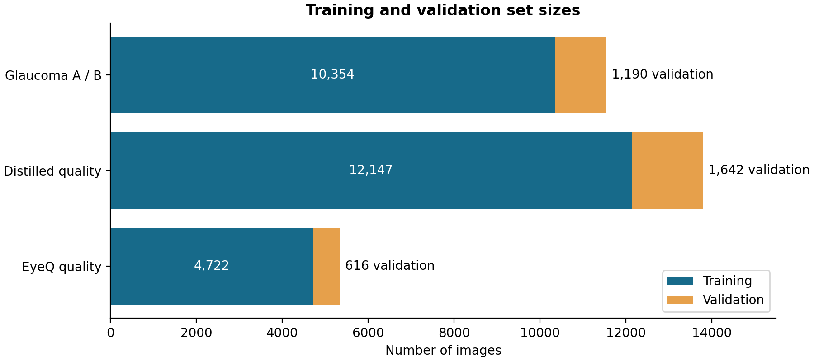
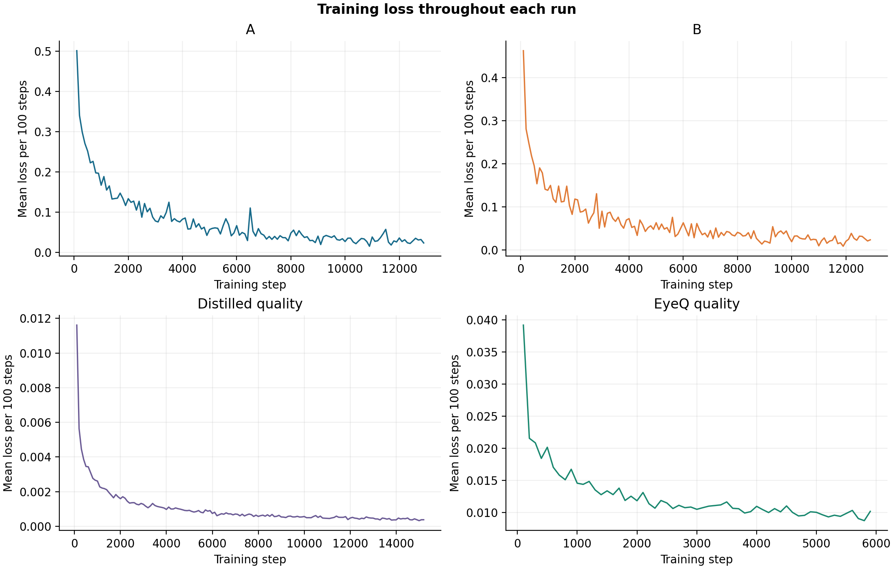
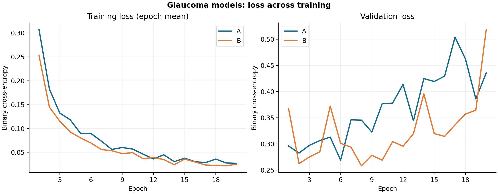
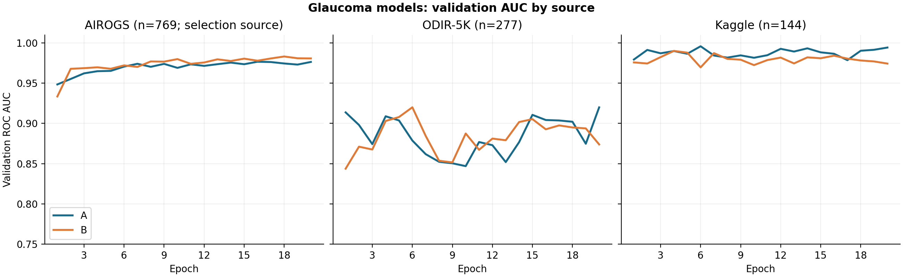
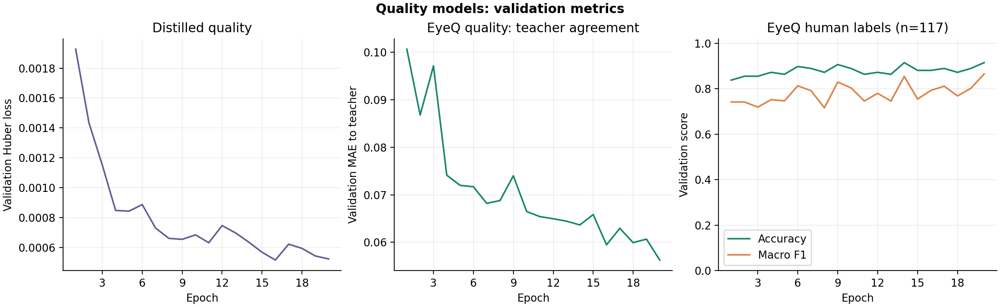
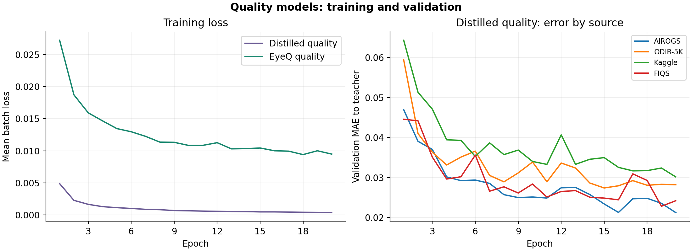
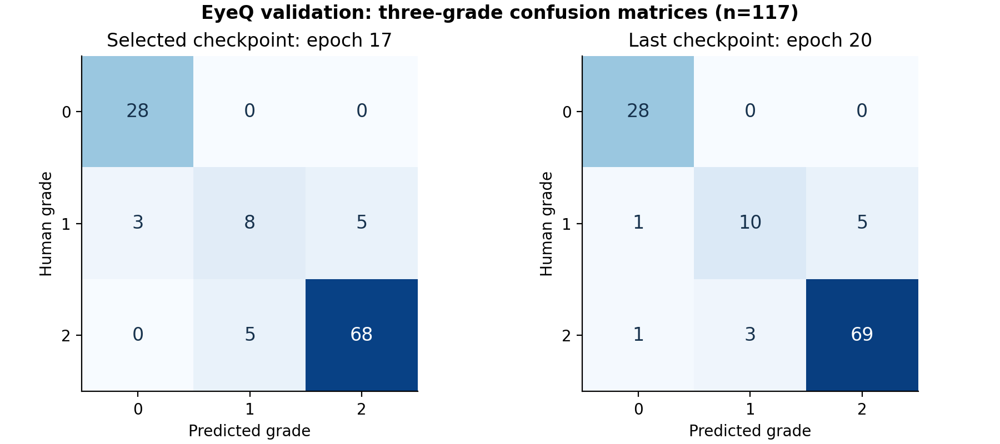

# Model training progress

English | [中文](训练进展报告.md)

Reviewed November 12, 2026. This report describes saved training and model-validation records. It complements the [November 11 project progress report](../eye_sentinel_full_progress_20261111_en.pdf). Independent test results are not yet included.

## Training and data

| Task | Model | Training / validation images | Epochs completed | Training steps |
|---|---|---:|---:|---:|
| Glaucoma A | EfficientNet-B0 | 10,354 / 1,190 | 20 / 20 | 12,960 |
| Glaucoma B, candidate | ResNet50 | 10,354 / 1,190 | 20 / 20 | 12,960 |
| Original quality model | EfficientNet-B0 | 12,147 / 1,642 | 20 / 20 | 15,200 |
| EyeQ quality model | EfficientNet-B0 | 4,722 / 616 | 20 / 20 | 5,920 |

Both training pipelines report completion. An epoch is one pass through the training data; a step uses one batch of images to update the model. The two glaucoma models use the same data split. Each run records a loss at every training step and validation results after each epoch. Loss measures the difference between model output and its training target; lower is better for that target.

Each point is the mean loss across 100 consecutive steps. The models have different targets, so their loss values should not be compared directly. All four step logs are continuous and their recorded losses are finite.

## Glaucoma models

Mean training loss fell from 0.307 to 0.027 for A and from 0.253 to 0.025 for B between the first and final epochs. Overall validation loss rose from 0.296 to 0.435 for A and from 0.367 to 0.518 for B. This divergence warrants a closer look at overfitting and probability calibration; it does not establish the cause on its own. Training curves show the arithmetic mean of batch losses within each epoch.

AUC measures how well the model ranks positive cases above negative cases, without selecting a classification threshold. The AIROGS validation subset (769 images) was used to select checkpoints: A reached its best AUC of **0.9766 at epoch 16**, and B reached **0.9831 at epoch 18**. At epoch 20 the values were 0.9764 and 0.9807, respectively. ODIR-5K and Kaggle validation subsets contain 277 and 144 images. These are validation results, and the difference between A and B has not been tested for statistical significance.

The disease-model logs do not contain accuracy for each epoch. The prediction file is overwritten at each validation, so it represents the last validation, not every epoch or the selected checkpoint. Accuracy also requires a chosen threshold.

## Image quality models

The original quality model's validation Huber loss fell from 0.001927 to 0.000524; its minimum was 0.000517 at epoch 16. This model learns continuous scores from a teacher model. Its loss measures agreement with the teacher, not accuracy against human grades.

The EyeQ model was validated on 616 images, including 117 with human grades in three categories. Accuracy calculated from the saved confusion matrices rose from **83.8% (98/117)** at epoch 1 to **91.5% (107/117)** at epoch 20. The final macro-F1 was **0.865**. Macro-F1 gives equal weight to the performance of each grade, even when the grade counts differ.

The selected EyeQ checkpoint is epoch 17, chosen using a combined teacher and human-grade validation loss. Its accuracy is **88.9% (104/117)** and macro-F1 is **0.811**. It is a different checkpoint from the final epoch.

The left panel shows each quality model's own training loss; their targets differ. The right panel shows the original model's mean absolute difference from the teacher score by image source. Lower values indicate closer agreement with the teacher.

Rows show the human grade and columns show the predicted grade. The diagonal contains correct predictions. The left matrix is the selected checkpoint; the right matrix is the last epoch.

## Next steps and records

These results describe training and model selection. The next step is to fix the model and decision thresholds, then report performance on independent internal and external test sets, including uncertainty and results by source. The 117 graded EyeQ images are a validation subset, and agreement with teacher scores is not a measure of agreement with human grading.

The source records are `steps.jsonl`, `epochs.jsonl`, `config.json`, and `run_summary.json` under `runs/formal_v3/{glaucoma_a,glaucoma_b_candidate,quality_student}/` and `runs/eyeq_quality_v1/quality_student/`, plus the pipeline status files. In the original formal_v3 logs, epoch numbers start at zero; the figures use 1–20. EyeQ validation logs already use 1–20.

The accompanying `chart_data.json` contains step losses and aggregate validation metrics, without images or sample identities. Run `plot_training.py` with Python and matplotlib to recreate the figures from this snapshot.
